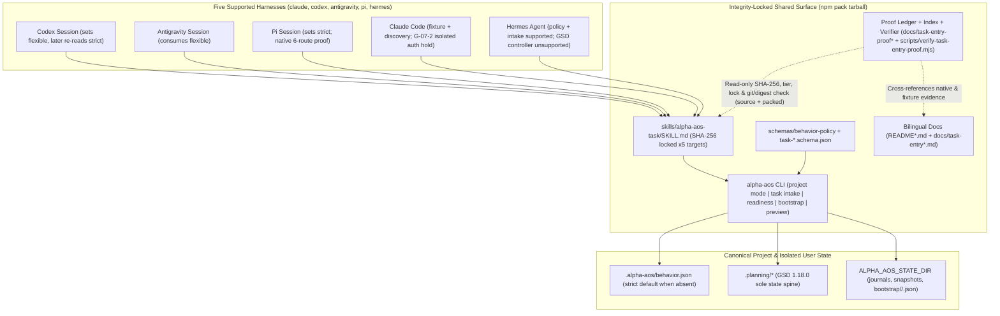

# Phase 31: Cross-Harness Proof and Distribution - Research

**Researched:** 2026-11-03
**Domain:** Cross-harness scenario proof matrix & read-only verifier, `npm pack` distribution integrity & isolated sandbox invocation, bilingual English/Korean user documentation, and honest full-regression debt ledger (`PROVE-01`–`PROVE-04`)
**Confidence:** HIGH

## User Constraints

### Locked Decisions (copied verbatim from `31-CONTEXT.md`)

#### 다섯 하네스 시나리오 매트릭스와 증명 계층 (`PROVE-01`)

- **D-01:** 교차 하네스 시나리오 매트릭스는 전용 v0.6.0 시나리오 증명 문서(`docs/` 하위 마크다운) + JSON 인덱스 + 독립 실행형 read-only 검증 스크립트 조합으로 구성한다. Phase 29(`docs/task-bootstrap-proof.md`)·Phase 30(`docs/task-style-proof.md`, `docs/task-style-proof-index.json`) 패턴을 계승해 온디스크 해시·커밋·증거 티어를 재검증하며, 기존 `alpha-aos doctor --matrix`와 provenance 테스트가 소비하는 `docs/SUPPORT_MATRIX.md` 스키마는 오염시키지 않고 상호 참조 링크만 연결한다.
- **D-02:** 유료 모델 호출 보류 원칙을 준수하여, 다섯 하네스 공통 교차 전환(`Codex flexible 설정 → Antigravity 소비 → Pi strict 설정 → 기존 Codex 세션이 다음 intake에서 strict 재확인`), `릴리스 완료 후 독립 버그 픽스 새 선택`, `absent`/`partial` 초기화·복구 결합 시나리오 전체는 무과금 결정론적 실제 CLI·파일시스템 통합 스위트로 5개 하네스 모두 검증한다. `native` 티어는 이미 확보된 승인 실기 영수증(예: Phase 29/30 로컬 실기 영수증)과 가용 호스트의 무과금 발견/read-only 프로브만 인정하며, 유료 모델 턴이 실행되지 않은 경로는 `unverified` 또는 `blocked`로 정직하게 분리 표기한다.
- **D-03:** 매트릭스는 하네스별 단일 요약 등급으로 뭉뚱그리지 않고, `하네스 × 시나리오·역할 축`(공유 정책 읽기/변경, 독립 작업 재선택, 초기화/복구 인계, 대화형 3경로, 오토파일럿 3경로, 네이티브 질문 UI vs `1–6` 번호 텍스트 fallback)으로 세분화해 `verified-native`, `verified-fixture`, `unsupported`, `unverified`, `blocked` 상태와 구체적 사유 코드를 셀 단위로 기록한다(예: `Hermes`는 공유 정책 조회·변경 및 intake 조회는 지원하되 GSD controller/state-writer 실행은 `unsupported`, `Claude Code` 격리 카나리 인증 한계는 `G-07-2` 사유 명시).
- **D-04:** 시나리오 매트릭스의 사용자 조회 수단은 패키지 동봉 문서(`docs/`) + JSON 인덱스 + `text`/`--json` 출력을 지원하는 독립 read-only 검증 스크립트로 제공한다. 공개 `alpha-aos` CLI 서브커맨드를 불필요하게 비대화하지 않으면서 소스 체크아웃과 패킹 설치본 양쪽에서 즉시 조회·재검증할 수 있게 한다.

#### 패킹 배포판 무결성과 발견·호출 검증 깊이 (`PROVE-02`)

- **D-05:** `package.json` `files` 및 `scripts/audit-tarball.mjs` 허용 목록(allowlist)에 v0.6.0 공유 정책·6개 경로 안내(`skills/alpha-aos-task/SKILL.md`), 추가된 `schemas/task-*.schema.json`, 검증 스크립트(`scripts/verify-*.mjs`) 및 정규화된 증명 문서·인덱스(`docs/`)를 명시적으로 등록한다. 반면 개인 호스트 절대 경로(`assertNoPrivatePaths`), `.planning/` 아티팩트, 임시 scratch 영수증, `catalog/candidate.lock.json` 유입은 패킹 감사에서 즉시 실패(fail-closed) 처리한다 — **Reversibility:** `costly` — 배포 tarball 허용 목록과 동봉 스키마·문서 경로는 패킹 검증 게이트(`audit-tarball.mjs`, `tarball-fixture.test.ts`) 전반이 공유하는 패키지 표면 계약이다.
- **D-06:** 패킹 아티팩트 설치 샌드박스에서 `catalog/stack.lock.json`에 핀 고정된 `alpha-aos-task` 원본 해시 및 다섯 하네스 타깃(`claude`, `codex`, `antigravity`, `pi`, `hermes`) 전체의 렌더링 바이트 해시 일치를 모두 검증한다. 안내 본문이나 타깃 렌더링 바이트가 변조된 경우 `install`/`doctor`가 fail-closed로 거부하는 음성(negative) 케이스까지 패킹 검증에 포함한다.
- **D-07:** 공유 정책과 6개 경로 안내의 발견성(discoverability)은 단순 `existsSync`나 문자열 포함 검사만으로 인정하지 않는다. 패킹 설치본 `alpha-aos` 바이너리의 `doctor`/어댑터 파싱(frontmatter, 메타데이터, 해시 상태 `CURRENT` 판정) 통과와 가용 로컬 하네스의 무과금 네이티브 발견 프로브를 결합해 증명하며, 미설치·미지원 하네스는 사유를 명시 보고한다.
- **D-08:** 패킹 설치본의 의미 있는 호출(meaningful invocation) 검증은 격리 샌드박스(`test/tarball-fixture.test.ts` 및 `test/helpers/packed-sandbox.ts` 패턴)에 설치된 실제 `alpha-aos` CLI 바이너리를 실행하여, (1) 설정 부재 시 무쓰기 `strict` 조회 및 `strict` ↔ `flexible` preview/apply/rollback, (2) 예측 가능한 intake 판정 및 6개 라벨 chooser 출력, (3) `absent`/`partial`/`ready` readiness 진단, (4) 대화형 3경로 투영 및 오토파일럿 3경로 구체적 계약 preview(`quickQuality: "full"` 다이제스트 바인딩 포함)까지 end-to-end로 무과금 호출하고, 개발자 실제 호스트 경로 무오염(`hostSnapshot`)을 함께 입증한다.

#### 영문·국문 문서 구성과 지원 한계 안내 (`PROVE-03`)

- **D-09:** 사용자 문서는 `README.md` / `README.ko.md`의 핵심 개요·빠른 시작 요약 표와, 전용 영문·국문 상세 사용자 가이드 쌍(예: `docs/task-entry.md` 및 `docs/task-entry.ko.md`)으로 역할을 분리한다. 이를 통해 `README` 비대화를 막고 저수준 운영 감사 문서인 `docs/task-runtime-controls.md`와 일반 사용자용 작업 진입 가이드를 명확히 구분한다.
- **D-10:** 영문 문서(`README.md` 및 영문 상세 가이드)에서도 실제 UI/CLI에 출력되는 6개 한국어 고정 라벨 원문(`대화형-quick`, `대화형-quick-full`, `대화형-phase`, `오토파일럿-quick`, `오토파일럿-quick-full`, `오토파일럿-phase`)을 번역·변형하지 않고 그대로 표기하며, 번호(`1–6`)·내부 canonical ID(`conversational-quick` 등)·영문 설명 및 명시 요청 예시를 1:1 매핑 표로 병기한다.
- **D-11:** 영문·국문 상세 가이드는 추상적 규칙 나열에 그치지 않고 대칭적인 의사결정 흐름과 구체적 양성/반례 쌍을 수록한다: (1) 단순 작업 면제(국소 rename·README 번역/링크 추가·한정 push) vs 비면제(다중 서브시스템/공개 API rename·충돌 해결 push), (2) 작업 수명 경계(릴리스 완료 후 독립 버그 픽스는 새 선택 vs 동일 활성 작업의 테스트 수리는 스타일 유지), (3) `absent`/`partial` 비파괴 복구 후 원래 요청 1회 인계, (4) 직접 GSD 명령 호출 시 chooser 생략(인용 문장과 구분) 및 오토파일럿의 exact 계약 승인·별도 `start` 경계.
- **D-12:** 영문·국문 양쪽 문서 모두 다섯 하네스의 실제 지원 한계 표(`Hermes` worker-only, `Claude Code` G-07-2 미검증 실기 영수증, 하네스별 질문 UI vs `1–6` 번호 텍스트 fallback, 미실행 3-OS CI 및 보류 상태)를 숨김없이 수록한다. 또한 `package.json` 버전 범프나 npm 정식 배포가 승인되지 않은 현 상태를 지켜 정식 출시 완료로 허위 표기하지 않으며, 영·한 필수 섹션 대칭·상대 링크 유효성·6개 고정 라벨 보존·개인 호스트 경로 부재를 자동 테스트로 강제한다.

#### 최종 회귀 게이트와 기존 회귀 부채·보류 항목 처리 (`PROVE-04`)

- **D-13:** Phase 31 전용 표적 행동 검증 스위트는 교차 하네스 전체 여정을 양성·음성(positive/negative) 쌍으로 결합 검증한다: (1) `Codex → Antigravity → Pi → 기존 Codex 세션` 모드 전환 성공 vs 손상된 정책/잘못된 루트 fail-closed 거부, (2) `오토파일럿-phase` 릴리스 완료 후 독립 버그 픽스의 새 chooser 강제 vs 활성 작업 연속성 유지, (3) `absent`/`partial` 복구 후 원래 요청·스타일 1회 인계 및 오토파일럿 exact 권한 보존 vs 중복 인계·승인 없는 시작 차단, (4) `오토파일럿-quick-full` 전 단계 증거 통과 vs 일반 quick 증거만 제출·다이제스트/안내 변조·미지원 하네스(`Hermes` 컨트롤러 등) 거부.
- **D-14:** 구현 웨이브 중에는 변경 슬라이스에 대한 표적 검사(`npm run check` 및 관련 테스트 파일 지정 실행)만 수행해 불필요한 전체 스위트 반복을 피하고, 최종 수용 게이트에서 동일 소스 `HEAD` 기준으로 `npm run check` → `npm run build` → 표적 Phase 31 양성/음성·문서·패킹 스위트 → `npm run audit-tarball` → 전체 `npm test`(`scripts/run-tests.mjs`) → `npm run build:check` → read-only 네이티브/시나리오 증명 검증기를 완주하여 실제 수치(`total`, `passed`, `failed`, `skipped`, `not-run`), 플랫폼, 커밋 SHA를 원장에 기록한다.
- **D-15:** 과거 `261101-ww3`에서 기록된 워커 시작 타임아웃 이력 및 4개 스위트(`task-progress-integration`, `task-progress`, `verify-efficient-wait`, `tarball-fixture`) 이력은 삭제하거나 임의 면제(waive)하지 않고 원장에 보존한다. 동시에 이번 Phase 31 최종 실행에서의 스위트별 실제 측정 결과(pass/fail/호스트 권한 제약 skip)를 대조 열로 투명하게 기록하며, 미실행 보류 항목(`3-OS/macOS CI`, `Claude G-07-2`, 글로벌 재적용/push/publish hold)이나 실패 항목은 절대 `passed`로 합산하지 않는다.
- **D-16:** 최종 회귀에서 v0.6.0 시나리오·패킹·무결성·호환성 관련 필수 검증이 하나라도 실패하면 해당 수용을 즉시 차단한다. 승인된 Phase 31 범위를 벗어나는 타 서브시스템 결함이 발견될 경우 무단으로 범위를 확장해 수리하지 않고 정확한 실패 증거를 기록한 뒤 명시적 범위 승인을 거친다. 로컬 테스트 통과만으로 완료를 선언하지 않고 승인된 별도 read-only 독립 코드 리뷰 게이트와 기존 릴리스 보류 경계를 유지한다.

### the agent's Discretion

- 신규 v0.6.0 교차 하네스 증명 문서·JSON 인덱스·검증 스크립트 및 영문/국문 사용자 가이드의 정확한 파일명(예: `docs/task-entry-proof.md`, `docs/task-entry-proof-index.json`, `scripts/verify-task-entry-proof.mjs`, `docs/task-entry.md`, `docs/task-entry.ko.md`)과 JSON 스키마 세부 필드 구성은 기존 Phase 29/30 검증기 및 `scripts/audit-tarball.mjs` 규칙에 맞춰 연구·계획 단계에서 확정한다.
- 패킹 샌드박스 테스트(`test/tarball-fixture.test.ts` 확장 vs 별도 패킹 검증 테스트 파일 분리) 및 표적 수용/문서 정합성 테스트 파일 분할 구조는 `scripts/run-tests.mjs` 실행 시간과 격리 안전성을 기준으로 설계한다.

### Deferred Ideas (OUT OF SCOPE)

- 유료 라이브 카나리 실행(`Claude Code` G-07-2 실기 유료 호출 영수증 수집 포함), 개발자 머신 글로벌 스킬 재적용(global reconcile), 원격 `git push`, GitHub Actions 3-OS/macOS CI 실행 및 수리, `package.json` 버전 범프 및 `npm publish` 정식 릴리스는 기존 보류(holds)에 따라 이번 Phase 범위 밖으로 유지한다.
- 프로젝트/글로벌 기본 실행 스타일 저장, 사용자 정의 스타일 카탈로그 추가, 신규 GUI/대시보드, 새로운 GSD 대체 상태 엔진은 채택하지 않는다.

---

## Project Constraints (from AGENTS.md)

1. **Cross-platform portability:** Scripts, path handling, and native configuration adapters must stay portable across Windows 11, current macOS, and current Linux (`win32`, `darwin`, `linux`) `[VERIFIED: AGENTS.md:L15-L16]`.
2. **Locked runtime floor:** Node.js `>=24.0.0`, npm `>=10.0.0`, and Git are mandatory `[VERIFIED: AGENTS.md:L16-L17]`.
3. **Five-harness parity honesty:** Supported harnesses are `claude` (`Claude Code`), `codex` (`Codex`), `antigravity` (`Antigravity GUI/CLI/IDE`), `pi` (`Pi Agent`), and `hermes` (`Hermes Agent`); unsupported parity must be reported explicitly rather than simulated `[VERIFIED: AGENTS.md:L17-L18]`.
4. **GSD single lifecycle spine:** `@opengsd/gsd-core` `full` profile (`1.18.0` in `catalog/stack.lock.json`) is the sole project lifecycle/state owner `[VERIFIED: AGENTS.md:L18-L19]`.
5. **Deterministic evidence & transactions:** Decisions, versions, and hashes must be inspectable without relying solely on LLM judgment; mutations default to dry-run and route through `applyFileTransaction` with snapshots and rollback `[VERIFIED: AGENTS.md:L19-L21,L162-L164]`.
6. **Zero secret/private leakage:** Credential values and private host paths must never enter repository files, manifests, locks, diagnostics, or command arguments `[VERIFIED: AGENTS.md:L21-L22]`.
7. **Discovery + meaningful invocation standard:** File presence alone (`existsSync`) is never sufficient validation; native discovery plus meaningful read-only or sandboxed invocation is required `[VERIFIED: AGENTS.md:L23-L24]`.
8. **TypeScript & test conventions:** ES2024 + NodeNext `.js` relative imports, strict `tsc --noEmit` (`npm run check`), double quotes, semicolons, 2-space indent, `node:test` + `node:assert/strict` executed via `scripts/run-tests.mjs` `[VERIFIED: AGENTS.md:L52-L53,L101-L110]`.
9. **Autopilot fail-closed boundary:** Autopilot tasks require read-only preview, exact 64-hex digest approval (`task approve --apply`), and separate `task start --apply`; inline implementation in chat is forbidden `[VERIFIED: AGENTS.md:L290-L296]`.
10. **Bounded verification cadence:** Run targeted checks during implementation waves and reserve the full suite (`npm test`) for the final acceptance gate `[VERIFIED: AGENTS.md:L318-L319]`.

---

## Summary

Phase 31 closes Milestone `v0.6.0` (`Predictable Task Entry and Shared Project Policy`) by proving, packaging, and documenting how Phase 27 (`behavior-policy`), Phase 28 (`task-intake`), Phase 29 (`task-bootstrap`), and Phase 30 (`task-style` / `task-contract` / `task-run`) compose across all five harnesses (`claude`, `codex`, `antigravity`, `pi`, `hermes`) without adding a new state engine or violating active paid-canary, global-reconcile, CI, or npm-publish holds `[VERIFIED: .planning/phases/31-cross-harness-proof-and-distribution/31-CONTEXT.md:L9-L12]`. All public CLI verbs (`project mode`, `task intake`, `task readiness`, `task bootstrap`, `task preview`, `task approve`, `task start`, `owned-skills sync`, `doctor`) and the shared five-target skill (`skills/alpha-aos-task/SKILL.md`, SHA-256 `7a90355b8d2c68a3836c937edaf619b2c0874c49d534b5ddf2bb9fbbde87cadb`) are already implemented and verified individually `[VERIFIED: src/cli.ts:L57-L71]`, `[VERIFIED: catalog/stack.lock.json:L130-L139]`.

Direct inspection of the repository uncovered **three high-impact gaps** that Phase 31 must remediate so distribution and proof gates are genuinely fail-closed rather than nominal:
1. **Packaged private-path & ephemeral-path contamination:** `docs/task-bootstrap-proof.md`, `docs/task-style-proof.md`, `docs/task-style-proof-index.json`, `README.md`, and `README.ko.md` are all shipped inside the `npm pack` tarball (`package.json` `files` includes `"docs/"`, `"README.md"`, `"README.ko.md"` `[VERIFIED: package.json:L27-L29]`), yet they currently contain literal developer-host paths (`<drive>:\Users\...` and `<drive>:/dev/...`) that trip `assertNoPrivatePaths` (`PRIVATE_PATH_PATTERN` `[VERIFIED: src/core/release-package-proof.ts:L72-L79]`) AND point `docs/task-style-proof-index.json` at `.planning/tmp/pi-native-proof`, which is excluded from git and tarballs `[VERIFIED: docs/task-bootstrap-proof.md:L96-L97]`, `[VERIFIED: docs/task-style-proof-index.json:L10-L14]`, `[VERIFIED: README.md:L138]`, `[VERIFIED: README.ko.md:L154]`. Furthermore, `scripts/audit-tarball.mjs` currently inspects entry **names** and byte sizes, not text **contents**, for private paths or required v0.6.0 file presence `[VERIFIED: scripts/audit-tarball.mjs:L166-L226]`.
2. **`doctor` owned-skill tamper blind spot:** `runDoctor` in `src/core/doctor.ts` currently checks only `/^[a-f0-9]{64}$/u` on the hash strings inside `stack.lock.json` without reading on-disk `skills/<id>/SKILL.md` or verifying `renderOwnedSkill` target hashes `[VERIFIED: src/core/doctor.ts:L46-L54]`. Under `D-06` and `D-07`, tampering packaged `skills/alpha-aos-task/SKILL.md` or `stack.lock.json` target hashes must fail closed in **both** `install` and `doctor` (while keeping host-global un-reconciled target files as `warning` rather than `error` so `test/doctor.test.ts` stays green under the Global Apply Hold `[VERIFIED: test/doctor.test.ts:L20-L31]`).
3. **Bilingual README drift & markdown syntax defect:** `README.md` currently has two sections both titled `### Scenario H` plus a dangling closing code fence (`alpha-aos repair` / `` ``` `` without an opening fence) at lines 290–292 `[VERIFIED: README.md:L265-L295]`, whereas `README.ko.md` omits the `Shared Project Behavior Policy` scenario altogether `[VERIFIED: README.ko.md:L260-L287]`, and neither Global Stack Matrix lists `alpha-aos-task` `[VERIFIED: README.md:L321-L332]`, `[VERIFIED: README.ko.md:L306-L317]`.

**Primary recommendation:** Structure Phase 31 into four crisp, non-overlapping waves plus one final single-`HEAD` regression gate:
- **Wave 1 (Packaging Hygiene & Skill Tamper Gate — `PROVE-02` foundation):** Normalize private/ephemeral paths across existing `docs/task-*-proof*` and `README*`, extend `scripts/audit-tarball.mjs` with required v0.6.0 entry presence + text-entry private-path fail-closed checks, and harden `src/core/doctor.ts` to verify packaged owned-skill frontmatter, source SHA-256, and 5-target rendered SHA-256 against `catalog/stack.lock.json`.
- **Wave 2 (5-Harness Proof Matrix, Index & Verifier + Composed Journeys — `PROVE-01` & `PROVE-04` targeted):** Ship `docs/task-entry-proof.md`, `docs/task-entry-proof-index.json`, and `scripts/verify-task-entry-proof.mjs` (working identically in git checkouts and packed installs), backed by `test/task-entry-cross-harness.test.ts` and `test/task-entry-proof.test.ts` covering every positive/negative pair in `D-02`, `D-03`, and `D-13`.
- **Wave 3 (Packed Sandbox 5-Target Discovery & Meaningful CLI Invocation — `PROVE-02`):** Extend `test/tarball-fixture.test.ts` (preserving `scripts/run-tests.mjs` single-`packed` host-snapshot isolation `[VERIFIED: scripts/run-tests.mjs:L171-L193]`) to verify 5-target `alpha-aos-task` hash parity, `doctor`/`owned-skills` frontmatter+`CURRENT` discovery, tamper fail-closed refusals, local read-only harness discovery probes, and end-to-end packed CLI invocation of `project mode`, `task intake`, `task readiness`, and `task preview` (`quickQuality: "full"` digest binding) with zero host drift.
- **Wave 4 (Bilingual User Guides, README Summaries & Doc Parity Tests — `PROVE-03`):** Author `docs/task-entry.md` and `docs/task-entry.ko.md`, repair and synchronize `README.md` and `README.ko.md`, cross-link `docs/SUPPORT_MATRIX.md` and `docs/task-runtime-controls.md`, and enforce structural symmetry, 6 Korean fixed labels, valid relative links, `0.5.0` non-inflation, and zero private paths via `test/task-entry-docs.test.ts`.
- **Wave 5 (Single-`HEAD` Final Regression & Honest Debt Ledger — `PROVE-04`):** Execute the exact `D-14` command sequence once on the final `HEAD`, record measured counts alongside the preserved `261101-ww3` debt comparison table and active holds (`D-15`, `D-16`), and re-verify all proof ledgers read-only.

---

## Architectural Responsibility Map

| Capability / Requirement | Primary Tier | Secondary Tier | Rationale |
|---|---|---|---|
| **5-Harness Scenario Matrix & Proof Verifier (`PROVE-01`)** | `docs/task-entry-proof.md` + `docs/task-entry-proof-index.json` + `scripts/verify-task-entry-proof.mjs` | `test/task-entry-cross-harness.test.ts`, `test/task-entry-proof.test.ts` | Keeps v0.6.0 scenario proof inspectable in both source checkouts and `npm pack` installs (`D-01`, `D-04`) without mutating `docs/SUPPORT_MATRIX.md` (`alpha-aos doctor --matrix` contract `[VERIFIED: docs/SUPPORT_MATRIX.md:L1-L36]`). |
| **Tarball Surface & Private-Path Fail-Closed Gate (`PROVE-02`, `D-05`)** | `package.json` (`files`) + `scripts/audit-tarball.mjs` | `src/core/release-package-proof.ts` (`assertNoPrivatePaths`) | Enforces positive allowlisting, required v0.6.0 schema/skill/verifier/doc presence, and zero private-path / `.planning/` / `candidate.lock.json` leakage at `prepack` and `audit-tarball` time `[VERIFIED: package.json:L37-L42]`. |
| **Owned-Skill Multi-Target Lock & Tamper Refusal (`PROVE-02`, `D-06`, `D-07`)** | `src/core/owned-skills.ts` + `src/core/doctor.ts` + `catalog/stack.lock.json` | `skills/alpha-aos-task/SKILL.md`, `test/tarball-fixture.test.ts` | Ensures `alpha-aos-task` source bytes and all 5 target renderings match `stack.lock.json`, and both `install` and `doctor` fail closed if packaged bytes or lock hashes are tampered `[VERIFIED: src/core/owned-skills.ts:L78-L106]`. |
| **Packed Meaningful CLI Invocation & Zero Host Drift (`PROVE-02`, `D-08`)** | `test/tarball-fixture.test.ts` + `test/helpers/packed-sandbox.ts` | `src/cli.ts` (`project mode`, `task intake`, `task readiness`, `task preview`) | Exercises the real packed `alpha-aos` binary inside an isolated prefix/home/state sandbox while `hostSnapshot` proves zero developer host mutation `[VERIFIED: test/tarball-fixture.test.ts:L325-L545]`. |
| **Bilingual User Documentation & Parity Enforcement (`PROVE-03`, `D-09`–`D-12`)** | `docs/task-entry.md` + `docs/task-entry.ko.md` + `README.md` + `README.ko.md` | `test/task-entry-docs.test.ts`, `docs/task-runtime-controls.md` | Separates concise README quick-start tables from symmetric deep-dive guides, preserves exact Korean 6-style labels in both languages, and automates parity/link/private-path verification. |
| **Final Regression & Historical Debt Ledger (`PROVE-04`, `D-13`–`D-16`)** | `docs/task-entry-proof.md` + `docs/task-entry-proof-index.json` | `scripts/run-tests.mjs`, `.planning/phases/31-cross-harness-proof-and-distribution/31-VERIFICATION.md` | Records exact single-`HEAD` pass/fail/skip/not-run counts while preserving `261101-ww3` history and active holds without silent waivers `[VERIFIED: .planning/quick/261101-ww3-make-milestone-capable-gsd-full-profile-/261101-ww3-SUMMARY.md:L37-L42]`. |

---

## Standard Stack

Phase 31 installs **zero new external npm dependencies**. All implementation, packaging, verification, and testing use the repository's locked runtime and dependency versions.

### Core Runtime & Compiler
| Library / Tool | Locked Version | Purpose | Why Standard |
|---|---|---|---|
| `node` | `>=24.0.0` (host `v24.13.1`) | Runtime (`node:fs`, `node:crypto`, `node:zlib`, `node:child_process`, `node:test`, `node:assert/strict`) | Declared in `package.json` `engines.node` `">=24.0.0"` `[VERIFIED: package.json:L46-L49]` and confirmed on host (`v24.13.1`) `[VERIFIED: node --version]`. |
| `npm` | `>=10.0.0` (host `11.8.0`) | `npm pack --ignore-scripts --json` tarball creation & isolated sandbox prefix installs | Declared in `package.json` `engines.npm` `">=10.0.0"` `[VERIFIED: package.json:L46-L49]` and confirmed on host (`11.8.0`) `[VERIFIED: npm --version]`. |
| `typescript` | `5.9.3` | Strict ES2024/NodeNext compilation (`npm run check`, `npm run build`) | Pinned in `devDependencies.typescript`: `"5.9.3"` `[VERIFIED: package.json:L58-L61]`. |
| `@types/node` | `24.7.2` | Node.js type definitions | Pinned in `devDependencies["@types/node"]`: `"24.7.2"` `[VERIFIED: package.json:L58-L61]`. |

### Existing Runtime Libraries & Locked Stack Components
| Package / Component | Locked Version / Hash | Purpose in Phase 31 | Provenance |
|---|---|---|---|
| `alpha-aos` (`package.json`) | `"0.5.0"` | Package manifest version — **MUST NOT be bumped** in Phase 31 per `D-12` and release hold | `"version": "0.5.0"` `[VERIFIED: package.json:L3]`. |
| `ajv` | `"8.20.0"` | Closed JSON Schema validation (`behavior-policy`, `task-intake`, `task-bootstrap`, `task-contract`) | `"ajv": "8.20.0"` `[VERIFIED: package.json:L52]`. |
| `yaml` / `jsonc-parser` / `smol-toml` / `ignore` | `"2.9.0"` / `"3.3.1"` / `"1.9.1"` / `"7.0.5"` | Catalog/manifest parsing and harness config rendering | `[VERIFIED: package.json:L53-L56]`. |
| `@modelcontextprotocol/sdk` | `"1.32.2"` | MCP proxy/bridge runtime (`AGENTS.md` snapshot says `1.30.0`, live `package.json` is `1.32.2`) | `"@modelcontextprotocol/sdk": "1.32.2"` `[VERIFIED: package.json:L51]`. |
| `@opengsd/gsd-core` | `"1.18.0"` (`profile: "full"`) | Sole GSD workflow/state spine across `claude`, `codex`, `antigravity`, `pi` | `"version": "1.18.0"`, `"profile": "full"` `[VERIFIED: catalog/stack.lock.json:L6-L11]`. |
| `ecc-universal` | `"2.2.3"` | Locked ECC skill package seeded in `packed-sandbox.ts` | `"version": "2.2.3"` `[VERIFIED: catalog/stack.lock.json:L12-L15]`. |
| `alpha-aos-task` (owned skill) | `7a90355b8d2c68a3836c937edaf619b2c0874c49d534b5ddf2bb9fbbde87cadb` | 5-harness task intake, mode policy, bootstrap, and 6-route guidance (`invocation: automatic`) | `sourceSha256` & 5 `targetSha256` entries `[VERIFIED: catalog/stack.lock.json:L130-L139]`, `[VERIFIED: catalog/stack.yaml:L66-L69]`. |

**Installation:** None required (`npm install` MUST NOT be run to add packages).

---

## Architecture Patterns

### System Data Flow: v0.6.0 Cross-Harness Composition, Proof & Packaged Distribution



### Concrete Resolution of All Discretion Items (`31-CONTEXT.md`)

To eliminate all planning ambiguity, Phase 31 should adopt these exact filenames and boundaries:

| Artifact Role | Exact Path | Rationale |
|---|---|---|
| **v0.6.0 Cross-Harness Proof Ledger (MD)** | `docs/task-entry-proof.md` | Matches `docs/task-bootstrap-proof.md` and `docs/task-style-proof.md` naming `[VERIFIED: docs/task-bootstrap-proof.md:L1]`, `[VERIFIED: docs/task-style-proof.md:L1]`; covered by `docs/` prefix in `package.json` and `audit-tarball.mjs` `[VERIFIED: scripts/audit-tarball.mjs:L189]`. |
| **v0.6.0 Cross-Harness Proof Index (JSON)** | `docs/task-entry-proof-index.json` | Matches `docs/task-style-proof-index.json` `[VERIFIED: docs/task-style-proof-index.json:L1-L4]`; ships in `docs/` so packed installs can run the verifier directly (`D-04`). |
| **v0.6.0 Read-Only Proof Verifier (CLI)** | `scripts/verify-task-entry-proof.mjs` | Matches `scripts/verify-task-bootstrap-native.mjs` and `scripts/verify-task-style-native.mjs`; pure Node ESM `.mjs` with zero external runtime dependencies so it runs cleanly in both repo checkouts and packed installs. |
| **English Detailed User Guide** | `docs/task-entry.md` | Cleanly separates end-user workflow guidance from low-level operator accounting in `docs/task-runtime-controls.md` (`D-09`) `[VERIFIED: docs/task-runtime-controls.md:L1-L7]`. |
| **Korean Detailed User Guide** | `docs/task-entry.ko.md` | Mirrors `README.md` / `README.ko.md` `.ko.md` convention `[VERIFIED: package.json:L28-L29]`. |
| **Packed Sandbox Verification** | Extend `test/tarball-fixture.test.ts` | `scripts/run-tests.mjs` isolates **only** `tarball-fixture.test.js` into the post-suite `packed` slot (`files.filter((file) => file.endsWith("tarball-fixture.test.js"))` `[VERIFIED: scripts/run-tests.mjs:L173]`). Extending `test/tarball-fixture.test.ts` reuses the single `npm pack` + sandbox install (~30–60s saved) AND guarantees `hostSnapshot` never races concurrent suites. |
| **Targeted Cross-Harness Composed Suite** | `test/task-entry-cross-harness.test.ts` | Dedicated fast CLI/service integration suite for all 5 harnesses and all 4 positive/negative pairs in `D-02` & `D-13` (uses `createIsolatedSandbox`, no `hostSnapshot`, safe in `concurrent` phase). |
| **Proof Verifier Positive/Negative Suite** | `test/task-entry-proof.test.ts` | Mirrors `test/task-style-native-proof.test.ts`; tests `scripts/verify-task-entry-proof.mjs` in both source-checkout mode and copied packed-directory mode (no `.git`, no `.planning`), plus 64 KiB cap, symlink refusal, spoofing refusal, and private-path refusal. |
| **Bilingual Docs & Hygiene Suite** | `test/task-entry-docs.test.ts` | Automated enforcement for `D-05` & `D-12`: section symmetry (`README.md` ↔ `README.ko.md`, `docs/task-entry.md` ↔ `docs/task-entry.ko.md`), verbatim 6 Korean style labels in both languages, relative link resolution, `0.5.0` non-inflation, and `assertNoPrivatePaths` across all packaged `docs/**`, `README*.md`, `skills/**`, and `schemas/**`. |

### Recommended Project File Delta Structure

```text
package.json                                 # (optional script alias if desired, keep version "0.5.0" & files intact)
scripts/
├── audit-tarball.mjs                        # EDIT: assert required v0.6.0 files + scan text entries for private paths
├── verify-task-style-native.mjs             # EDIT (minimal): support portable/archived locators cleanly when .planning/tmp is absent
└── verify-task-entry-proof.mjs              # NEW: read-only cross-harness matrix & scenario proof verifier (--index, --json)
src/core/
└── doctor.ts                                # EDIT: verify packaged owned-skill source & 5-target rendered SHA-256 against lock
docs/
├── task-bootstrap-proof.md                  # EDIT: normalize personal host paths (<user-home>/... aliases) + cross-link
├── task-style-proof.md                      # EDIT: normalize D:/dev path, fix tarball-fixture.test.js name + cross-link
├── task-style-proof-index.json              # EDIT: replace private D:/dev/.planning/tmp path with portable relative/archived locator
├── task-runtime-controls.md                 # EDIT: add concise cross-link header to docs/task-entry.md & docs/task-entry-proof.md
├── SUPPORT_MATRIX.md                        # UNCHANGED schema/table (or safe footer link only if doctor --matrix / provenance unaffected — safest: leave untouched and link FROM README & task-entry-proof.md per D-01!)
├── task-entry.md                            # NEW: English user guide (modes, 6 Korean labels table, exemptions, boundaries, bootstrap, limits)
├── task-entry.ko.md                         # NEW: Korean user guide (1:1 structural mirror of docs/task-entry.md)
├── task-entry-proof.md                      # NEW: 5-harness matrix, scenario chains, regression ledger & 261101-ww3 debt comparison
└── task-entry-proof-index.json              # NEW: bounded (<64 KiB) machine-verifiable scenario/cell proof index
README.md                                    # EDIT: fix duplicate Scenario H & broken fence, add v0.6.0 Task Entry summary table & links, remove D:\dev path, add alpha-aos-task to matrix
README.ko.md                                 # EDIT: add matching Shared Behavior Policy & v0.6.0 Task Entry summary table & links, remove D:\dev path, add alpha-aos-task to matrix
test/
├── tarball-fixture.test.ts                  # EDIT: add v0.6.0 5-target skill hash/tamper, doctor/discovery, and packed CLI invocation checks
├── task-entry-cross-harness.test.ts         # NEW: 5-harness policy chain, release->bugfix fresh chooser, absent/partial once-only + autopilot gates, D-13 negatives
├── task-entry-proof.test.ts                 # NEW: positive/negative unit & CLI tests for verify-task-entry-proof.mjs (source + packed copy)
└── task-entry-docs.test.ts                  # NEW: bilingual symmetry, 6 Korean labels, relative links, private-path zero-leakage gate
```

> [!IMPORTANT]
> Per `D-01`, **do NOT alter the table columns, header timestamps, or taxonomy of `docs/SUPPORT_MATRIX.md`** `[VERIFIED: docs/SUPPORT_MATRIX.md:L1-L36]`. Link from `README.md`, `README.ko.md`, `docs/task-entry.md`, `docs/task-entry.ko.md`, and `docs/task-entry-proof.md` **to** `docs/SUPPORT_MATRIX.md` and `docs/SUPPORT_MATRIX_v0.2.0.md`, leaving `docs/SUPPORT_MATRIX.md` byte-untouched so `alpha-aos doctor --matrix` and existing matrix parsers have zero regression risk.

### Pattern 1: Cross-Harness Proof Index & Dual-Context Read-Only Verifier (`PROVE-01`, `D-01`–`D-04`)

**What:** `docs/task-entry-proof-index.json` records a closed, `<64 KiB` JSON document containing:
1. **`packageBindings`:** Locked `alpha-aos-task` `sourceSha256` and 5 `targetSha256` digests, plus required v0.6.0 schema relative paths and their SHA-256 digests — all verifiable on disk inside **both** a git checkout and an `npm pack` installation!
2. **`cells` (55 cells = 5 harnesses × 11 scenario/role axes per `D-03`):**
   - Harnesses: `claude`, `codex`, `antigravity`, `pi`, `hermes`.
   - Axes (`D-03`):
     1. `policy-query-and-set` (shared `strict`/`flexible` read/set/rollback)
     2. `independent-task-reselection` (fresh chooser after completed task vs active-task continuity)
     3. `bootstrap-and-recovery-handoff` (`absent`/`partial` readiness, non-destructive recovery, once-only claim)
     4. `conversational-quick` (`대화형-quick`)
     5. `conversational-quick-full` (`대화형-quick-full`)
     6. `conversational-phase` (`대화형-phase`)
     7. `autopilot-quick` (`오토파일럿-quick`)
     8. `autopilot-quick-full` (`오토파일럿-quick-full`)
     9. `autopilot-phase` (`오토파일럿-phase`)
     10. `question-ui-delivery` (native 6-option UI vs `1–6` numbered-text fallback)
     11. `gsd-controller-authority` (GSD lifecycle controller/state-writer ceiling)
   - Each cell carries:
     - `harness`: `"claude" | "codex" | "antigravity" | "pi" | "hermes"`
     - `axis`: canonical axis ID above
     - `status`: `"verified-native" | "verified-fixture" | "unsupported" | "unverified" | "blocked"`
     - `reasonCode`: bounded machine-readable code (e.g., `"PI_NATIVE_SIX_ROUTE_RECEIPT"`, `"CODEX_NATIVE_BOOTSTRAP_RECEIPT"`, `"ANTIGRAVITY_NATIVE_INTAKE_SESSION"`, `"DETERMINISTIC_CLI_FIXTURE_VERIFIED"`, `"HERMES_WORKER_ONLY_NO_GSD_CONTROLLER"`, `"CLAUDE_G_07_2_ISOLATED_AUTH_HOLD"`, `"NO_SPEND_POLICY_PAID_TURN_WITHHELD"`, `"NUMBERED_TEXT_FALLBACK_REQUIRED"`)
     - `evidenceRefs`: array of repo-relative file paths (`docs/...`, `skills/...`, `schemas/...`) or git-only test/commit anchors (`commitSha`, `testSuitePath` marked `checkoutOnly: true`).
3. **`composedScenarios`:** Explicit records for the mandatory multi-harness chains (`D-02`, `D-13`):
   - `chain-policy-transition`: `codex (set flexible) -> antigravity (consume flexible) -> pi (set strict) -> codex-existing-session (next intake sees strict)`
   - `chain-task-boundary`: `autopilot-phase (release completed) -> independent bug-fix (fresh 6-style chooser -> autopilot-quick-full)`
   - `chain-bootstrap-continuity`: `absent/partial readiness -> prepare -> recovery -> once-only claim -> autopilot dispatchAuthorized:false + exact approve + separate start`
   - `chain-quality-and-tamper-guards`: `autopilot-quick-full 7-stage pass vs ordinary-quick rejection, tampered skill/digest rejection, hermes controller rejection`
4. **`regressionLedger`:** Structured summary of the final gate run (`headCommitSha`, `platform`, `nodeVersion`, `npmVersion`, `suites`, `historicalDebtComparison` for `261101-ww3`, and `activeHolds`).

**Dual-Context Verification Rule (Critical for `D-04`):**
When `node scripts/verify-task-entry-proof.mjs --index docs/task-entry-proof-index.json [--json]` runs:
- It enforces `stat.isFile()`, `!stat.isSymbolicLink()`, `stat.size <= 65536` (`64 KiB`), `assertNoPrivatePaths(rawIndexText)`, and anti-spoofing (`status: "verified-native"` rejected if `provenance === "fixture"` or `isFixture === true` or `harness === "hermes"` on controller/6-route controller axes).
- For **packaged anchors** (`skills/alpha-aos-task/SKILL.md`, `catalog/stack.lock.json`, `schemas/*.schema.json`, `docs/*.md`), it **always** re-computes SHA-256 on disk in both source checkouts and `npm pack` installations.
- For **checkout-only anchors** (`test/*.test.ts` files and `git cat-file -t <commitSha>` when `.git` exists at package root), it verifies them on disk/git when `.git` is present, and in a packed installation (where `.git` and `test/` are intentionally excluded by `audit-tarball.mjs` `[VERIFIED: scripts/audit-tarball.mjs:L170-L173]`) it reports `verificationContext: "packed-package"` (`checkoutAnchorsDeferred: true`) while still strictly verifying all packaged hashes, schemas, lock bindings, and anti-spoofing invariants!

### Pattern 2: Tarball Surface & Private-Path Fail-Closed Audit (`PROVE-02`, `D-05`, `D-06`)

**What:** Upgrade `scripts/audit-tarball.mjs` in two ways while keeping zero external dependencies:
1. **Required v0.6.0 Entry Presence Check (`REQUIRED_PACKAGE_ENTRIES`):** Assert that every packed archive contains:
   - `skills/alpha-aos-task/SKILL.md`
   - `schemas/behavior-policy.schema.json`
   - `schemas/task-intake.schema.json`
   - `schemas/task-bootstrap.schema.json`
   - `schemas/task-contract.schema.json`
   - `schemas/task-gsd-stage-receipt.schema.json`
   - `schemas/task-receipt.schema.json`
   - `scripts/verify-task-bootstrap-native.mjs`
   - `scripts/verify-task-style-native.mjs`
   - `scripts/verify-task-entry-proof.mjs`
   - `docs/task-entry.md`, `docs/task-entry.ko.md`, `docs/task-entry-proof.md`, `docs/task-entry-proof-index.json`
2. **Archive Text-Content Private-Path Scan:** During `listTarballFiles` / `auditTarballArchive`, extract UTF-8 text for inspectable text entries under `docs/`, `skills/`, `schemas/`, and root `README*.md` / `CHANGELOG.md`, and test against `PRIVATE_PATH_PATTERN = /([a-zA-Z]:[\\/](?:Users|dev|home|temp|AppData)|[\\/](?:home|Users)[\\/])/iu` (matching `src/core/release-package-proof.ts:L72` `[VERIFIED: src/core/release-package-proof.ts:L72-L79]`) plus `.planning/tmp/` references in JSON proof indices. Any match appends a violation and exits with code `3`!

### Pattern 3: Meaningful Skill Discoverability & Packed CLI Invocation (`PROVE-02`, `D-06`–`D-08`)

**What:** Inside `test/tarball-fixture.test.ts` (within the isolated `FixtureSandbox` created by `createIsolatedSandbox(context)` `[VERIFIED: test/helpers/packed-sandbox.ts:L147-L185]`):
1. **5-Target Owned-Skill Hash & Rendering Parity (`D-06`):**
   - For all 5 targets (`claude`, `codex`, `antigravity`, `pi`, `hermes`), run `sandbox.runCli(["owned-skills", "sync", "alpha-aos-task", "--target", target, "--apply", "--json"])`, then re-run without `--apply` and assert `action === "current"` and `currentHash === expectedHash === installedLock.components.ownedSkills["alpha-aos-task"].targetSha256[target]`.
   - Parse the deployed `SKILL.md` YAML frontmatter (`name: alpha-aos-task`, non-empty `description`) and assert all 6 Korean style labels and policy-precedence rules are present.
2. **Negative Tamper Fail-Closed Checks (`D-06`):**
   - Temporarily mutate a byte in `<installedPackage>/skills/alpha-aos-task/SKILL.md` (restoring in `finally`): verify **both** `sandbox.runCli(["install", "--target", "codex"])` (exit `!= 0`, `Owned skill source hash mismatch`) **and** `sandbox.runCli(["doctor", "--json"])` (exit `2`, finding `lock.owned-skill.alpha-aos-task` `level: "error"`) fail closed.
   - Temporarily mutate `targetSha256.pi` in `<installedPackage>/catalog/stack.lock.json` (restoring in `finally`): verify **both** `sandbox.runCli(["owned-skills", "sync", "alpha-aos-task", "--target", "pi"])` (`Owned skill rendered hash mismatch`) **and** `sandbox.runCli(["doctor", "--json"])` (exit `2`, `level: "error"`) fail closed.
3. **Read-Only Local Harness Discovery Probe (`D-07`):**
   - Run `sandbox.runCli(["inventory", "--json"])` and `sandbox.runCli(["doctor", "--json"])` to combine `doctor`/adapter parsing with zero-spend local harness binary/config discovery (`detected: true/false`, explicit notes for `.CMD` shims or missing binaries `[VERIFIED: src/adapters/harnesses.ts:L69-L89]`).
4. **End-to-End Packed CLI Invocation (`D-08`):**
   - In a sandbox project directory (`join(sandbox.repo, "packed-e2e")`):
     - Query `project mode` on unconfigured project -> `effectiveMode: "strict"`, `source: "builtin-default"`, `exists: false`, zero `.alpha-aos` created.
     - Preview & apply `project mode set flexible`, verify revision change, preview & apply `strict`, and `rollback <opId> --apply`.
     - Invoke `task intake --input <req.json> --json` -> `nextAction: "choose-style"`, 6 Korean labels in exact order, `executionAuthorized: false`.
     - Invoke `task readiness --input <readiness.json> --json` across `absent-project`, `partial-project` (only `.planning/PROJECT.md` present -> non-destructive `recoveryPlan`), and `ready` states; also verify `controller: "hermes"` returns `unsupported`/`blocked` explicitly.
     - Verify conversational 3-route projections (`explicit.style` -> `executionRoute`) and invoke `task preview <contract.json> --json` for `autopilot-quick`, `autopilot-quick-full` (`scope.quickQuality: "full"` changing the 64-hex `digest`), and `autopilot-phase` (`scope.phaseSelection`), confirming `approved: false` and `hostSnapshot` remaining 100% clean.

### Pattern 4: Symmetric Bilingual Documentation (`PROVE-03`, `D-09`–`D-12`)

**What:** Keep `README.md` and `README.ko.md` concise by adding one symmetric section (`## Predictable Task Entry & Six Execution Styles` / `## 예측 가능한 작업 진입과 6개 실행 스타일`) with the compact 6-style mapping table, `project mode` quick commands, and links to `docs/task-entry.md`, `docs/task-entry.ko.md`, `docs/task-entry-proof.md`, and `docs/task-runtime-controls.md` (while repairing `README.md`'s duplicate `Scenario H` and broken code fence).

In `docs/task-entry.md` and `docs/task-entry.ko.md`, use **identical numbered H2/H3 section structure** (8 H2 sections) so `test/task-entry-docs.test.ts` can verify structural parity deterministically:
1. `## 1. Shared Project Behavior Modes (strict vs flexible)` / `## 1. 공유 프로젝트 행동 모드 (strict vs flexible)`
2. `## 2. Six Execution Styles and Canonical Mapping` / `## 2. 6개 실행 스타일과 표준 매핑` (preserving verbatim `대화형-quick` .. `오토파일럿-phase` in **both** English and Korean tables per `D-10`!)
3. `## 3. Intake Precedence and Decision Flow` / `## 3. 작업 진입 우선순위와 판정 흐름`
4. `## 4. Simple-Operation Exemptions vs Substantial Work` / `## 4. 단순 작업 면제 기준과 반례` (positive/negative twin table per `D-11`)
5. `## 5. Task Lifetime Boundaries (Active Continuity vs Fresh Choice)` / `## 5. 작업 수명 경계 (활성 작업 유지 vs 새 작업 재선택)`
6. `## 6. GSD Readiness, Non-Destructive Recovery, and Once-Only Handoff` / `## 6. GSD 초기화 진단, 비파괴 복구 및 1회 인계`
7. `## 7. Direct GSD Commands and Autopilot Approval Boundaries` / `## 7. 직접 GSD 명령 우선순위와 오토파일럿 승인·시작 경계`
8. `## 8. Five-Harness Support Matrix, Limitations, and Current Release Status` / `## 8. 5대 하네스 지원 한계와 현재 배포·검증 보류 상태` (`Hermes` worker-only, `Claude Code` `G-07-2`, question UI vs `1–6` numbered text fallback, 3-OS CI hold, `package.json` `0.5.0` / unpublished v0.6.0 status per `D-12`).

---

## Don't Hand-Roll

| Problem | Don't Build | Use Instead | Why |
|---|---|---|---|
| Tarball archive parsing & security checks | Custom shell `tar -tzf` wrapper or third-party tar dependency | `listTarballFiles` & `auditTarballEntries` in `scripts/audit-tarball.mjs` (`node:zlib` `gunzipSync` + POSIX ustar validator) | Already enforces 64 MiB compressed / 256 MiB uncompressed bounds, octal checksums, symlink/device entry rejection, and case-collision checks across all 3 OSes `[VERIFIED: scripts/audit-tarball.mjs:L87-L157]`. |
| Isolated `npm pack` install & host-drift proof | Ad-hoc temp directories mutating `process.env` | `createIsolatedSandbox`, `packRelease`, `installPackedRelease`, `seedHarnessPrerequisites`, `snapshotTargets`, `describeHostDrift` in `test/helpers/packed-sandbox.ts` | Scrubs `npm_*` env vars, isolates `HOME`/`USERPROFILE`/`ALPHA_AOS_STATE_DIR`/all 5 harness config dirs, and fingerprints host bytes without leaking file contents `[VERIFIED: test/helpers/packed-sandbox.ts:L147-L185,L443-L496]`. |
| Private-path detection in docs & indices | Ad-hoc substring checks for one developer username | `assertNoPrivatePaths` (`PRIVATE_PATH_PATTERN`) in `src/core/release-package-proof.ts` | Catches `<drive>:\Users`, `<drive>:/dev`, `<drive>:\AppData`, `/Users/`, and `/home/` uniformly across Windows/macOS/Linux `[VERIFIED: src/core/release-package-proof.ts:L72-L79]`. |
| Owned-skill rendering & SHA-256 verification | Custom regex frontmatter/hash scripts | `renderOwnedSkill`, `destinationFor`, `planOwnedSkillSync`, `applyOwnedSkillSync` in `src/core/owned-skills.ts` | Single source of truth for `catalog/stack.lock.json` `ownedSkills` verification and transactional deployment `[VERIFIED: src/core/owned-skills.ts:L53-L124]`. |
| Test suite execution & npm lifecycle scrubbing | Raw `node --test dist/test/*.js` globs | `node scripts/run-tests.mjs` (with `--files dist/test/<suite>.test.js` during waves, bare for final gate) | Scrubs `npm_config_*` / `init_cwd`, fails closed on missing files, serializes Windows native process suites, and runs `tarball-fixture.test.js` last `[VERIFIED: scripts/run-tests.mjs:L60-L73,L171-L193]`. |
| v0.6.0 policy, intake, bootstrap & contract logic | New cross-harness state wrapper or mock state machine | Existing `src/cli.ts` verbs + `behavior-policy.ts`, `task-intake.ts`, `task-bootstrap.ts`, `task-style.ts`, `task-contract.ts`, `task-run.ts` | Phase 31 proves the **real** public surfaces compose across 5 harnesses (`D-02`, `D-08`, `D-13`); mock wrappers would invalidate the proof. |

---

## Common Pitfalls

### Pitfall 1: Live Private Host Paths Currently Embedded in Packaged `docs/` and `README*`
- **What goes wrong:** `package.json` packs `"docs/"`, `"README.md"`, and `"README.ko.md"` `[VERIFIED: package.json:L27-L29]`. Right now:
  - `docs/task-bootstrap-proof.md` lines `96–97`, `111`, `119`, `123` contain a literal Windows user profile path (`...\Users\...\.gemini\antigravity-cli\brain\cd05fd60-ce7b-4655-ae1a-e794d0b88c1c\scratch\...`) `[VERIFIED: docs/task-bootstrap-proof.md:L96-L97,L111-L124]`.
  - `docs/task-style-proof.md` line `93` and `docs/task-style-proof-index.json` lines `10`, `34`, `88`, `112`, `136`, `190` contain a literal `<drive>:/dev/.../.planning/tmp/pi-native-proof` path `[VERIFIED: docs/task-style-proof.md:L93]`, `[VERIFIED: docs/task-style-proof-index.json:L10,L34,L88,L112,L136,L190]`.
  - `README.md` line `138` and `README.ko.md` line `154` contain `<drive>:\dev\my-project` `[VERIFIED: README.md:L138]`, `[VERIFIED: README.ko.md:L154]`.
  Every one of those matches `PRIVATE_PATH_PATTERN` in `assertNoPrivatePaths` (`src/core/release-package-proof.ts:L72` `[VERIFIED: src/core/release-package-proof.ts:L72-L79]`)!
- **Why it happens:** `scripts/audit-tarball.mjs` only validates entry paths (`auditTarballEntries`), never scanning text entry contents `[VERIFIED: scripts/audit-tarball.mjs:L166-L226]`.
- **How to avoid:** Normalize all five existing files to portable aliases (e.g., `<scratch-root>/native-bootstrap-receipt.json`, `<isolated-scratch-repo>`, `~/projects/my-project`) while preserving every cryptographic SHA-256 digest and Git commit SHA verbatim, AND add a content-level `assertNoPrivatePaths` check to `scripts/audit-tarball.mjs` and `test/task-entry-docs.test.ts`.
- **Warning signs:** `assertNoPrivatePaths` throwing `private host path detected in ...` on any file matched by `package.json` `files`.

### Pitfall 2: `.planning/tmp/` Locators Break Verifiers Inside Packed Installations (`D-04`)
- **What goes wrong:** `docs/task-style-proof-index.json` sets `"projectRoot": ".../.planning/tmp/pi-native-proof"` `[VERIFIED: docs/task-style-proof-index.json:L10]`. Because `.planning/` is gitignored for `tmp/` and explicitly forbidden in tarballs (`/^\.planning(?:\/|$)/iu` `[VERIFIED: scripts/audit-tarball.mjs:L169]`), running a proof verifier from an `npm pack` installation (`D-04`) fails with `Referenced projectRoot directory does not exist` `[VERIFIED: scripts/verify-task-style-native.mjs:L146-L150]`.
- **How to avoid:**
  1. For `docs/task-entry-proof-index.json` and `scripts/verify-task-entry-proof.mjs`, separate **packaged on-disk anchors** (`skills/alpha-aos-task/SKILL.md`, `catalog/stack.lock.json`, `schemas/*.schema.json`, `docs/*.md` — always present and SHA-256 verified in both git checkouts and packed installs) from **historical native scratch receipts** (recorded by immutable `artifactSha256`, `sourceSha256`, `resultSha256`, and `commitSha`, with optional `--scratch-root` re-verification when the scratch directory is mounted).
  2. Normalize `docs/task-style-proof-index.json` to remove the private `<drive>:/dev/...` prefix (e.g. `.planning/tmp/pi-native-proof` relative to repo root) and ensure `verify-task-entry-proof.mjs` does not require `.planning/tmp/` to exist when verifying from an installed package.

### Pitfall 3: `runDoctor` Owned-Skill Blind Spot vs Global Apply Hold (`test/doctor.test.ts`)
- **What goes wrong:** Two opposite traps exist in `src/core/doctor.ts`:
  1. Currently `runDoctor` (`src/core/doctor.ts:L46-L54` `[VERIFIED: src/core/doctor.ts:L46-L54]`) only checks `/^[a-f0-9]{64}$/u.test(entry.sourceSha256)` on the JSON object in `stack.lock.json` — so corrupting `skills/alpha-aos-task/SKILL.md` in a packed install leaves `alpha-aos doctor` exiting `0` (`ok`), violating `D-06`!
  2. Conversely, if `runDoctor` emitted `level: "error"` whenever a *host user's global deployed skill* (`~/.claude/skills/alpha-aos-task/SKILL.md`) differs from `stack.lock.json`, `test/doctor.test.ts` (which calls `runDoctor` against the real developer `homedir()` where `claude` is `detected: true` `[VERIFIED: test/doctor.test.ts:L20-L30]`) would **fail** because the developer machine is under the Global Apply Hold (`D-15`, `Deferred Ideas`)!
- **How to avoid:**
  - In `runDoctor(catalog, lock, inventory, root = packageRoot())`:
    - Verify **packaged** `<root>/<skill.source>` existence, YAML frontmatter, `sourceSha256`, and `renderOwnedSkill` 5-target `targetSha256` against `lock.components.ownedSkills`: emit `level: "error"` (`lock.owned-skill.<id>`) on any mismatch or missing file -> fails closed (`exit 2`) in `doctor` when packaged guidance or lock hashes are tampered, while passing (`ok`) in `test/doctor.test.ts`!
    - For **deployed** target files under harness skill roots (`destinationFor`), follow the exact precedent of `policy.claude-ecc-skills` (`src/core/doctor.ts:L104-L106` `[VERIFIED: src/core/doctor.ts:L104-L106]`): emit `level: "warning"` if drifted on disk, while `alpha-aos owned-skills sync alpha-aos-task --target <h> --json` (`action !== "current"`), `applyOwnedSkillSync` (`ComponentPlanError`), and `rollback --apply` (`RollbackDriftError`, `exit 2`) enforce target-byte drift refusal in the packed sandbox!

### Pitfall 4: `scripts/run-tests.mjs` Only Isolates `tarball-fixture.test.js` for `hostSnapshot`
- **What goes wrong:** `scripts/run-tests.mjs` line `173` defines `const packed = named === null ? files.filter((file) => file.endsWith("tarball-fixture.test.js")) : [];` `[VERIFIED: scripts/run-tests.mjs:L171-L173]`. Any *new* test file named e.g. `packed-task-entry.test.ts` runs in the `concurrent` worker pool (`--test-concurrency=4`) alongside 100+ other test files. If it calls `hostSnapshot()`, concurrent suites touching OS temp/cache or probing host paths can trigger spurious drift failures, AND running `packRelease` + `installPackedRelease` twice adds ~60s to `npm test`.
- **How to avoid:** Put all `hostSnapshot`-guarded packed artifact checks (`D-06`, `D-07`, `D-08`) inside `test/tarball-fixture.test.ts`! Keep `test/task-entry-cross-harness.test.ts`, `test/task-entry-proof.test.ts`, and `test/task-entry-docs.test.ts` strictly inside temporary `mkdtemp` / `createIsolatedSandbox` directories with zero `hostSnapshot` dependence.

### Pitfall 5: Shared `~/.agents/skills` Between Codex & Pi, and Windows `.CMD` Shims
- **What goes wrong:**
  1. `globalEccSkillRoot` maps **both** `codex` and `pi` to `join(home, ".agents", "skills")` (`src/core/ecc-skills.ts:L55,L57` `[VERIFIED: src/core/ecc-skills.ts:L52-L60]`, `test/owned-skills.test.ts:L85-L96` `[VERIFIED: test/owned-skills.test.ts:L85-L96]`). Note `CODEX_HOME` overrides `.codex` config root (`harnesses.ts:L25`), NOT `globalEccSkillRoot("codex")`! Because `alpha-aos-task` uses `invocation: "automatic"` with identical rendered SHA-256 across all 5 targets (`7a90355b...` `[VERIFIED: catalog/stack.lock.json:L131-L138]`), Codex and Pi converge to the exact same bytes at `<home>/.agents/skills/alpha-aos-task/SKILL.md`. Tests mutating `<home>/.agents/skills/alpha-aos-task/SKILL.md` affect both `codex` and `pi` in that sandbox home.
  2. On Windows, `alpha-aos inventory --json` reports `detected: true, version: null` for `codex` (`codex.CMD`) and `pi` (`pi.CMD`) with note `"version unavailable: reading a version from .CMD shims would require an interpreter"` `[VERIFIED: node dist/src/cli.js inventory --json]`, whereas `resolveTaskAgentLaunch` (`src/adapters/task-agent-launch.ts:L99-L116` `[VERIFIED: src/adapters/task-agent-launch.ts:L99-L116]`) unwraps npm `.cmd` shims to `node` + underlying `.js` entrypoint without a shell.
- **How to avoid:** Document this exact Windows `.CMD` discovery note vs `resolveTaskAgentLaunch` direct-launch unwrapping in `docs/task-entry-proof.md` and `docs/task-entry*.md`, and assert `detected` + `notes` honestly rather than assuming `inventory.harnesses[i].version !== null` on Windows.

### Pitfall 6: `README.md` Duplicate Heading, Broken Fence, Missing Korean Parity, and Version `0.5.0`
- **What goes wrong:**
  1. `README.md` has two `### Scenario H` headings (`L265` and `L294`) and an unclosed `` ``` `` code block at `L290-L292` `[VERIFIED: README.md:L265-L295]`.
  2. `README.ko.md` is missing the `Shared Project Behavior Policy` scenario (`L260-L287` `[VERIFIED: README.ko.md:L260-L287]`).
  3. Both READMEs omit `alpha-aos-task` (and `computer-use` / `cli-anything`) from the Global Stack Matrix (`README.md:L117,L321-L332`, `README.ko.md:L133,L306-L317`).
  4. `package.json` `"version"` is `"0.5.0"` `[VERIFIED: package.json:L3]`. Claiming `"alpha-aos@0.6.0 is published on npm"` violates `D-12`.
- **How to avoid:** Renumber scenarios cleanly (`Scenario H` = Shared Project Policy & Predictable Task Entry, `Scenario I` = Shipping Verified GSD Phases, `Scenario J` = Structured Independent Milestone Final Review) identically in `README.md` and `README.ko.md`, fix the broken code fence, update the Global Stack Matrix in both files, and explicitly state that the v0.6.0 task-entry capabilities are verified on the local source/packed build (`package.json` manifest `0.5.0` while npm publish remains held).

### Pitfall 7: `261101-ww3` Debt Ledger Naming Accuracy & Non-Waiver Rule (`D-15`)
- **What goes wrong:** `docs/task-style-proof.md` line `79` misnamed `tarball-fixture.test.js` as `tarball.test.js` `[VERIFIED: docs/task-style-proof.md:L79]`, whereas the actual suite recorded in `261101-ww3-SUMMARY.md` line `38` and `scripts/run-tests.mjs` line `173` is `tarball-fixture.test.js` `[VERIFIED: .planning/quick/261101-ww3-make-milestone-capable-gsd-full-profile-/261101-ww3-SUMMARY.md:L38]`, `[VERIFIED: scripts/run-tests.mjs:L173]`.
- **How to avoid:** Use the exact four suite names (`task-progress-integration.test.js`, `task-progress.test.js`, `verify-efficient-wait.test.js`, `tarball-fixture.test.js`) plus `command-job-runtime.test.js` (`phase26 public attach observes an applied registered job`, job `job-8aff6aa5e58e46ea` timeout history) in the `261101-ww3` comparison table in `docs/task-entry-proof.md`, and keep `skipped` / `not-run` / `held` counts strictly separate from `passed` (`D-15`).

---

## Code Examples

All examples below use actual verified exports, CLI flags, and file structures from the repository.

### 1. Extending `runDoctor` (`src/core/doctor.ts`) for Packaged Owned-Skill Integrity (`D-06`, `D-07`)
Grounded in `src/core/doctor.ts:L46-L54` `[VERIFIED: src/core/doctor.ts:L46-L54]` and `src/core/owned-skills.ts:L60-L106` `[VERIFIED: src/core/owned-skills.ts:L60-L106]`:

```typescript
// In src/core/doctor.ts — verify packaged source + 5-target rendered SHA-256 fail-closed,
// while reporting host deployed skill drift as warning (preserving Global Apply Hold).
import { createHash } from "node:crypto";
import { packageRoot } from "./paths.js";
import { destinationFor, renderOwnedSkill } from "./owned-skills.js";

function sha256Utf8(text: string): string {
  return createHash("sha256").update(Buffer.from(text, "utf8")).digest("hex");
}

// Inside runDoctor(catalog, lock, inventory, root = packageRoot()):
if (name === "ownedSkills") {
  for (const [skillId, entry] of Object.entries(component as NonNullable<StackLock["components"]["ownedSkills"]>)) {
    const catalogSkill = catalog.components.ownedSkills.find((item) => item.id === skillId);
    const formatOk = /^[a-f0-9]{64}$/u.test(entry.sourceSha256)
      && Object.values(entry.targetSha256).every((hash) => /^[a-f0-9]{64}$/u.test(hash));
    if (!formatOk || !catalogSkill) {
      findings.push({ level: "error", code: `lock.owned-skill.${skillId}`, message: `${skillId} lock metadata or hash is invalid` });
      continue;
    }
    const sourcePath = join(root, catalogSkill.source);
    if (!existsSync(sourcePath)) {
      findings.push({ level: "error", code: `lock.owned-skill.${skillId}`, message: `${skillId} packaged source file is missing` });
      continue;
    }
    try {
      const sourceText = readFileSync(sourcePath, "utf8");
      const actualSourceHash = sha256Utf8(sourceText);
      if (actualSourceHash !== entry.sourceSha256) {
        findings.push({
          level: "error",
          code: `lock.owned-skill.${skillId}`,
          message: `${skillId} source SHA-256 mismatch against lock`,
        });
        continue;
      }
      let targetMismatch: string | null = null;
      for (const target of catalogSkill.targets) {
        const rendered = renderOwnedSkill(sourceText, target, catalogSkill.invocation, catalogSkill.argumentHint);
        const expectedTargetHash = entry.targetSha256[target];
        if (!expectedTargetHash || sha256Utf8(rendered) !== expectedTargetHash) {
          targetMismatch = target;
          break;
        }
      }
      findings.push(targetMismatch === null
        ? { level: "ok", code: `lock.owned-skill.${skillId}`, message: `${skillId} source and ${catalogSkill.targets.length} target hashes verified` }
        : { level: "error", code: `lock.owned-skill.${skillId}`, message: `${skillId} rendered hash mismatch for target ${targetMismatch}` });
    } catch (error) {
      findings.push({
        level: "error",
        code: `lock.owned-skill.${skillId}`,
        message: `${skillId} failed frontmatter/render validation: ${error instanceof Error ? error.message : String(error)}`,
      });
    }
  }
  continue;
}
```

### 2. Extending `scripts/audit-tarball.mjs` for Required v0.6.0 Surface & Private-Path Content Audit (`D-05`)
Grounded in `scripts/audit-tarball.mjs:L166-L226` `[VERIFIED: scripts/audit-tarball.mjs:L166-L226]` and `src/core/release-package-proof.ts:L72` `[VERIFIED: src/core/release-package-proof.ts:L72]`:

```javascript
const PRIVATE_PATH_PATTERN = /([a-zA-Z]:[\\/](?:Users|dev|home|temp|AppData)|[\\/](?:home|Users)[\\/])/iu;

export const REQUIRED_V060_ENTRIES = Object.freeze([
  "skills/alpha-aos-task/SKILL.md",
  "schemas/behavior-policy.schema.json",
  "schemas/task-intake.schema.json",
  "schemas/task-bootstrap.schema.json",
  "schemas/task-contract.schema.json",
  "schemas/task-gsd-stage-receipt.schema.json",
  "schemas/task-receipt.schema.json",
  "scripts/verify-task-bootstrap-native.mjs",
  "scripts/verify-task-style-native.mjs",
  "scripts/verify-task-entry-proof.mjs",
  "docs/task-entry.md",
  "docs/task-entry.ko.md",
  "docs/task-entry-proof.md",
  "docs/task-entry-proof-index.json",
]);

function isTextAuditableEntry(path) {
  return (
    path === "README.md" ||
    path === "README.ko.md" ||
    path === "CHANGELOG.md" ||
    ((path.startsWith("docs/") || path.startsWith("skills/") || path.startsWith("schemas/")) &&
      /\.(?:md|json|yaml|yml)$/iu.test(path))
  );
}
```

### 3. Composed 5-Harness Policy & Intake CLI Flow in `test/task-entry-cross-harness.test.ts` (`D-02`, `D-13`)
Grounded in `src/cli.ts:L1658-L1743` (`project mode`) `[VERIFIED: src/cli.ts:L1658-L1743]` and `src/cli.ts:L2270-L2391` (`task intake`, `task readiness`, `task bootstrap`) `[VERIFIED: src/cli.ts:L2270-L2391]`:

```typescript
// 1. Codex sets project mode to flexible
const codexPreview = parseJsonResult<{ planDigest: string }>(
  runHarnessCli("codex", ["project", "mode", "set", "flexible", projectDir, "--json"]),
  "codex preview flexible",
);
parseJsonResult(
  runHarnessCli("codex", [
    "project", "mode", "set", "flexible", projectDir,
    "--plan-digest", codexPreview.planDigest, "--apply", "--json",
  ]),
  "codex apply flexible",
);

// 2. Antigravity enters same project and consumes flexible without reconfiguration
const agyIntake = parseJsonResult<{ policy: { effectiveMode: string; source: string }; nextAction: string; executionAuthorized: boolean }>(
  runHarnessCli("antigravity", ["task", "intake", "--input", substantialReqPath, "--json"]),
  "antigravity intake consumes flexible",
);
assert.equal(agyIntake.policy.effectiveMode, "flexible");
assert.equal(agyIntake.policy.source, "project-policy");
assert.equal(agyIntake.nextAction, "adaptive-intake");
assert.equal(agyIntake.executionAuthorized, false);

// 3. Pi switches project back to strict
const piPreview = parseJsonResult<{ planDigest: string }>(
  runHarnessCli("pi", ["project", "mode", "set", "strict", projectDir, "--json"]),
  "pi preview strict",
);
parseJsonResult(
  runHarnessCli("pi", [
    "project", "mode", "set", "strict", projectDir,
    "--plan-digest", piPreview.planDigest, "--apply", "--json",
  ]),
  "pi apply strict",
);

// 4. Existing Codex session (same CODEX_HOME + stateRoot) runs next intake -> sees fresh strict & 6 Korean styles
const codexNextIntake = parseJsonResult<{
  policy: { effectiveMode: string };
  nextAction: string;
  chooser?: { options: readonly { number: number; id: string; label: string }[] };
}>(
  runHarnessCli("codex", ["task", "intake", "--input", substantialReqPath, "--json"]),
  "existing codex session next intake",
);
assert.equal(codexNextIntake.policy.effectiveMode, "strict");
assert.equal(codexNextIntake.nextAction, "choose-style");
assert.deepEqual(
  codexNextIntake.chooser?.options.map((o) => o.label),
  ["대화형-quick", "대화형-quick-full", "대화형-phase", "오토파일럿-quick", "오토파일럿-quick-full", "오토파일럿-phase"],
);
```

---

## Environment Availability

Probed read-only on the current workstation at `HEAD` `51cf0ef295a5a7f618ea7de8a8a31e45dc259d4a` via `node dist/src/cli.js inventory --json` and tool `--version` checks (zero model calls, zero mutations) `[VERIFIED: node dist/src/cli.js inventory --json]`:

| Dependency / Harness | Required For | Available | Observed Version / Command | Honest Proof Ceiling & Fallback Notes |
|---|---|---|---|---|
| `node` | Build, CLI, verifiers, `node:test` | ✓ | `v24.13.1` (`node.exe`) | Satisfies `>=24.0.0` `[VERIFIED: package.json:L47]`. |
| `npm` | `npm pack`, `tarball-fixture` sandbox | ✓ | `11.8.0` (`npm.CMD`) | Satisfies `>=10.0.0`; invoked on Windows via `node` + `npm-cli.js` without shell `[VERIFIED: scripts/audit-tarball.mjs:L239-L246]`. |
| `git` | `git cat-file` commit checks, git fixtures | ✓ | `git version 2.55.0.windows.3` | Available on `PATH` `[VERIFIED: git --version]`. |
| `claude` (`Claude Code`) | Discovery probe & fixture matrix | ✓ (binary) | `2.1.312 (Claude Code)` (`~\.local\bin\claude.EXE`) | Paid calls withheld (`D-02`); isolated canary login blocked under standing gap `G-07-2` (`CLAUDE_CONFIG_DIR` isolation loses user OAuth) `[VERIFIED: .planning/STATE.md:L408]`. Record live paid routes as `unverified` / `blocked (G-07-2)`. |
| `codex` (`Codex`) | Discovery probe, fixture matrix, Phase 29 native bootstrap receipt | ✓ (shim) | `~\AppData\Roaming\npm\codex.CMD` (`inventory` `version: null`; direct `.js` launch supported) | Phase 29 native bootstrap tracer proven (`commitSha: 3adb72549623865abc4187715bc344b346f8acc9`) `[VERIFIED: docs/task-bootstrap-proof.md:L98-L105]`; new paid calls withheld (`D-02`). |
| `antigravity` (`Antigravity`) | Discovery probe, fixture matrix, Phase 27/28 native intake proof | ✓ | `1.4.12` (`~\AppData\Local\agy\bin\agy.EXE`) | Native intake & policy verified in Phases 27/28 `[VERIFIED: .planning/phases/27-shared-project-behavior-policy/27-VERIFICATION.md:L8-L9]`, `[VERIFIED: .planning/phases/28-predictable-strict-and-flexible-intake/28-VERIFICATION.md:L8-L9]`. |
| `pi` (`Pi Agent`) | Discovery probe, fixture matrix, Phase 30 native 6-route receipt | ✓ (shim) | `~\AppData\Roaming\npm\pi.CMD` (`pi` `1.4.0` via direct launch) | Native 6-route execution proven in Phase 30 (`commitSha: f0b7f315c9d719a3ed74f591b92b0fc8e4cebe9b`) `[VERIFIED: .planning/phases/30-six-execution-styles-and-quality-binding/30-VERIFICATION.md:L8-L9]`; shares `~/.agents/skills` with Codex `[VERIFIED: src/adapters/harnesses.ts:L79]`. |
| `hermes` (`Hermes Agent`) | Discovery probe, worker/policy/intake fixture | ✓ | `Hermes Agent v0.22.5 (2026.9.24)` (`~\.hermes\bin\hermes.EXE`) | Supports shared policy & intake query, **explicitly `unsupported`** as GSD lifecycle controller / state-writer `[VERIFIED: src/core/support-matrix.ts:L353-L354]`, `[VERIFIED: skills/alpha-aos-task/SKILL.md:L208]`. |

**Missing dependencies with no fallback:** None for local Windows Phase 31 implementation and verification. Cross-OS (`macos-latest`, `ubuntu-latest`) CI execution remains an explicit held item (`not-run` / `held`) per `D-12` and `D-15`.

---

## Validation Architecture

### Test Framework
| Property | Value |
|---|---|
| Framework | Node.js built-in `node:test` + `node:assert/strict` (`Node v24.13.1`) `[VERIFIED: AGENTS.md:L52]`, `[VERIFIED: scripts/run-tests.mjs:L153]` |
| Config file | `tsconfig.json` + `scripts/run-tests.mjs` (`package.json` `"test": "npm run build && node scripts/run-tests.mjs"` `[VERIFIED: package.json:L43]`) |
| Quick run command (during waves) | `npm run build && node scripts/run-tests.mjs --files dist/test/<target>.test.js` `[VERIFIED: scripts/run-tests.mjs:L101-L145]` |
| Full suite command (final gate ONLY) | `npm test` (followed by `npm run build:check` and read-only proof verifiers per `D-14`) `[VERIFIED: .planning/phases/31-cross-harness-proof-and-distribution/31-CONTEXT.md:L42]` |

### Phase Requirements → Test Map
| Req ID | Behavior | Test Type | Automated Command | File Exists? |
|---|---|---|---|---|
| `PROVE-01` | 5-harness matrix (`claude`, `codex`, `antigravity`, `pi`, `hermes`) across policy transitions (`Codex flexible -> Antigravity -> Pi strict -> existing Codex session`), release -> independent bug-fix fresh chooser, `absent`/`partial` once-only handoff + autopilot exact authority, distinct `verified-native`/`verified-fixture`/`unsupported`/`unverified`/`blocked` tiers, and dual-context read-only verifier | Integration + CLI Verifier | `node scripts/run-tests.mjs --files dist/test/task-entry-cross-harness.test.js dist/test/task-entry-proof.test.js && node scripts/verify-task-entry-proof.mjs --index docs/task-entry-proof-index.json --json` | ❌ Wave 0 / Wave 2 new files |
| `PROVE-02` | `npm pack` allowlist & private-path fail-closed audit, `alpha-aos-task` 5-target hash lock & tamper refusal in `install` + `doctor`, meaningful discoverability (`doctor`/frontmatter/`CURRENT` + local probes), meaningful packed CLI invocation (`project mode`, `task intake`, `task readiness`, `task preview` w/ `quickQuality: "full"`), and `hostSnapshot` zero drift | Tarball + Packed Sandbox E2E | `npm run audit-tarball && node scripts/run-tests.mjs --files dist/test/doctor.test.js dist/test/tarball-fixture.test.js` | ⚠️ Extend existing `scripts/audit-tarball.mjs`, `src/core/doctor.ts`, `test/tarball-fixture.test.ts` |
| `PROVE-03` | Symmetric English/Korean docs (`README.md`, `README.ko.md`, `docs/task-entry.md`, `docs/task-entry.ko.md`), verbatim 6 Korean style labels in both languages, simple-exemption twins, task boundaries, bootstrap, direct commands, honest 5-harness limits, `0.5.0` non-inflation, valid links, zero private paths | Automated Doc Contract | `node scripts/run-tests.mjs --files dist/test/task-entry-docs.test.js` | ❌ Wave 0 / Wave 4 new file |
| `PROVE-04` | Targeted positive/negative behavioral pairs (`D-13`) + single-`HEAD` final full regression (`D-14`) + preserved `261101-ww3` debt comparison & unwaived active holds (`D-15`, `D-16`) | Acceptance + Full Regression Gate | `npm run check && npm run build && node scripts/run-tests.mjs --files dist/test/task-entry-cross-harness.test.js dist/test/task-entry-proof.test.js dist/test/task-entry-docs.test.js dist/test/tarball-fixture.test.js && npm run audit-tarball && npm test && npm run build:check && node scripts/verify-task-entry-proof.mjs --index docs/task-entry-proof-index.json --json` | ⚠️ Recorded in Wave 5 after full gate |

### Sampling Rate (`D-14`)
- **Per task / implementation commit:** `npm run check && npm run build && node scripts/run-tests.mjs --files <modified-test-slice>` (typical runtime `<15s`; `tarball-fixture.test.js` run once when Wave 3 touches packed lifecycle).
- **Per wave merge:** Targeted Phase 31 test files (`task-entry-cross-harness`, `task-entry-proof`, `task-entry-docs`, plus `audit-tarball` when packaging/docs change). **Do NOT repeat full `npm test` across intermediate waves** (`D-14`).
- **Phase final gate (Wave 5, single `HEAD`):** Execute the complete `D-14` chain once on the final source `HEAD`, capture exact `total` / `passed` / `failed` / `skipped` / `not-run` counts (plus individual counts for all 4 `261101-ww3` suites and `command-job-runtime.test.js`), write them into `docs/task-entry-proof.md` and `docs/task-entry-proof-index.json`, and re-run `npm run audit-tarball`, `npm run build:check`, and `node scripts/verify-task-entry-proof.mjs` to confirm clean post-ledger state.
  *(Note: updating `docs/task-entry-proof*` with the measured SHA/counts does not touch `src/` or `test/`, so `dist/build-artifact.json` (`npm run build:check`) remains valid; record `testedSourceHead` explicitly in the ledger so the commit containing the ledger update doesn't create a circular self-SHA paradox!)*

### Wave 0 / New Test Files Required
- [ ] `test/task-entry-cross-harness.test.ts` — 5-harness composed journeys & `D-13` positive/negative pairs (`PROVE-01`, `PROVE-04`)
- [ ] `test/task-entry-proof.test.ts` — `scripts/verify-task-entry-proof.mjs` boundary, anti-spoofing, private-path, and packed-copy tests (`PROVE-01`)
- [ ] `test/task-entry-docs.test.ts` — Bilingual heading symmetry, 6 Korean fixed labels, relative links, version non-inflation, and `assertNoPrivatePaths` scan across all packaged files (`PROVE-02`, `PROVE-03`)
- [ ] Extend `test/tarball-fixture.test.ts` & `test/doctor.test.ts` — Packed 5-target `alpha-aos-task` integrity, tamper refusal in `install`/`doctor`, discovery, and meaningful CLI invocation (`PROVE-02`)

---

## Security Domain

### Applicable ASVS L1 Categories
| ASVS Category | Applies | Control / Existing Repository Primitive |
|---|---|---|
| **V1 Architecture & Threat Modeling** | Yes | Preserve single GSD writer spine, `executionAuthorized: false` across intake/readiness/bootstrap, and zero inline autopilot execution `[VERIFIED: src/core/task-intake.ts:L149]`, `[VERIFIED: skills/alpha-aos-task/SKILL.md:L148-L150]`. |
| **V5 Input Validation** | Yes | Closed JSON schemas (`additionalProperties: false`), 16 KiB intake/bootstrap input cap (`MAX_INPUT_BYTES = 16 * 1024` `[VERIFIED: src/core/task-bootstrap.ts:L40]`), 64 KiB proof index cap (`MAX_INDEX_BYTES = 64 * 1024` `[VERIFIED: scripts/verify-task-style-native.mjs:L20]`), symlink refusal via `lstatSync`. |
| **V10 Malicious Code & Supply Chain Integrity** | Yes | `catalog/stack.lock.json` SHA-256 locks for `alpha-aos-task` (`sourceSha256` + 5 `targetSha256`), `audit-tarball.mjs` POSIX ustar allowlist + `candidate.lock.json` refusal `[VERIFIED: scripts/audit-tarball.mjs:L167-L190]`. |
| **V14 Configuration & Data Protection** | Yes | `assertNoPrivatePaths` (`PRIVATE_PATH_PATTERN`) across all packaged docs/indices/READMEs `[VERIFIED: src/core/release-package-proof.ts:L72-L79]` + `CREDENTIAL_NAME_PATTERN` redaction seam in `src/cli.ts` `[VERIFIED: src/cli.ts:L155-L164,L291-L307]`. |
| **V2 / V3 / V6 Authentication, Session, Crypto** | N/A | Phase 31 adds no auth, session token, or custom cryptographic primitive (uses standard SHA-256 via `node:crypto`). |

### Known Threat Patterns & Mitigations (STRIDE)
| Threat (STRIDE) | Concrete Failure Mode | Mitigation in Phase 31 |
|---|---|---|
| **Information Disclosure** | Developer home/workspace paths (`<drive>:\Users\...`, `<drive>:/dev/...`) or `.planning/` scratch artifacts leak into the `npm pack` tarball (`D-05`, `D-12`). | Sanitize `docs/task-bootstrap-proof.md`, `docs/task-style-proof.md`, `docs/task-style-proof-index.json`, `README.md`, `README.ko.md`; enforce `PRIVATE_PATH_PATTERN` scan over text entries in `scripts/audit-tarball.mjs` and `test/task-entry-docs.test.ts`. |
| **Tampering** | Packaged `skills/alpha-aos-task/SKILL.md` or `stack.lock.json` target hashes are modified after unpack, weakening autopilot consent or mode rules (`D-06`). | Extend `runDoctor` (`src/core/doctor.ts`) to hash-verify packaged `SKILL.md` and all 5 `renderOwnedSkill` outputs against `stack.lock.json` (`level: "error"`, exit `2`), complementing `planOwnedSkillSync` / `applyOwnedSkillSync` refusal in `install`. |
| **Spoofing / Repudiation** | Fixture test output or unrun paid canary routes (`Claude G-07-2`, `Hermes` controller) are labeled `verified-native` or counted as `passed` (`D-02`, `D-03`, `D-15`). | `scripts/verify-task-entry-proof.mjs` enforces anti-spoofing rules (rejects `verified-native` when `provenance === "fixture"`, `isFixture === true`, or `harness === "hermes"` on GSD controller routes) and separates `passed` / `failed` / `skipped` / `not-run` / `held`. |
| **Elevation of Privilege** | Switching project mode to `flexible` or completing `absent`/`partial` bootstrap handoff auto-approves or auto-starts an autopilot contract (`D-08`, `D-13`). | Composed tests in `test/task-entry-cross-harness.test.ts` assert `executionAuthorized === false` on intake/readiness, `dispatchAuthorized === false` on autopilot bootstrap claim, and explicit refusal of `task start` without matching `task approve --contract-digest <64-hex> --apply`. |
| **Denial of Service** | Oversized or symlinked proof index / tar entry exhausts memory or escapes package root. | Enforce `lstatSync` regular-file check, `<= 65536` bytes (`64 KiB`), bounded array counts, and POSIX ustar bounds in `verify-task-entry-proof.mjs` and `audit-tarball.mjs`. |

---

## Assumptions Log

| # | Claim | Section | Risk if Wrong |
|---|---|---|---|
| A1 | `testedSourceHead` in `docs/task-entry-proof-index.json` should record the exact Git commit SHA of the compiled code/tests measured by the final gate (rather than attempting to embed the SHA of the commit that writes the ledger itself, which is cryptographically impossible in Git). `[ASSUMED]` | Validation Architecture / Architecture Patterns | Zero functional risk — this is the exact pattern used in `docs/task-style-proof.md:L62` (`Base Source Commit: 1f7acd87bc56261a90ce097620b7da7d542d6f30` `[VERIFIED: docs/task-style-proof.md:L62]`). |
| A2 | Leaving `skills/alpha-aos-task/SKILL.md` unchanged (unless a factual defect is uncovered) is preferable because `SKILL.md` already covers Section 1 (Policy), Section 2 (Intake & 6 Korean labels), Section 3 (6 Routes & `quickQuality: "full"`), and Section 4 (Readiness & Bootstrap) `[VERIFIED: skills/alpha-aos-task/SKILL.md:L16-L209]`. `[ASSUMED]` | Architecture Patterns | Low — if `SKILL.md` is edited, updating all 6 hashes (`sourceSha256` + 5 `targetSha256`) in `catalog/stack.lock.json` in the same commit keeps every lock check green. |

---

## Open Questions (RESOLVED)

1. **Exact filenames for the new v0.6.0 proof ledger, index, verifier, and bilingual user guides (`Discretion Item 1`)**
   - **What we know:** Existing Phase 29/30 artifacts use `docs/task-bootstrap-proof.md`, `docs/task-style-proof.md`, `docs/task-style-proof-index.json`, `scripts/verify-task-bootstrap-native.mjs`, `scripts/verify-task-style-native.mjs`, and `README.ko.md` `[VERIFIED: docs/task-bootstrap-proof.md:L1]`, `[VERIFIED: docs/task-style-proof.md:L1]`, `[VERIFIED: package.json:L28-L29]`.
   - **Resolution:** Standardize on `docs/task-entry-proof.md`, `docs/task-entry-proof-index.json`, `scripts/verify-task-entry-proof.mjs`, `docs/task-entry.md`, and `docs/task-entry.ko.md`. All five paths automatically fall under the existing `"docs/"` and `"scripts/"` prefixes in `package.json` `files` and `scripts/audit-tarball.mjs` `[VERIFIED: package.json:L25-L27]`, `[VERIFIED: scripts/audit-tarball.mjs:L189]`.

2. **Extend `test/tarball-fixture.test.ts` vs create a second packed test file (`Discretion Item 2`)**
   - **What we know:** `scripts/run-tests.mjs` only routes `tarball-fixture.test.js` into the post-suite `packed` slot (`L173`) so `hostSnapshot` cannot race concurrent tests `[VERIFIED: scripts/run-tests.mjs:L171-L193]`, and `packRelease` + `installPackedRelease` + `seedHarnessPrerequisites` is expensive (~30–60s).
   - **Resolution:** Extend `test/tarball-fixture.test.ts` for all `hostSnapshot`-guarded packed sandbox assertions (`D-06`, `D-07`, `D-08`), and place fast deterministic multi-harness, verifier, and doc-parity tests in `test/task-entry-cross-harness.test.ts`, `test/task-entry-proof.test.ts`, and `test/task-entry-docs.test.ts`.

3. **How should `scripts/verify-task-entry-proof.mjs` behave inside an `npm pack` installation where `.git/` and `.planning/` are absent (`D-04`)?**
   - **What we know:** `audit-tarball.mjs` forbids `.git/`, `.planning/`, and `test/` in the packed tarball `[VERIFIED: scripts/audit-tarball.mjs:L168-L174]`.
   - **Resolution:** Design `docs/task-entry-proof-index.json` so packaged file hashes (`skills/alpha-aos-task/SKILL.md`, `catalog/stack.lock.json`, `schemas/task-*.schema.json`, `docs/task-entry*.md`) are verified unconditionally on disk in both environments, while `checkoutOnly` references (`test/*.test.ts`, `git cat-file -t <commitSha>`) are verified whenever `.git` exists and reported transparently as `verificationContext: "packed-package"` (`checkoutAnchorsPresent: false`, `valid: true`) inside an unpacked tarball install.

---

## Sources

### Primary (HIGH confidence — verified directly in this session)
- `.planning/phases/31-cross-harness-proof-and-distribution/31-CONTEXT.md` (`L1-L146`) — Locked user decisions `D-01`–`D-16`, Discretion, and Deferred scope
- `.planning/REQUIREMENTS.md` (`L1-L129`) — `PROVE-01`–`PROVE-04` and canonical 6 Korean style labels/descriptions
- `.planning/STATE.md` (`L1-L160`, `L380-L458`) — Project history, `G-07-2`, `260924-g11`, and `261101-ww3` records
- `.planning/quick/261101-ww3-make-milestone-capable-gsd-full-profile-/261101-ww3-SUMMARY.md` (`L1-L47`) — Exact `261101-ww3` worker handshake failure and 4 unexecuted suites
- `.planning/phases/27-shared-project-behavior-policy/27-VERIFICATION.md` (`L1-L100`), `.planning/phases/28-predictable-strict-and-flexible-intake/28-VERIFICATION.md` (`L1-L100`), `.planning/phases/29-gsd-initialization-and-request-continuity/29-VERIFICATION.md` (`L1-L100`), `.planning/phases/30-six-execution-styles-and-quality-binding/30-VERIFICATION.md` (`L1-L110`) — Prior phase verification baselines & native receipts
- `AGENTS.md` (`L1-L320`), `package.json` (`L1-L63`), `catalog/stack.yaml` (`L1-L83`), `catalog/stack.lock.json` (`L1-L163`) — Governance, package surface, and locked SHA-256/sha512 pins
- `scripts/audit-tarball.mjs` (`L1-L320`), `scripts/run-tests.mjs` (`L1-L194`), `scripts/verify-task-bootstrap-native.mjs` (`L1-L140`), `scripts/verify-task-style-native.mjs` (`L1-L220`) — Packaging, test runner, and read-only verifier implementations
- `src/cli.ts` (`L1-L850`, `L950-L2550`), `src/core/doctor.ts` (`L1-L127`), `src/core/owned-skills.ts` (`L1-L279`), `src/core/ecc-skills.ts` (`L1-L90`), `src/core/release-package-proof.ts` (`L1-L200`), `src/core/support-matrix.ts` (`L280-L420`), `src/core/behavior-policy.ts` (`L1-L180`), `src/core/task-intake.ts` (`L1-L180`), `src/core/task-bootstrap.ts` (`L1-L180`), `src/core/task-style.ts` (`L1-L263`), `src/core/task-contract.ts` (`L1-L180`), `src/core/task-run.ts` (`L1-L150`), `src/adapters/harnesses.ts` (`L1-L111`), `src/adapters/task-agent-launch.ts` (`L1-L140`) — Public CLI & core services
- `skills/alpha-aos-task/SKILL.md` (`L1-L366`), `docs/SUPPORT_MATRIX.md` (`L1-L36`), `docs/task-bootstrap-proof.md` (`L1-L138`), `docs/task-style-proof.md` (`L1-L104`), `docs/task-style-proof-index.json` (`L1-L211`), `docs/task-runtime-controls.md` (`L1-L80`), `README.md` (`L110-L150`, `L260-L340`), `README.ko.md` (`L125-L165`, `L255-L325`) — Shared skill & documentation baseline
- `test/tarball-fixture.test.ts` (`L1-L546`), `test/helpers/packed-sandbox.ts` (`L1-L200`, `L350-L500`), `test/doctor.test.ts` (`L1-L32`), `test/owned-skills.test.ts` (`L1-L180`), `test/project-mode-routing.test.ts` (`L1-L166`), `test/provenance.test.ts` (`L1-L120`) — Test fixtures & sandbox infrastructure

---

## Metadata

**Confidence breakdown:**
- Standard stack & locked hashes: **HIGH** — Directly verified against `package.json`, `catalog/stack.yaml`, and `catalog/stack.lock.json`.
- Architecture, packaging & verifier design: **HIGH** — Directly grounded in `audit-tarball.mjs`, `packed-sandbox.ts`, `tarball-fixture.test.ts`, `doctor.ts`, `owned-skills.ts`, and `verify-task-style-native.mjs`.
- Pitfalls & regression debt fidelity: **HIGH** — Live defects (private host paths in packaged `docs/` and `README*`, `.planning/tmp/` broken packed path, `doctor.ts` owned-skill hash check gap, `README.md` duplicate `Scenario H` / broken code fence, `run-tests.mjs` `tarball-fixture.test.js` slot) verified line-by-line on disk.

**Research date:** 2026-11-03
**Valid until:** Until `catalog/stack.lock.json` or `package.json` `files` surface changes (30+ days for stable v0.6.0 milestone planning).
