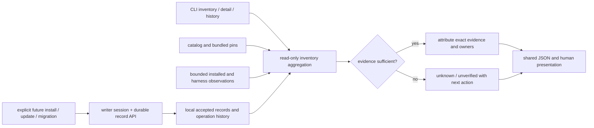

# Phase 39: Tool Inventory and Local Release Records — Research

<user_constraints>
## User Constraints (from CONTEXT.md)

### Locked Decisions

#### 통합 목록의 기본 화면

- **D-01:** 기본 화면은 관리 도구 중심이다. Cua·GSD·ECC·MCP·브리지는 버전과 상태를 자세히 표시하고, 자체 스킬·번들 라이브러리·외부 필수 도구는 분류별로 요약한다. 상세 조회에서는 전체 구성요소를 확인할 수 있어야 한다.
- **D-02:** 도구별로 묶고, 각 도구 아래에 연결된 하네스와 대상별 차이를 표시한다. 공유 설치도 파악할 수 있어야 한다.
- **D-03:** 카탈로그에 정의된 관리 도구는 미설치 항목까지 기본 목록에 포함한다. `미설치`와 `설치 여부 확인 불가`를 구분한다.
- **D-04:** 기록 불일치·확인 불가·검증 실패 등 문제 항목을 먼저 표시하고, 정상 항목과 단순 미설치는 뒤에 표시한다.

#### 수동 설치·중복 설치의 표시

- **D-05:** 수동 설치도 해당 도구 아래 함께 표시한다. alpha-AOS 관리 기록이 없으면 `외부 관리 · 관리 기록 없음`으로 표시하고, 관찰된 버전·경로와 검증 여부를 구분한다. 발견만으로 관리 소유권이나 신뢰를 부여하지 않는다.
- **D-06:** 여러 설치 중 하네스 설정이나 실행 경로로 확인된 실제 사용 설치를 먼저 표시하되 나머지도 함께 표시한다. 사용 대상을 확정할 수 없으면 `사용 대상 확인 불가`로 표시한다. 하네스별로 서로 다른 사용 대상이 있을 수 있으며 전역 대표 설치를 임의로 추정하지 않는다.
- **D-07:** 도구 설치와 연결 설정의 관리 주체를 따로 표시한다. 예: `도구 설치: 외부 관리 / 연결 설정: alpha-AOS 관리`.
- **D-08:** 중복 설치 자체는 문제로 간주하지 않는다. 하네스별 의도적인 버전 분리는 일반 정보로 표시한다. 경로 충돌·관리 기록 불일치·사용 대상 불명확은 문제 항목으로 표시한다.

#### 설치 상태와 검증 상태의 표현

- **D-09:** 기본 화면에서 설치·무결성·연동 상태를 각각 표시한다. 수행하지 않은 검사는 `미검증`으로 남긴다. 어떤 검증을 통과했는지 구분하는 기존 요구사항을 유지하며, 이 단계의 상태 표현이 새 연동 검증 실행까지 구현했다는 뜻은 아니다.
- **D-10:** 기본 화면은 설치된 버전을 중심으로 선택 버전과의 차이를 표시한다. 요청·선택·설치·검증의 전체 식별 정보는 상세 조회에서 확인한다.
- **D-11:** `미검증`·`확인 불가`에는 짧은 이유와 다음 조치를 기본 화면에 표시한다. 자세한 증거는 상세 조회에 둔다. 수행하지 않은 검사를 실패나 성공으로 바꾸어 표현하지 않는다.
- **D-12:** 현재 사용 상태와 최근 작업 결과를 함께 표시한다. 예를 들어 이전 버전의 정상 동작을 확인한 상태에서 새 버전 업데이트가 실패했다면 현재 버전의 확인된 상태와 최근 업데이트 실패를 구분한다. 이전의 검증 증거 없이 현재 정상 동작을 추정해서는 안 된다.

#### 로컬 기록의 조회와 기존 설치 인정 기준

- **D-13:** 도구별 변경 이력과 작업별 전체 결과를 모두 조회할 수 있어야 한다. 하나의 작업에 포함된 여러 도구의 성공·실패 결과를 함께 확인할 수 있어야 한다.
- **D-14:** 버전·출처·무결성·결과 등 메타데이터는 실패·중단 기록까지 자동 삭제 없이 보존하고, 조회 시 최근 항목부터 보여준다. 설치 파일·다운로드 아티팩트의 보관 정책은 이 결정에 포함하지 않는다.
- **D-15:** 목록 조회는 읽기 전용으로 유지한다. 기존 설치를 처음 발견했다고 새 로컬 관리 기록을 자동 생성하지 않는다. 조회에서는 기존 증거와 부족한 증거를 보여주고, 관리 기록은 명시적인 이관·설치·업데이트 작업에서 생성한다. Phase 39는 이 계약을 정의하며 전체 이관 구현은 Phase 43에 남긴다.
- **D-16:** 공식 출처·정확한 버전·무결성 증거와 현재 설치의 일치를 확인할 수 있으면 재설치 없이 인계할 수 있다. 충분한 증거가 있는 설치에 공식 배포본의 무조건적인 재확보를 요구하지 않는다. 증거 부족이나 사용자 수정이 있으면 그대로 표시하고 검증 완료로 간주하지 않으며, 임의의 현재 바이트를 해시한 사실만으로 공식 배포본임을 인정하지 않는다. 기존 관리 주체·출처 증거와 사용자 변경을 보존한다.

### the agent's Discretion

사용자가 별도로 판단을 위임한 항목은 없다. 세부 명령·플래그 이름, 스키마 구조와 버전, 정확한 저장 경로, 출력 문구·열 너비, 증거 수집 구현은 위 결정과 기존 안전 계약을 만족하는 범위에서 연구·계획 단계에서 정한다.

### Deferred Ideas (OUT OF SCOPE)

새로운 범위 확대 제안은 없었다. 설치 파일 보관·실제 업데이트·검증·복구·전체 이관은 기존 로드맵 경계를 유지한다. 일치하는 pending todo는 없었다.
</user_constraints>

<phase_requirements>
## Phase Requirements

| ID | Description | Research Support |
|---|---|---|
| LOC-01 | Users can inspect installed versions, official sources and management ownership for Cua, GSD, ECC, managed MCP servers and bridges in one inventory. | Catalog-seeded tool view, independent installation/connection ownership, multi-harness evidence and unknown states. [VERIFIED: .planning/REQUIREMENTS.md:14-14] |
| LOC-04 | Users can inspect locally recorded exact versions, official sources, verified artifact integrity and applied results for each managed tool. | Versioned append-preserving record API, operation and tool history, evidence-linked identities, failure-safe accepted pointer. [VERIFIED: .planning/REQUIREMENTS.md:17-17] |
</phase_requirements>

**Researched:** 2026-11-06  
**Domain:** local tool inventory, provenance and durable release records  
**Confidence:** MEDIUM — source seams verified; proposed observation coverage and durability require implementation tests.

## Summary

기존 inventory는 프로세스·하네스 탐지 결과를 반환하며 관리 도구 전체 또는 로컬 릴리스 기록을 제공하지 않는다. 기존 `Inventory` 소비자와 호환되는 별도 통합 뷰를 추가하고, 잠금 파일과 Cua 핀은 선택·출처의 과거 증거로 읽되 실제 설치나 검증 성공으로 승격하지 않는다. [VERIFIED: src/core/inventory.ts:5-22] [VERIFIED: src/types.ts:194-211]

**권장:** 읽기 전용의 도구별 관찰 집계와 명시적 작업만 사용하는 버전형 기록 API를 분리한다. 수집 불가를 알 수 없음으로 남기고 검증 증거에 대상·범위·방법·결과를 연결한다. 계획의 구체적인 구조는 제안이며, 최신 릴리스 선택과 실제 통합 검증·복구·기존 소비자 이관은 후속 단계다. [VERIFIED: .planning/ROADMAP.md:38-95]

## Architectural Responsibility Map

| Capability | Primary Tier | Secondary Tier | Rationale |
|---|---|---|---|
| 관리 도구·하네스 관찰과 표시 | 로컬 CLI 서비스 | 읽기 전용 OS/설정 탐지 | 한 도구의 여러 설치 및 하네스별 연결을 증거로 투영한다. [ASSUMED] |
| 버전·작업 이력 | 로컬 상태 저장소 | 단일 writer/트랜잭션 | 명시적 변경에만 기록하고 조회는 부작용 없이 처리한다. [VERIFIED: .planning/phases/39-tool-inventory-and-local-release-records/39-CONTEXT.md:50-55] |
| 출처·무결성 증거 | 소스별 증거 어댑터 | 저장소 | 선택, 설치, 파일 일치, 통합 확인을 다른 사실로 표현한다. [ASSUMED] |

## Project Constraints (from AGENTS.md)

- 이 저장소 개발에 alpha-AOS 자체 거버넌스·자동 실행을 요구하지 않는다. 명시적으로 요청된 이번 GSD 계획은 허용된다. 개인 워크스테이션 전달 정책상 push에 CI·테스트·사전 검증을 강제하지 않는다. [VERIFIED: AGENTS.md:1-14]
- 런타임의 제한된 경로, 비밀 보호, 단일 writer, 검토된 변경과 롤백 경계를 보존한다. TypeScript의 엄격한 타입 검사와 기존 코드 스타일을 따른다. [VERIFIED: AGENTS.md:1-14] [VERIFIED: tsconfig.json:2-14]
- 이 연구는 설치·업데이트·배포·외부 게시 권한이 아니다. 실호스트 결과를 주장하지 않는다. [VERIFIED: .planning/PROJECT.md:26-39]

## Standard Stack

기존 Node 내장 파일·암호화 API, 기존 TypeScript/테스트 러너 및 프로젝트의 스키마·트랜잭션 시설을 사용한다. 새 패키지 설치는 계획하지 않는다. 선언된 `"typescript": "5.9.3"`와 `"ajv": "8.20.0"`은 기존 의존성이지 최신 버전 또는 이번 단계의 새 설치 제안이 아니다. [VERIFIED: package.json:38-51]

현재 기준 항목의 원문은 `"gsd": { "package": "@opengsd/gsd-core", "version": "1.18.0"`와 `"ecc": { "package": "ecc-universal", "version": "2.2.3"`이다. MCP 및 브리지 잠금의 원문은 `"context7"` / `"@upstash/context7-mcp"` / `"4.4.4"`, `"exa"` / `"exa-mcp-server"` / `"3.4.2"`, `"firecrawl"` / `"firecrawl-mcp"` / `"3.34.1"`, `"pi"` / `"pi-mcp-adapter"` / `"6.0.0"`이다. 이는 배포본에 기록된 선택값이며 설치된 호스트의 관찰값이 아니다. [VERIFIED: catalog/stack.lock.json:6-15] [VERIFIED: catalog/stack.lock.json:88-109]

Cua 핀의 원문은 `"name": "cua-driver"`, `"version": "0.38.0"`, `"tag": "cua-driver-rs-v0.38.0"`, `"sourceId": "driver-release"`이다. 이는 현재 호스트 상태가 아니다. [VERIFIED: catalog/computer-use-runtime.json:2-10]

하네스 타입 원문은 `"claude" | "codex" | "antigravity" | "pi" | "hermes"`이며 서버 타입 원문은 `"context7" | "exa" | "firecrawl"`이다. 브리지는 잠금 파일에서 별도 항목으로 다룬다. [VERIFIED: src/types.ts:17-19] [VERIFIED: catalog/stack.lock.json:105-109]

## Architecture Patterns



### 책임과 제안 파일

| 경계 | 계획할 변경 | 근거 |
|---|---|---|
| 목록 집계 | `src/core/inventory.ts`의 기존 동기 계약을 보존하고 제안 별도 비동기 집계 모듈에서 catalog, lock, Cua 관찰, 로컬 기록을 합친다. | 설치·진단 등의 기존 호출자가 동일 함수를 사용한다. [VERIFIED: src/cli.ts:1036-1051] [VERIFIED: src/cli.ts:1555-1572] |
| 타입/스키마 | 제안 `src/core/tool-records.ts`와 `schemas/tool-release-record.schema.json`: 스키마 버전, 도구 키, 작업 ID, 각 식별 단계와 증거 참조, 도구별 결과 및 시간; 알 수 없음에는 이유와 권장 조치. | 현재 `LockedPackage` 원문 `package: string; version: string; integrity: string;`은 선택 잠금 정보를 담는다. [VERIFIED: src/types.ts:166-185] |
| CLI/표시 | 기존 `inventory`에 상세 및 이력 조회 경로를 추가하고 같은 결과 모델에서 JSON과 표를 출력한다. 문제 우선, 실제 사용이 증명된 설치 우선, 하네스별 나머지 설치도 보여준다. | 기존 출력은 `formatInventory`에 모인다. [VERIFIED: src/format.ts:60-63] |
| 범위 분류 | 자체 스킬, 패키지 내 라이브러리, 외부 필수 프로그램은 별도 요약과 상세만 제공한다. 탐지를 새 설치 권한으로 바꾸지 않는다. | [VERIFIED: .planning/phases/39-tool-inventory-and-local-release-records/39-CONTEXT.md:8-12] |

### 기록 API와 실패 안전성 — 제안

1. 명시적 작업 생성 시 안전하게 검증한 고유 식별자, 관련 도구별 요청·선택 identity 및 시각을 기록한다. 작업당 다수 도구 결과를 연결하고 도구/작업별 역순 조회를 지원한다. 파일명 생성에는 외부 입력을 그대로 사용하지 않는다. [ASSUMED]
2. 설치 관찰과 검증은 독립된 필드다. 출처는 공식 소스 식별자·정확한 릴리스/아티팩트, 무결성은 알고리즘·기대값의 출처·검사 대상·실제 확인 여부를 담는다. 메타데이터에 있는 체크섬, 실제 다운로드된 파일 검증, 설치된 파일 일치, 프로토콜/호출 확인을 혼동하지 않는다. npm 문서는 레지스트리 서명이 이름·버전·무결성을 묶는다고 설명한다. [CITED: https://docs.npmjs.com/about-registry-signatures/]
3. 제안 성공 확정은 필요한 명시적 증거를 확인한 뒤 원자적으로 현재 승인 참조를 바꾼다. 실패·중단 시 시도 및 부분 결과를 보존하고 이전 승인 참조는 유지한다. 현재 관찰이 이전 승인과 다르면 이전 것이 실제로 여전히 실행 중이라고 주장하지 않는다. 이 단계에서 복구 실행은 구현하지 않는다. [ASSUMED]
4. 기본 상태 루트의 원문은 `return join(homedir(), ".alpha-aos");`, override의 원문은 `process.env.ALPHA_AOS_STATE_DIR?.trim()`이다. override가 체크아웃 내부를 가리킬 수 있으므로 새 기록 writer는 정규화·실경로·symlink 경계를 확인하고 checkout 내부를 거부해야 한다. [VERIFIED: src/core/paths.ts:93-97] [ASSUMED]
5. 기존 `withComponentSession`, `applyFileTransaction` 및 writer session의 검토·경합·내구성 기능을 재사용하되, 동시 writer와 교체 중 중단을 테스트한다. 트랜잭션 상태 원문은 `"applying" | "applied" | "rolled-back" | "failed" | "repaired"`이며 파일 성공은 연동 성공이 아니다. [VERIFIED: src/core/transaction.ts:111-121] [VERIFIED: src/core/component-session.ts:96-177]
6. 기록 스키마는 명시된 허용 필드만 받아 URL 사용자정보·토큰·환경변수 값·원본 stderr/명령줄을 저장하지 않는다. redaction만으로 비밀이 제거됐다고 가정하지 않는다. 과거 기록의 파손·미지원 버전은 조용한 초기화 대신 진단한다. [ASSUMED]

### 증거와 소유권

- 실제 사용 대상은 각 하네스의 실행 경로 또는 연결 설정과 관찰 설치의 연결이 입증될 때만 특정한다. 공유 설치는 여러 연결을 참조하게 하고, 미확정이면 각 후보와 불확실성을 남긴다. 설정 관리 주체와 실행 파일 관리 주체를 별개로 둔다. [ASSUMED]
- `verifyOfficialCua`는 핀에 지정된 설치 파일의 경로·타입·크기·해시를 비교한다. 이 비교의 결과와 핀 자체의 출처·이전 검증 증거는 별개로 보관한다. 로컬 임의 해시만으로 공식 배포를 인정하지 않는다. [VERIFIED: src/core/computer-use-install.ts:40-57]
- MCP 구성은 잠금된 패키지와 버전을 명령에 포함할 수 있으므로 연결 설정이 있다고 실제 다운로드·설치·작동을 증명하지 않는다. [VERIFIED: src/core/mcp.ts:189-202]
- 누락과 접근 불가를 구분하려면 관찰별 오류를 분류한다. 탐색 범위 밖의 설치는 존재하지 않는다고 선언하지 않으며 한 후보의 발견으로 전체 검색이 완료됐다고 주장하지 않는다. [ASSUMED]

## Don't Hand-Roll

| 문제 | 재사용 | 이유 |
|---|---|---|
| 경로 검증·내구성·충돌 | 기존 writer session, 트랜잭션 및 path proof | 구현된 검토·단일 writer·저널 경계를 유지한다. [VERIFIED: src/core/component-session.ts:96-177] [VERIFIED: src/core/transaction.ts:163-194] |
| 하네스 탐지 | 기존 `collectInventory` 및 어댑터 | 기존 소비자와 일치하는 탐지 결과를 기반으로 한다. [VERIFIED: src/core/inventory.ts:1-22] |
| Cua 핀 비교 | 기존 `verifyOfficialCua` | 제공되는 비교 증거를 재사용하되 공식 출처/연동의 별도 증거로 포장하지 않는다. [VERIFIED: src/core/computer-use-install.ts:40-57] |

## Common Pitfalls

- 버전, 설정 파일 또는 기대 무결성 문자열만으로 설치/출처/통합을 확인했다고 처리하면 안 된다. 서로 다른 상태와 증거 범위를 보여준다. [ASSUMED]
- 실패한 새 작업의 선택 identity로 이전 승인 identity를 덮거나, 이전 기록이 있다는 사실만으로 현재 실행을 보장하면 안 된다. 재시작과 중단 지점마다 디스크 상태를 검증한다. [ASSUMED]
- `userStateRoot` override, symlink와 경로 대소문자 차이를 테스트하지 않으면 체크아웃 외부 저장 및 root 경계가 깨질 수 있다. [ASSUMED]
- 하네스별 PATH와 설정, 버전별 설치·연결이 다를 수 있다. 발견된 첫 설치를 전역 사용 대상으로 추정하지 않는다. [ASSUMED]
- 출처 URL, 에러 문자열, 경로 및 하네스 설정에 자격 증명이 들어갈 수 있다. 저장·콘솔·JSON 모두 허용 필드와 비밀 차단을 검증한다. [ASSUMED]
- Phase 39의 기록 계약을 전체 소비자 이관이나 새 통합 검사 실행의 완료로 오인하지 않는다. [VERIFIED: .planning/ROADMAP.md:74-95]

## Code Examples

아래는 기존 API가 아닌 제안된 호출 관계다. 구체적인 타입 이름과 상태 값은 구현 시 스키마와 함께 확정한다. [ASSUMED]

```typescript
const inventory = await collectManagedTools({ catalog, lock, stateRoot, observers });
const history = await readToolHistory({ stateRoot, toolId });
// A separate, explicit mutation session owns record writes.
```

## Environment Availability

| Dependency | Required By | Available | Version | Fallback |
|---|---|---|---|---|
| Node | 빌드·테스트 | 예 | v24.13.1 | — [VERIFIED: local `node --version`] |
| npm | 빌드·스크립트 | 예 | 11.8.0 | — [VERIFIED: local `npm --version`] |
| Git | 소스 관리 | 예 | 2.55.0.windows.3 | — [VERIFIED: local `git --version`] |

실제 Cua·각 하네스·외부 서비스의 설치, 자격증명, 실호스트 연동과 다른 OS는 조사 실행으로 검증하지 않았다. 외부 서비스나 실설치 없이 격리된 fixture로 계약을 검증한다. [ASSUMED]

## Validation Architecture

테스트 프레임워크는 Node 내장 테스트 러너이며 기존 테스트 러너는 컴파일된 파일 목록을 `--files`로 받는다. `npm run check`는 정적 검사, `npm run build`는 테스트 실행 전 컴파일을 수행한다. 전체 `npm test`는 선택적 전체 회귀 검사이며 push/CI 필수 조건이 아니다. [VERIFIED: package.json:23-35] [VERIFIED: scripts/run-tests.mjs:89-100]

| 요구사항 | 의미 있는 검증 | 제안 명령 및 파일 |
|---|---|---|
| LOC-01 | 카탈로그 미설치/접근 불가 구분, 수동·다중 설치, 하네스별 사용 증거, 설치/연결 소유권 분리, 중복 자체는 정상, 문제 우선·JSON/표 일관성 | `npm run build` 후 `node scripts/run-tests.mjs --files dist/test/tool-inventory.test.js` — 신규 fixture 테스트 [ASSUMED] |
| LOC-04 | 정확한 단계별 identity 및 도구/작업별 역순 이력, 여러 도구 부분 실패, 미검증 상태, 이전 성공 유지, 중단·재시작, 손상/미지원 스키마 실패, 허위 출처·임의 해시 거부 | `npm run build` 후 `node scripts/run-tests.mjs --files dist/test/tool-records.test.js` — 신규 fixture 테스트 [ASSUMED] |
| LOC-01/04 | 읽기만 해도 새 파일이 생기지 않음; 비밀이 기록·표·JSON에 없음; root 밖·checkout 내부·symlink 탈출 거부; 동시 writer 충돌; 기존 inventory 소비자 호환 | `npm run build` 후 `node scripts/run-tests.mjs --files dist/test/tool-inventory.test.js dist/test/tool-records.test.js dist/test/install.test.js` [ASSUMED] |

### Wave 0

- [ ] 임시 home/state root, 모의 catalog·하네스 연결·다중 설치·Cua pin, 주입 가능한 관찰 결과와 failure point를 준비한다. 실제 홈·레지스트리·설치기를 쓰지 않는다. [ASSUMED]
- [ ] 신규 두 테스트 파일과 필요한 fixture를 구현한다. 제안 명령은 파일 생성 전에는 실행 가능하다고 주장하지 않는다. [ASSUMED]
- [ ] 요구되는 단계별 표본 테스트와 `npm run check`를 수행하고, 추가 회귀 범위는 실제 변경에 따라 정한다. 전체 테스트는 선택사항이다. [ASSUMED]

## Security Domain

| 범주 | 적용 | 제어 |
|---|---|---|
| 인증·세션 | 이 로컬 읽기/기록 범위에서는 직접 구현 없음 | 자격증명 값 수집 금지. [ASSUMED] |
| 접근 제어 | 예 | writer 소유권, 허용 루트, 실경로 및 symlink 검사. [ASSUMED] |
| 입력 검증 | 예 | 버전형 스키마, 제한된 ID, URL 및 기록 필드 allowlist. [ASSUMED] |
| 암호화·무결성 | 예 | 기존 Node 암호 해시와 신뢰 가능한 출처의 기대값을 비교하고 증거 대상을 기록한다. [ASSUMED] |

위 ASVS 해당성은 이 단계 설계의 적용 판단이며 공식 버전별 번호 매핑을 검증한 결과는 아니다. 경로 조작과 비밀 노출을 독립적인 부정 테스트로 확인한다. [ASSUMED]

## Assumptions Log

| # | Claim | Risk if Wrong |
|---|---|---|
| A1 | 제안된 모듈 분리·비동기 집계·기록 API 및 원자적 승인 참조 구현이 기존 경계에 적합하다. | API 변경 또는 충돌·부분 기록 처리 누락. |
| A2 | 하네스별 근거 기반 귀속, 실패 분류, 허용 필드 및 경로 검사로 D-01–D-16을 구현할 수 있다. | 불완전한 탐지·비밀 노출·잘못된 소유권. |
| A3 | 제안 fixture 및 테스트 파일/명령으로 범위를 독립 검증할 수 있다. | 실행 전에 fixture/test runner 연결 재확인 필요. |
| A4 | 위 보안 범주 적용 판단 및 환경에 대한 제한은 실호스트 증거가 아니다. | 미검증 설치·호환성을 완료로 잘못 보고할 수 있다. |

## 기존 관찰 표면과 계획된 범위

**설계 결정:** Phase 39의 production observer는 아래 표면과 명시적으로 주입된 제한된 후보만 파일 읽기로 확인한다. 관찰한 범위와 빠진 범위를 반환하고, 명시된 후보들에서 ENOENT가 확인된 경우에만 그 **후보 범위의** 부재를 보고한다. 범위 밖 수동 설치의 전역 부재는 단정하지 않는다. 파일 접근 거부·불완전한 범위·파싱 실패는 unknown이며, 파일 존재만으로 실행·공식 신뢰·관리 소유권을 확정하지 않는다. 이 문단은 39-03의 구체적인 구현 계약 제안이다. [VERIFIED: .planning/phases/39-tool-inventory-and-local-release-records/39-03-PLAN.md] [ASSUMED]

| 도구 | 기존에 읽을 수 있는 표면 | Phase 39에서 확정 가능한 사실과 한계 |
|---|---|---|
| Cua | 코드의 `officialCuaPaths`는 공식 실행 파일 및 legacy 경로 후보를 산출하며 `verifyOfficialCua`는 선택 pin의 파일 목록과 바이트를 비교한다. 원문 경로 조각은 `".cua-driver"`, `".cua-driver-rs"`, `"cua-driver.exe"`, `"/Applications/CuaDriver.app/Contents/MacOS/cua-driver"`다. [VERIFIED: src/core/computer-use-install.ts:29-57] | 후보 존재·해당 pin의 설치 파일 일치만 표시한다. pin 자체의 주장만으로 외부 출처 또는 GUI 작동을 확인하지 않는다. 후보 밖 및 읽지 못한 곳은 unknown이다. [ASSUMED] |
| GSD | 다섯 하네스 루트를 `globalGsdConfigRoot`로 구하고 각 루트 아래 원문 `"gsd-core", "VERSION"`, `".gsd-profile"`, `"gsd-core", ".gsd-runtime"`을 읽는다. [VERIFIED: src/core/install.ts:104-130] | 이 파일들은 설치된 것으로 보이는 버전·대상 메타데이터이고 설치 파일 전체의 공식 출처 및 실제 실행을 증명하지 않는다. 현재 함수는 제한 범위 밖의 수동 설치를 열거하지 않는다. [ASSUMED] |
| ECC | 기존 전역 npm 루트와 각 하네스 skill 루트를 본다. 원문에서 Claude는 `"skills"`, Codex/Pi는 `".agents", "skills"`, Antigravity는 `".gemini", "config"`, `"skills"`, Hermes는 `"skills"` 조합이다. [VERIFIED: src/core/ecc-skills.ts:52-59] [VERIFIED: src/core/install.ts:328-370] | npm manifest 버전과 배포된 skill은 별개의 관찰이다. 공유 skill 경로는 공유 사실만 표시한다. 변환된 skill의 해시만으로 원본 tarball 출처나 런타임 실행을 입증하지 않는다. [ASSUMED] |
| Context7 / Exa / Firecrawl | 잠금의 세 package identity와 bounded npm roots·PATH 후보·각 MCP 연결 설정을 사용한다. 원문 식별자는 `"@upstash/context7-mcp"`, `"exa-mcp-server"`, `"firecrawl-mcp"`다. [VERIFIED: catalog/stack.lock.json:88-102] | 명시된 package manifest와 경로는 해당 후보의 관찰이다. 설정의 package spec 또는 proxy는 연결 의도이지 실제 설치·실행 증거가 아니다. npx 캐시 등 범위 밖 위치는 unknown으로 둔다. [VERIFIED: src/core/mcp.ts:189-202] [ASSUMED] |
| Pi bridge | 기존 코드는 구성 파일 디렉터리 아래 원문 `"npm", "node_modules", bridge.package, "package.json"`을 사용해 manifest 버전과 잠금을 비교한다. [VERIFIED: src/core/mcp.ts:594-596] [VERIFIED: src/core/mcp.ts:632-643] | 그 manifest만 해당 후보의 버전을 보여준다. 브리지 사용·연동 또는 다른 위치의 부재는 입증하지 않는다. [ASSUMED] |

다섯 하네스의 **MCP 설정 연결**은 `globalMcpConfigPath` 및 `nativeConfigFormat`을 사용한다. 원문 경로 구성은 Claude `".claude.json"`, Codex `".codex", "config.toml"` (환경 override 지원), Antigravity `".gemini", "config", "mcp_config.json"`, Pi `".pi", "agent", "mcp.json"` (환경 override 지원), Hermes `hermesHome(...), "config.yaml"`이고 형식 선택 원문은 `"codex" → "toml"`, `"hermes" → "yaml"`, 그 외 `"json"`이다. [VERIFIED: src/core/mcp.ts:121-128] [VERIFIED: src/core/mcp.ts:501-504]

GSD 루트와 ECC skill 루트의 다섯 하네스 분기는 각각 위 코드에서 확인된다. **계획:** 명시적 실행 파일 또는 안전하게 읽은 shim/manifest와 정확한 identity·경로가 같은 경우에만 하네스 관계를 확정하고, proxy·npx 참조와 해석할 수 없는 wrapper는 관계 미확정으로 남긴다. Antigravity 및 Hermes 탐지 후보들은 위 MCP 구성 경로보다 넓다. 기존 `probeHarness`는 `probeCommand`를 호출하므로 39-03의 subprocess 금지 관찰에는 그대로 재사용하지 말고 경로 계산만 재사용해야 한다. [VERIFIED: src/adapters/harnesses.ts:18-48] [VERIFIED: src/adapters/harnesses.ts:69-86] [ASSUMED]

## 기존 증거와 인계 판정 계약

| 증거 원천 | 확인된 내용 | 인계에서 사용할 수 있는 범위 |
|---|---|---|
| stable lock | `LockedPackage` 원문 `package: string; version: string; integrity: string;` 및 ECC의 source/target 해시, 별도 MCP/bridge 항목을 정의한다. [VERIFIED: src/types.ts:166-190] | 선택 identity와 기대 무결성 후보. 단독으로 공식 source 인증, 실제 tarball 검사, 설치 위치와의 연결을 증명하지 않는다. [ASSUMED] |
| 파일 transaction journal | 파일 항목 원문 `target`, `existed`, `snapshot`, `beforeHash`, `afterHash`, `proofDigest`; 작업 원문 `id`, `createdAt`, `status`, `allowedRoots`, `files`. [VERIFIED: src/core/transaction.ts:101-121] | 해당 관리 파일의 변경·전후 바이트 관계와 작업 연계를 보조할 수 있다. journal만으로 공식 artifact, 외부 installer의 모든 효과 또는 실제 도구 실행 성공을 입증하지 않는다. [ASSUMED] |
| ECC fixture 결과 | tarball 바이트를 계산해 잠금 integrity와 비교한 후 선택 skill의 원본·변환 해시를 반환한다. [VERIFIED: src/core/ecc-fixture.ts:350-388] | 개별 결과가 신뢰할 수 있게 보존되고 정확한 artifact, 변환 규칙 및 현재 대상 파일에 연결되는 경우 해당 범위의 근거가 된다. 이 함수가 반환한 사실만으로 실제 호스트에 결과가 보존됐다고 가정하지 않는다. [ASSUMED] |
| MCP fixture | `npm pack` 결과의 integrity를 잠금과 비교하고 archive의 존재를 확인한다. [VERIFIED: src/core/mcp-fixture.ts:55-72] | fixture 당시 package 일치의 근거 후보이지만 독립적인 현재 설치의 바이트·호출 결과로 확장하지 않는다. [ASSUMED] |
| Cua pin과 installed-file 비교 | 원문 `"downloadVerified": true`, `"signatureVerified": true`, 그리고 Windows asset의 `"proof": "host-verified-checksum-signature-and-file-manifest"`, `"liveVerified": false`가 pin에 있다. `verifyOfficialCua`는 설치된 목록 파일을 pin의 기대 해시와 비교한다. [VERIFIED: catalog/computer-use-runtime.json:2-19] [VERIFIED: src/core/computer-use-install.ts:40-57] | 이 boolean/문자열은 기록된 주장이다. 신뢰 가능한 공식 artifact→서명/체크섬→파일 manifest→현재 설치 파일을 잇는 검증 가능한 별도 증거가 있어야 출처까지 확정한다. pin 비교만으로 GUI 호출 성공을 부여하지 않는다. [ASSUMED] |

**구체 판정:** (1) 공식 publisher/source에 대한 신뢰 가능한 근거, (2) 정확한 버전과 artifact identity, (3) 그 artifact에 결합된 신뢰 가능한 기대 digest와 실제 검증 결과, (4) 검증된 artifact/변환 결과에서 현재 설치 대상까지 이어지는 경로·파일 일치 증거, (5) 기존 소유권·사용자 수정 상태가 모두 연결될 때만 인계 준비로 평가한다. 이미 남아 있는 충분한 증거를 사용할 수 있으며 다운로드·재설치는 필수가 아니다. 일부 파일만 검사했다면 그 파일 범위만 인정한다. 누락·충돌·변조·불명확한 변환 또는 실경로 접근 실패는 항목별 부족 근거와 다음 조치로 표시하고, 수정된 파일을 덮거나 관리 소유권을 자동 부여하지 않는다. 미실행 통합 검사는 별도 unverified다. Phase 39는 평가와 명시적 handoff 입력 계약을 제공하며 실제 일괄 이관은 Phase 43이다. [VERIFIED: .planning/phases/39-tool-inventory-and-local-release-records/39-CONTEXT.md:50-55] [VERIFIED: .planning/ROADMAP.md:86-95] [ASSUMED]

## Open Questions

1. **RESOLVED — 관찰 범위와 하네스 귀속:** 위 ‘기존 관찰 표면과 계획된 범위’ 표를 39-03의 구현 계약으로 사용한다. 각 도구의 확인 가능한 경로와 증거, 미확정 조건, 다섯 하네스의 설정 형식 및 기존 subprocess 탐지 재사용 금지까지 결정했다. 실호스트에 무엇이 설치되어 있는지는 이 설계 결정으로 확인되지 않는다. [VERIFIED: src/core/install.ts:104-130] [VERIFIED: src/core/mcp.ts:121-128] [VERIFIED: src/adapters/harnesses.ts:69-86] [ASSUMED]
2. **RESOLVED — 기존 증거와 인계:** 위 ‘기존 증거와 인계 판정 계약’의 필수 연결과 각 기존 형식의 기여 범위를 39-04 평가 기준으로 사용한다. lock·journal·pin boolean 각각만으로는 신뢰할 수 있는 전체 artifact→현재 설치 체인이 성립하지 않으며 충분히 보존된 별도 증거가 있으면 재다운로드는 필요 없다. 실제 특정 호스트에서 이 체인이 존재하는지는 조사하지 않았다. [VERIFIED: src/types.ts:166-190] [VERIFIED: src/core/transaction.ts:101-121] [VERIFIED: catalog/computer-use-runtime.json:2-19] [ASSUMED]

## Sources and Metadata

- 주요 소스: 위에 인라인으로 인용한 프로젝트 타입·잠금·Cua 구현·계획 문서. 소스에 명시된 잠금과 로컬 호스트 관찰은 별개다.
- 공식 문서: [npm registry signatures](https://docs.npmjs.com/about-registry-signatures/); [Cua driver release](https://github.com/trycua/cua/releases/tag/cua-driver-rs-v0.38.0); [Node file system](https://nodejs.org/api/fs.html). 문서 확인은 새 버전 호환성 또는 현재 설치 증명이 아니다. [CITED: https://docs.npmjs.com/about-registry-signatures/]
- 아키텍처: MEDIUM — 기존 접점은 확인했고 새 기록 경계는 제안. 도구 버전: HIGH — 잠금 파일 자체만 확인. 함정: MEDIUM — 부정 fixture 검증 필요. 연구일 2026-11-06, 후속 단계 착수 전 재확인 권장.
