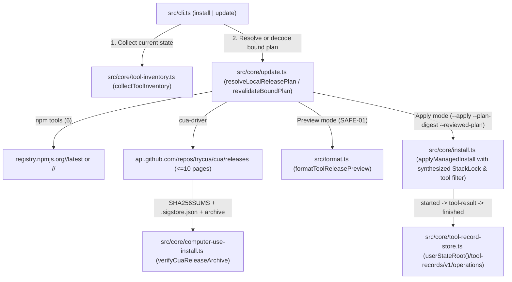

# Phase 40: Local Official Release Updates - Research

**Researched:** 2026-11-07
**Domain:** Local official stable release resolution, preview-apply identity binding, Cua & npm installer orchestration, and local release record persistence
**Confidence:** HIGH

<user_constraints>
## User Constraints (from CONTEXT.md)

### Locked Decisions

#### 설치·업데이트 명령과 대상 선택 방식

- **D-01:** `alpha-aos install`과 `alpha-aos update`는 동일한 로컬 릴리스 해석·프리뷰·적용 라이프사이클 엔진을 공유하되 기본 의도를 구분한다. `install`은 미설치(또는 아직 로컬 인정 기록이 없는) 관리 도구를 공식 최신 안정 릴리스로 설치하고 이미 정상 설치·인정된 도구는 기존 버전을 유지하며, `update`는 설치된 도구까지 공식 최신 안정 릴리스와 비교해 새 버전으로 업그레이드한다.
- **D-02:** `install`과 `update` 모두 `--tool`(Phase 39 `inventory`와 동일한 7개 관리 도구 ID: `cua-driver`, `gsd`, `ecc`, `mcp:context7`, `mcp:exa`, `mcp:firecrawl`, `bridge:pi`)과 `--target`(하네스) 필터를 지원한다. Cua 바이너리나 전역 npm 패키지처럼 여러 하네스가 공유하는 설치가 변경될 때는 직접 지정한 대상뿐 아니라 영향받는 다른 하네스도 프리뷰에 함께 명시한다.
- **D-03:** 기본 `alpha-aos update`는 현재 설치된 관리 도구만 업그레이드 대상으로 삼고 미설치(`absent`) 도구는 건너뛰며(`미설치 · 변경 없음` 표시), 사용자가 `--tool`로 미설치 도구를 직접 지정한 경우에는 암묵적 설치 대신 `install` 명령을 사용하도록 명시적 안내와 함께 거부한다.
- **D-04:** `install`과 일관되게 기본 `alpha-aos update`(및 호환 별칭 `--check`)는 읽기 전용 프리뷰로, `alpha-aos update --apply`는 검토된 계획 적용으로 동작하게 통일한다. 패키지 체크아웃 내부의 `catalog/candidate.lock.json`을 수정하던 `update --stage`는 일반 도구 업데이트 경로에서 제거하고 폐기 안내와 함께 거부한다.

#### 프리뷰(Preview)와 적용(Apply)의 바인딩 계약

- **D-05:** 프리뷰(SAFE-01)는 체크아웃이나 사용자 상태 루트에 어떠한 파일도 쓰지 않는다. 대신 프리뷰 출력에 검토된 릴리스 식별 정보와 계획 다이제스트가 묶인 실행 명령을 제시하고, CLI에서 `--apply` 실행 시 이 검토 바인딩을 필수로 요구하여(생략 시 프리뷰 먼저 실행 안내) 검토 없이 임의 버전이 적용되는 것을 차단한다.
- **D-06:** 프리뷰가 출력하는 복사·실행용 `--apply` 명령에는 계획 다이제스트(`--plan-digest`)와 함께 도구별 검토된 정확한 버전·아티팩트 식별 정보(컴팩트 바인딩 토큰 또는 `--reviewed-plan` 입력 지원)가 포함된다. `--apply`는 움직이는 `latest` 태그나 채널을 다시 조회하지 않고, 바인딩된 특정 릴리스 버전의 공식 메타데이터·무결성·로컬 사전 상태만 재검증한다.
- **D-07:** 사람이 읽는 기본 프리뷰 화면은 변경 대상 도구를 먼저 배치하고, 각 도구별로 ① 기존/인정 버전 → 신규 버전 및 공식 출처·아티팩트 식별 요약, ② 영향받는 하네스(공유 설치 파급 포함), ③ 네이티브 설치기 부수 효과, ④ 복구 범위(트랜잭션 자동 롤백 가능 항목 vs 어댑터 복구·외부 잔여 효과)를 순서대로 표시한다. 이미 최신이거나 변경 없는 도구는 하단에 간결히 요약하며, 전체 세부 필드는 `--json` 출력에도 동일하게 포함한다.
- **D-08:** 선택된 모든 도구가 이미 최신 버전이면 프리뷰는 변경 없음으로 안내하고 적용 시에도 멱등(no-op)으로 처리한다. 프리뷰 이후 `--apply` 실행 시 로컬 설치 상태·대상 설정 파일·경로 경계·아티팩트 무결성 중 하나라도 달라지면 부분 적용 없이 변경 전에 즉시 거부(`plan-drift`)하고, 구체적인 불일치 항목과 새 프리뷰 실행 명령을 안내한다.

#### 릴리스 탐색 예외 및 플랫폼 지원 정책

- **D-09:** npm 패키지 탐색은 공식 레지스트리의 `latest` dist-tag를 조회하되, `latest`가 가리키는 버전이 시맨틱 프리릴리스(`-alpha`, `-beta`, `-rc`, `-nightly` 등 하이픈 프리릴리스 식별자 포함)이면 임의로 이전 정식 버전을 탐색해 폴백하지 않고 명시적 거부(`latest-is-prerelease`)로 처리하여 기존 설치 상태를 유지한다.
- **D-10:** Cua 공식 릴리스 탐색은 제한된 페이지 한도(bounded pagination) 내에서 GitHub 릴리스 목록을 조회해 `cua-driver-rs-v<X.Y.Z>` 정식 드라이버 태그(`draft: false`, nightly 및 시맨틱 프리릴리스 제외, 저장소 특성상 붙는 GitHub `prerelease` 불리언 라벨은 허용) 중 가장 높은 정식 버전을 선택한다. 최신 정식 릴리스에 현재 OS/아키텍처용 에셋이 없거나 페이지 탐색 한도 내에 유효한 정식 릴리스를 확정할 수 없으면 이전 버전으로 암묵적 폴백하지 않고 구체적 사유(`unsupported-platform` 또는 `incomplete-discovery`)로 거부한다.
- **D-11:** 여러 관리 도구를 함께 조회·업데이트할 때 대상 범위의 모든 도구 탐색 결과를 끝까지 수집해 함께 보여주되, 하나라도 탐색 실패·메타데이터/출처 검증 실패·플랫폼 미지원이 발생하면 전체 계획의 `--apply`를 거부(기존 상태 유지)하고 사용자가 `--tool` 필터로 정상 도구만 지정해 진행할 수 있음을 안내한다.
- **D-12:** 정식 `cua-driver-rs-v<X.Y.Z>` 릴리스에 현재 Linux 아키텍처(`x64`/`arm64`)의 공식 검증 가능한 바이너리 아카이브가 존재하면 유효한 플랫폼 에셋으로 선택하되, 프리뷰와 기록에 업스트림의 Linux 플랫폼 주의사항 및 네이티브 부수 효과(Wayland helper 등)를 명시하고 실제 호스트 GUI 연동 검증은 `미검증`(`unverified`)으로 구분한다.

#### Cua 공식 설치 어댑터와 아티팩트 검증 경계

- **D-13:** 체크아웃의 `catalog/computer-use-runtime.json` 고정 버전 핀에만 의존하지 않고 최신 Cua 정식 릴리스를 선택·설치할 수 있도록, 저장소에 검토된 Cua 공식 출처 신뢰 정책(공식 서명된 체크섬 목록·Sigstore 증빙·허용된 발행 워크플로 식별자)으로 선택한 릴리스 아카이브의 무결성을 먼저 검증한 뒤 검증된 아카이브에서 설치 엔트리포인트 및 구성 파일 해시를 로컬 도출해 설치 검증과 로컬 기록에 사용한다. 서명·체크섬 증빙이 누락되거나 일치하지 않으면 변경 전에 거부한다.
- **D-14:** 최신 Cua 릴리스 설치 시에는 해시가 검증된 공식 설치 어댑터(검토된 벤더 설치 스크립트 또는 해당 릴리스 태그에 서명·검증된 공식 설치기)에 검토된 정확한 버전(`-Release` / `CUA_DRIVER_RS_VERSION`)과 검증된 아티팩트를 고정 전달해 실행한다. 검증되지 않은 외부 `main` 브랜치 스크립트를 런타임에 내려받아 실행하는 것은 금지한다.
- **D-15:** Cua 업데이트 실행 시 기존처럼 `CUA_DRIVER_RS_KEEP_VERSIONS: "0"`으로 이전 버전을 즉시 삭제하지 않고 최소 직전 정상 버전을 보존하도록 설치 환경/경로를 구성하며, OS별 네이티브 설치 부수 효과(Windows 정션 및 바이너리 경로, macOS `/Applications/CuaDriver.app`, Linux `~/.local/bin` 및 Wayland helper)와 복구 범위를 프리뷰 및 실행 계획에 명시한다.
- **D-16:** `--apply` 실행은 패키지 체크아웃 내부의 `catalog/*.json`(`stack.lock.json`, `candidate.lock.json`, `computer-use-runtime.json`)을 수정하지 않고, `userStateRoot()/tool-records`에 작업(`started` → 도구별 `tool-result` → `finished`)과 정확한 `requested`·`resolved`·`installed` 식별 정보 및 실제 수행된 발견·무결성 증거를 기록한다. 수행하지 않은 실제 호스트 호출(invocation) 검증은 `unverified`로 남겨 이전 인정(`accepted`) 체인을 허위 완료로 덮어쓰지 않는다.

### Claude's Discretion

사용자가 별도로 판단을 위임한 항목은 없다. 컴팩트 바인딩 토큰/인자의 구체적 직렬화 형식, GitHub 릴리스 페이지 탐색 상한 수치, Cua 아카이브/체크섬 검증 모듈 분리 구조, 세부 오류 코드 이름은 위 결정과 기존 런타임 안전 계약을 만족하는 범위에서 연구·계획 단계에서 정한다.

### Deferred Ideas (OUT OF SCOPE)

None — discussion stayed within phase scope. 호환성 어댑터 단순화(Phase 41), 미기록 버전의 실제 프로토콜·호출 검증 및 사후 복구(Phase 42), 기존 설치의 전면 이관 및 하위 소비자/문서 전환(Phase 43)은 승인된 로드맵 단계에 그대로 유지한다.
</user_constraints>

<phase_requirements>
## Phase Requirements

| ID | Description | Research Support |
|----|-------------|------------------|
| LOC-02 | Installation and explicit tool-update requests resolve the latest official releases locally, without prior alpha-AOS remote lock promotion or repository write permission; selection follows each source's official stable-channel rules and excludes semantic prereleases/nightlies. | Unified local release resolver in `src/core/update.ts` covering npm `latest` dist-tag (`!/^\d+\.\d+\.\d+$/` rejected as `latest-is-prerelease`) and Cua GitHub Releases (`https://api.github.com/repos/trycua/cua/releases?per_page=100&page=<1..10>`, matching `^cua-driver-rs-v(\d+\.\d+\.\d+)$`, `draft: false`, allowing GitHub `prerelease` boolean, excluding `nightly-cua-driver-rs-v*` and withdrawn `0.28.3`, refusing `unsupported-platform` / `incomplete-discovery`). `[VERIFIED: .planning/REQUIREMENTS.md:15]` `[VERIFIED: .planning/phases/40-local-official-release-updates/40-CONTEXT.md:22-46]` |
| LOC-03 | Before applying an update, users can review exact old/new versions, affected targets, native installer side effects and recovery scope; apply remains bound to the reviewed release identities. | Read-only preview (SAFE-01) emitting a bound `--apply --plan-digest <digest> --reviewed-plan <token>` command, shared blast-radius calculation from Phase 39 `collectToolInventory` / `observeHarnessToolBindings`, explicit native side-effect & recovery scope disclosure, exact version revalidation on `--apply` without re-querying moving `latest` tags, and local record persistence via `src/core/tool-record-store.ts`. `[VERIFIED: .planning/REQUIREMENTS.md:16]` `[VERIFIED: .planning/phases/40-local-official-release-updates/40-CONTEXT.md:29-33]` |
</phase_requirements>

## Project Constraints (from AGENTS.md)

- **Repository Development Policy (2026-11-05):** Develop `alpha-AOS` directly with native tools; do NOT invoke `alpha-aos-task`, `alpha-aos-control`, pack advisory/materialization, task contracts, digest approvals, autopilot runners, or `alpha-aos gsd-context` as prerequisites for work in this repository. `[VERIFIED: AGENTS.md:1-10]`
- **Delivery Policy (2026-11-05):** Personal workstation delivery. Scheduled dependency updates and automatic promotion are disabled. Runtime approval, filesystem, secret, and rollback safeguards remain in force. Do not describe unrun checks as passed. `[VERIFIED: AGENTS.md:12-14]`
- **Runtime & Toolchain Floor:** Node.js `>=24.0.0`, npm `>=10.0.0`, and Git are required (`requirePreflight` in `src/core/install.ts:138-147`). `[VERIFIED: AGENTS.md:31]` `[VERIFIED: package.json:48-51]`
- **Supported Harnesses:** `export type HarnessId = "claude" | "codex" | "antigravity" | "pi" | "hermes";` `[VERIFIED: src/types.ts:17]`
- **Supported MCP Servers:** `export type McpServerId = "context7" | "exa" | "firecrawl";` `[VERIFIED: src/types.ts:18]`
- **Safety & Secret Boundaries:** Mutations are previewable, root-bounded (`proveOperationPaths`, `recheckPathProof`), snapshotted (`applyFileTransaction`), and single-writer (`withComponentSession` / `acquireMutationSession`). Credential values must never enter manifests, locks, plans, journals, diagnostics, command arguments, or repository files. `[VERIFIED: AGENTS.md:35-36]`

---

## Summary

Phase 40 replaces the legacy candidate-lock promotion workflow (`alpha-aos update --stage` writing `catalog/candidate.lock.json`) with a local official release resolution, preview, and apply engine shared by `alpha-aos install` and `alpha-aos update` `[VERIFIED: .planning/phases/40-local-official-release-updates/40-CONTEXT.md:22-25]`. Currently, `src/core/update.ts` only queries npm `latest` for GSD, ECC, MCP servers, and the Pi bridge to stage `catalog/candidate.lock.json`, while `alpha-aos update --apply` in `src/cli.ts:1601-1616` ignores upstream releases and merely re-runs `applyManagedInstall` against the static `catalog/stack.lock.json` and `catalog/computer-use-runtime.json` `[VERIFIED: src/core/update.ts:35-75]` `[VERIFIED: src/cli.ts:1598-1628]`. Phase 39 already established the unified 7-tool inventory (`collectToolInventory` in `src/core/tool-inventory.ts:119-220`) and the transactional local release record store (`planToolRecordOperation`, `beginToolOperation`, `appendToolResult`, `finishToolOperation` in `src/core/tool-record-store.ts:44-150`) under `userStateRoot()/tool-records/v1/operations` `[VERIFIED: src/core/tool-records.ts:92]`.

To satisfy `LOC-02` and `LOC-03` (`D-01` through `D-16`), the codebase needs four tightly integrated capabilities:
1. **Source-Specific Official Stable Release Resolvers:** An npm stable resolver that fetches `https://registry.npmjs.org/<pkg>/latest` (for discovery) and `https://registry.npmjs.org/<pkg>/<version>` (for bound apply revalidation) while rejecting any semantic prerelease (`!/^\d+\.\d+\.\d+$/` → `latest-is-prerelease`), paired with a Cua GitHub release resolver that walks `https://api.github.com/repos/trycua/cua/releases?per_page=100&page=<1..10>`, filters for `draft === false` and `^cua-driver-rs-v(\d+\.\d+\.\d+)$` (allowing GitHub's `prerelease: true` flag while excluding `nightly-cua-driver-rs-v*` and withdrawn version `"0.28.3"`), and verifies `SHA256SUMS` and `<asset>.sigstore.json` against the reviewed publisher workflow identity `[VERIFIED: scripts/vendor/cua-driver-0.38.0/install.ps1:136-182, 1109-1155]`.
2. **Read-Only Preview with Bound Apply Token:** Both `install` and `update` default to a zero-write preview (SAFE-01) that aggregates discovery across all selected tools (`--tool`, `--target`), orders tools with changes first (`D-07`), discloses shared harness blast radius, native installer side effects, and recovery scope, and prints a copy-pasteable `--apply --plan-digest <digest> --reviewed-plan <token>` command `[VERIFIED: .planning/phases/40-local-official-release-updates/40-CONTEXT.md:29-33]`.
3. **Dynamic In-Memory StackLock & Cua Adapter Execution:** On `--apply`, the engine decodes the bound per-tool versions/digests, revalidates the specific release metadata and local pre-state (`assertPlanUnchanged`), dynamically computes `ecc.sourceSha256` and `ecc.targetSha256` from the verified `ecc-universal` tarball when `ecc` is updated (avoiding the empty-hash failure in `requireEccLock` at `src/core/ecc-skills.ts:62-69`), and executes the Cua vendored installer with pre-staged verified release bytes and version retention (`CUA_DRIVER_RS_KEEP_VERSIONS: "2"` or `"5"`) `[VERIFIED: src/core/ecc-skills.ts:62-69]` `[VERIFIED: src/core/computer-use-install.ts:88]`.
4. **Local Tool Record Persistence Without Checkout Mutation:** `--apply` never writes to `catalog/*.json`; instead, it records `started` → `tool-result` → `finished` in `userStateRoot()/tool-records/v1/operations/<operationId>` with `verified: null` and `acceptedTransitions: []` so unperformed host invocation checks remain `unverified` and never overwrite prior `accepted` chains `[VERIFIED: src/core/tool-record-store.ts:44-150]` `[VERIFIED: .planning/phases/40-local-official-release-updates/40-CONTEXT.md:46]`.

**Primary recommendation:** Build a dedicated local release lifecycle module (or expand `src/core/update.ts` + `src/core/computer-use-install.ts`) that produces a `LocalToolReleasePlan` and `ReviewedReleaseBinding`, feeds a synthesized in-memory `StackLock` + dynamic `CuaReleasePin` into `createManagedInstallOperationPlan` / `applyManagedInstall`, and wraps the apply execution with `planToolRecordOperation` / `withToolRecordSession` in `userStateRoot()/tool-records`.

---

## Architectural Responsibility Map

| Capability | Primary Tier | Secondary Tier | Rationale |
|------------|-------------|----------------|-----------|
| CLI argument parsing (`--tool`, `--target`, `--check`, `--apply`, `--plan-digest`, `--reviewed-plan`, `--stage` refusal) & output redaction | CLI Entrypoint (`src/cli.ts`) | Formatter (`src/format.ts`) | `src/cli.ts` owns closed flag validation (`parseClosedFlags`) and the `print()` redaction boundary; `src/format.ts` renders human-readable previews and apply reports. `[VERIFIED: src/cli.ts:1039-1108, 1598-1628]` |
| Official release discovery (npm `latest` stable check, Cua bounded pagination, multi-tool outcome aggregation) | Release Resolver (`src/core/update.ts`) | Tool Inventory (`src/core/tool-inventory.ts`) | `src/core/update.ts` already houses `resolveCandidate` and `latestPackage`; expanding it to resolve all 7 managed tools against current observations from `collectToolInventory` keeps network resolution separate from mutation. `[VERIFIED: src/core/update.ts:24-75]` |
| Cua release archive verification (`SHA256SUMS`, `.sigstore.json` bundle, local file hash derivation, version retention) | Cua Installer Adapter (`src/core/computer-use-install.ts`) | Process Runner (`src/core/process.ts`) | `src/core/computer-use-install.ts` owns `officialCuaPaths`, `verifyOfficialCua`, `planCuaInstall`, and `installCua`; extending it to accept a dynamically verified release pin avoids static `0.38.0` coupling. `[VERIFIED: src/core/computer-use-install.ts:20-107]` |
| Preview-apply digest binding, drift detection (`plan-drift`), and filtered component orchestration | Install Orchestrator (`src/core/install.ts`) | Component Session (`src/core/component-session.ts`) | `createManagedInstallOperationPlan` and `applyManagedInstall` orchestrate fixtures, external installers, and native file syncs under a single `MutationSession` and `reviewedDigest`. `[VERIFIED: src/core/install.ts:613-972]` `[VERIFIED: src/core/component-session.ts:65-167]` |
| Local release record persistence (`started` → `tool-result` → `finished`) | Tool Record Store (`src/core/tool-record-store.ts`) | Tool Record Reader (`src/core/tool-records.ts`) | Phase 39's `planToolRecordOperation`, `beginToolOperation`, `appendToolResult`, and `finishToolOperation` enforce schema validation, `safeToolRecordSource`, and journaled writes under `userStateRoot()/tool-records`. `[VERIFIED: src/core/tool-record-store.ts:44-169]` |

---

## Standard Stack

### Core
| Library / Runtime | Version | Purpose | Why Standard |
|-------------------|---------|---------|--------------|
| Node.js | `>=24.0.0` (host `v24.13.1`) | Runtime, built-in `fetch`, `node:crypto`, `node:zlib`, `node:test` | Enforced by `package.json` `engines.node` and `requirePreflight` in `src/core/install.ts:144`. `[VERIFIED: package.json:48-50]` `[VERIFIED: src/core/install.ts:138-147]` |
| TypeScript | `5.9.3` | Strict ES2024 type checking and compilation | In-repo compiler configured in `package.json`. `[VERIFIED: package.json:63]` |
| `ajv` / `ajv-formats` | `8.20.0` / `3.0.1` | JSON Schema validation (`schemas/tool-release-record.schema.json`) | Used by `validateManagedDocument` in `src/core/validation.ts` and `src/core/tool-record-store.ts:31-36`. `[VERIFIED: package.json:54-55]` |

### Supporting
| Library / Built-in | Version | Purpose | When to Use |
|--------------------|---------|---------|-------------|
| `node:crypto` (`createHash`, `createPublicKey`, `verify`, `X509Certificate`) | Built-in (Node 24) | SHA-256 / SHA-512 integrity verification, Sigstore / P-256 signature verification, plan digests | Computing `reviewedDigest`, verifying npm `sha512-...` SRI, verifying `SHA256SUMS` and `.sigstore.json` bundles, and deriving Cua file hashes. `[VERIFIED: src/core/tool-handoff-loader.ts:1, 81-84]` |
| `node:zlib` (`gunzipSync`, `inflateRawSync`) | Built-in (Node 24) | In-memory / bounded extraction of `.tar.gz` and `.zip` release archives | Inspecting `package/package.json` or `skills/*/SKILL.md` in npm tarballs (`manifestFromArchive` in `src/core/tool-handoff-loader.ts:38-60`) and deriving file hashes from Cua `.zip` / `.tar.gz` archives. `[VERIFIED: src/core/tool-handoff-loader.ts:4, 38-60]` |
| `yaml` / `smol-toml` / `jsonc-parser` | `2.9.0` / `1.9.1` / `3.3.1` | Native harness config parsing and rendering | Used by `src/core/mcp.ts` and `src/core/tool-observers.ts` for Claude/Antigravity/Pi JSON, Codex TOML, and Hermes YAML. `[VERIFIED: package.json:57-59]` |

### Alternatives Considered
| Instead of | Could Use | Tradeoff |
|------------|-----------|----------|
| Built-in `fetch` + `node:crypto` + `node:zlib` | Adding `semver`, `tar`, or `sigstore` npm dependencies | Do not add new runtime dependencies: `package.json` `dependencies` are inventoried as `"bundled-library"` in `src/core/tool-inventory.ts:191-202`, and strict regex/tuple SemVer parsing (`^\d+\.\d+\.\d+$`) plus built-in `node:zlib` / `node:crypto` already cover all repo needs without supply-chain expansion. `[VERIFIED: src/core/tool-inventory.ts:191-202]` |

**Installation:**
No new `npm install` packages are needed or recommended. All functionality uses existing dependencies in `package.json` and Node.js `>=24.0.0` built-in modules `[VERIFIED: package.json:52-64]`.

---

## Architecture Patterns

### System Architecture Diagram



### Recommended Project Structure
```
src/
├── cli.ts                         # Unified flag parsing for install & update (--tool, --target, --check, --apply, --plan-digest, --reviewed-plan; refuse --stage)
├── format.ts                      # Human-readable preview (changed tools first, 4 required sections, runnable --apply command) & apply summary
├── types.ts                       # Shared types for ManagedToolId, ReviewedReleaseBinding, ToolUpdatePreview, etc.
└── core/
    ├── update.ts                  # Local official release resolver (npm stable + Cua bounded GitHub releases), binding token codec, preview/apply planner
    ├── computer-use-install.ts    # Dynamic Cua release verification (SHA256SUMS + Sigstore + local file hash derivation), pre-staged versioned install, KEEP_VERSIONS retention
    ├── install.ts                 # Filtered tool/target install & update orchestration using synthesized StackLock + dynamic Cua pin + ECC dynamic hash population
    ├── tool-record-store.ts       # Existing Phase 39 transactional record writer (reused as-is)
    └── tool-inventory.ts          # Existing Phase 39 observation & harness binding collector (reused as-is)
```

### Pattern 1: Unified Managed Tool Vocabulary & Install vs Update Intent (`D-01`, `D-02`, `D-03`, `D-04`)

**What:** Both `alpha-aos install` and `alpha-aos update` operate over the exact 7 managed tool IDs established in Phase 39 `[VERIFIED: src/cli.ts:1045]` `[VERIFIED: schemas/tool-release-record.schema.json:25]`:
- `"cua-driver"` (GitHub releases `trycua/cua`, `sourceId: "driver-release"`)
- `"gsd"` (npm `@opengsd/gsd-core`, `sourceId: "npm-registry"`)
- `"ecc"` (npm `ecc-universal`, `sourceId: "npm-registry"`)
- `"mcp:context7"` (npm `@upstash/context7-mcp`, `sourceId: "npm-registry"`)
- `"mcp:exa"` (npm `exa-mcp-server`, `sourceId: "npm-registry"`)
- `"mcp:firecrawl"` (npm `firecrawl-mcp`, `sourceId: "npm-registry"`)
- `"bridge:pi"` (npm `pi-mcp-adapter`, `sourceId: "npm-registry"`, applicable when `pi` is a selected or installed target)

The package mapping is already enforced in `safeToolRecordSource` (`src/core/tool-records.ts:64-67`):
```typescript
// Verbatim from src/core/tool-records.ts:64-67
if (result.resolved.sourceId === "driver-release") return result.toolId === "cua-driver" && url.hostname === "github.com" && url.pathname.startsWith("/trycua/cua/releases/download/");
const packages: Record<string, string> = { gsd: "@opengsd/gsd-core", ecc: "ecc-universal", "mcp:context7": "@upstash/context7-mcp", "mcp:exa": "exa-mcp-server", "mcp:firecrawl": "firecrawl-mcp", "bridge:pi": "pi-mcp-adapter" };
const expected = packages[result.toolId], path = decodeURIComponent(url.pathname);
return result.resolved.sourceId === "npm-registry" && url.hostname === "registry.npmjs.org" && expected !== undefined && (path === `/${expected}` || path.startsWith(`/${expected}/-/`));
```
`[VERIFIED: src/core/tool-records.ts:64-67]`

**Intent differentiation (`D-01`, `D-03`):**
- **`alpha-aos install`:** Inspects each targeted tool via `collectToolInventory`. If a tool is `"absent"` or has no local accepted/installed state for the requested target(s), resolves its latest official stable release and plans installation. If a tool is already `"installed"` and healthy/accepted, preserves its existing installed version (`action: "current"`) without upgrading it `[VERIFIED: .planning/phases/40-local-official-release-updates/40-CONTEXT.md:22]`.
- **`alpha-aos update` (and `alpha-aos update --check`):**
  - When `--tool` is **not** passed: only targets tools where `observation.installation === "installed"`. Tools with `observation.installation === "absent"` are skipped and displayed at the bottom as `미설치 · 변경 없음` (`absent-skipped`) without querying or installing them `[VERIFIED: .planning/phases/40-local-official-release-updates/40-CONTEXT.md:24]`.
  - When `--tool <id>` **is** explicitly passed and that tool has `observation.installation === "absent"`: refuses immediately with an explicit error directing the user to run `alpha-aos install --tool <id>` (and `--target <harness>` if applicable) `[VERIFIED: .planning/phases/40-local-official-release-updates/40-CONTEXT.md:24]`.
  - When `--stage` is passed (`alpha-aos update --stage`): refuses immediately with a deprecation message explaining that `candidate.lock.json` staging is retired in favor of local preview (`alpha-aos update`) and bound apply (`alpha-aos update --apply --plan-digest <digest> --reviewed-plan <token>`) `[VERIFIED: .planning/phases/40-local-official-release-updates/40-CONTEXT.md:25]`.

### Pattern 2: Source-Specific Stable Channel Resolution & All-or-Nothing Refusal (`D-09`, `D-10`, `D-11`, `D-12`)

**1. npm Official Stable Channel (`D-09`):**
- **Preview Discovery:** Queries `https://registry.npmjs.org/${encodeURIComponent(pkg)}/latest` with `AbortSignal.timeout(10_000)` `[VERIFIED: src/core/update.ts:25-28]`.
- **Stable SemVer Gate:** Validates `body.version`:
  - If `typeof body.version !== "string"` or `!body.dist?.integrity` or `!/^sha512-[A-Za-z0-9+/]+=*$/.test(body.dist.integrity)`, records discovery failure (`invalid-metadata`).
  - If `body.version` contains a prerelease hyphen (e.g., `-alpha`, `-beta`, `-rc`, `-nightly`, i.e. `/^\d+\.\d+\.\d+-/.test(body.version)` or `!/^\d+\.\d+\.\d+$/.test(body.version)`), records explicit refusal code `"latest-is-prerelease"` (`D-09`) and **never** falls back to an older version `[VERIFIED: .planning/phases/40-local-official-release-updates/40-CONTEXT.md:36]`.
- **Source URL & Digest for `ToolResult["resolved"]`:**
  - `schemas/tool-release-record.schema.json:27-29` requires `resolved.digest` to match `"pattern": "^[a-f0-9]{64}$"` (a 64-hex SHA-256 string) and `resolved.sourceId` to be `"npm-registry"`, while `safeToolRecordSource` (`src/core/tool-records.ts:66-67`) requires `resolved.sourceUrl` to be `https://registry.npmjs.org/<pkg>` or `https://registry.npmjs.org/<pkg>/-/<tarball>` (with no query/hash/port) `[VERIFIED: schemas/tool-release-record.schema.json:27-29]` `[VERIFIED: src/core/tool-records.ts:63-68]`.
  - Note: npm `dist.integrity` is `sha512-<base64>`. For `StackLock` / fixture verification, retain the exact `sha512-<base64>` string in `LockedPackage.integrity`; for `ToolResult["resolved"]["digest"]` (which must be 64-char hex SHA-256 per `schemas/tool-release-record.schema.json:27`), store `sha256(dist.integrity)` or the SHA-256 of the verified tarball bytes! Let's ensure both the SRI `sha512-...` and the 64-hex `digest` are bound in the reviewed plan token.

**2. Cua Official Stable Channel (`D-10`, `D-12`):**
- **Bounded Pagination:** Queries `https://api.github.com/repos/trycua/cua/releases?per_page=100&page=${page}` for `page = 1..10` (`MAX_CUA_RELEASE_PAGES = 10`, matching `scripts/vendor/cua-driver-0.38.0/install.ps1:1109` and `_install-rust.sh:750`) `[VERIFIED: scripts/vendor/cua-driver-0.38.0/install.ps1:1109]` `[VERIFIED: scripts/vendor/cua-driver-0.38.0/_install-rust.sh:750]`.
- **Tag & Channel Rules (`D-10`):**
  - Rejects `release.draft === true` `[VERIFIED: scripts/vendor/cua-driver-0.38.0/install.ps1:1114]`.
  - **Allows** `release.prerelease === true` or `false` (upstream marks `cua-driver-rs-v*` releases as `prerelease: true` in GitHub metadata; tag syntax defines the channel, as documented in `_install-rust.sh:755-757`: `"Cua Driver's stable tags are marked prerelease in GitHub metadata, so tag syntax—not the prerelease flag—defines the channel"`) `[VERIFIED: scripts/vendor/cua-driver-0.38.0/_install-rust.sh:755-757]`.
  - Requires `tag_name` to match `^cua-driver-rs-v(\d+\.\d+\.\d+)$` (strictly excluding `nightly-cua-driver-rs-v*`, `cua-driver-v*` legacy Swift tags, `lume-*`, and any tag with `-alpha`/`-beta`/`-rc`) `[VERIFIED: scripts/vendor/cua-driver-0.38.0/install.ps1:1118-1120]`.
  - Excludes withdrawn versions: `WITHDRAWN_CUA_VERSIONS = new Set(["0.28.3"])` `[VERIFIED: scripts/vendor/cua-driver-0.38.0/install.ps1:161]` `[VERIFIED: scripts/vendor/cua-driver-0.38.0/_install-rust.sh:680]`.
  - Compares eligible versions by numeric `[major, minor, patch]` tuple descending and picks the highest version.
- **Incomplete Discovery vs Unsupported Platform Refusal (`D-10`):**
  - If an HTTP error/timeout occurs, or if 10 full pages (`batch.length === 100` on page 10) are scanned without finding any eligible `cua-driver-rs-v<X.Y.Z>` release, or if no eligible release exists across all returned pages, refuse with `"incomplete-discovery"` (or `"discovery-failed"` on network error) `[VERIFIED: .planning/phases/40-local-official-release-updates/40-CONTEXT.md:37]`.
  - Once the highest stable release `cua-driver-rs-v<X.Y.Z>` is selected, check its `assets` array for the current platform/architecture (`windows`/`x64`, `windows`/`arm64`, `macos`/`universal` or `darwin-<arch>`, `linux`/`x64`, `linux`/`arm64`). If the selected highest release does not contain the required platform archive or `SHA256SUMS` / `.sigstore.json`, refuse with `"unsupported-platform"` or `"invalid-metadata"` — **never** fall back to an older release `[VERIFIED: .planning/phases/40-local-official-release-updates/40-CONTEXT.md:37]`.
- **Linux Support (`D-12`):**
  - On Linux (`x64` → `cua-driver-rs-<version>-linux-x86_64-binary.tar.gz`, `arm64` → `cua-driver-rs-<version>-linux-arm64-binary.tar.gz`), select the asset as valid, include Linux native side effects (`~/.local/bin/cua-driver`, `~/.cua-driver/packages/releases/<version>-<target>`, and GNOME Wayland helper `~/.local/share/gnome-shell/extensions/winrects@cua` when GNOME Wayland is active) and upstream caveats in the preview, and keep host GUI invocation verification as `"unverified"` `[VERIFIED: catalog/computer-use-runtime.json:93-149]` `[VERIFIED: .planning/phases/40-local-official-release-updates/40-CONTEXT.md:39]`.

**3. Multi-Tool Discovery Aggregation (`D-11`):**
- Always run discovery for **all** targeted tools in parallel (`Promise.allSettled` / structured result per tool) so a user running `alpha-aos update` sees the complete status table for every tool in one pass.
- If **any** targeted tool has an error status (`"latest-is-prerelease"`, `"unsupported-platform"`, `"incomplete-discovery"`, `"invalid-metadata"`, `"discovery-failed"`, or `"absent-tool-in-update"`), the overall plan is marked `applyAllowed: false`, no `--apply` command is emitted (or `--apply` refuses before any mutation), and the output prints a clear hint: e.g., `Use --tool <id> to apply only the ready tool(s).` `[VERIFIED: .planning/phases/40-local-official-release-updates/40-CONTEXT.md:38]`.

### Pattern 3: Preview-Apply Binding Contract (`D-05`, `D-06`, `D-07`, `D-08`)

**Why a Self-Contained Binding Token is Needed:**
- `D-05` requires that preview (SAFE-01) writes **nothing** to the package checkout or `userStateRoot()`. Therefore, preview cannot save a plan file to disk for `--apply` to read later `[VERIFIED: .planning/phases/40-local-official-release-updates/40-CONTEXT.md:29]`.
- `D-06` requires that `--apply` does **not** re-query moving `latest` tags; instead, the runnable `--apply` command printed by preview carries `--plan-digest <digest>` AND the reviewed per-tool release/artifact bindings (`--reviewed-plan <token>`) `[VERIFIED: .planning/phases/40-local-official-release-updates/40-CONTEXT.md:30]`.

**Recommended Compact Binding Token Design:**
- Define a deterministic JSON structure `ReviewedReleasePlanPayload`:
  ```typescript
  export interface ReviewedToolBinding {
    toolId: string; // e.g. "gsd", "cua-driver"
    action: "install" | "update" | "current" | "skip-absent";
    oldVersion: string | null;
    release: string; // e.g. "1.18.0" or "0.38.0"
    artifact: string; // e.g. "@opengsd/gsd-core@1.18.0" or "cua-driver-rs-0.38.0-windows-x86_64-binary.zip"
    integrity: string; // sha512-... for npm, sha256 hex for Cua archive
    digest: string; // 64-char hex sha256 for ToolResult.resolved.digest
    sourceId: "npm-registry" | "driver-release";
    sourceUrl: string;
    platform: "windows" | "macos" | "linux";
    architecture: "x64" | "arm64" | "universal";
  }

  export interface ReviewedReleasePlanPayload {
    v: 1;
    mode: "install" | "update";
    targets: HarnessId[];
    tools: ReviewedToolBinding[];
  }
  ```
- Encode `ReviewedReleasePlanPayload` using `deflateRawSync(Buffer.from(JSON.stringify(payload), "utf8")).toString("base64url")` (Node built-in `node:zlib`), keeping the CLI token compact (~200–350 chars even for all 7 tools) and shell-safe across PowerShell, bash, and zsh without quotes!
- Compute `planDigest = reviewedDigest(mode === "install" ? "local-install-plan" : "local-update-plan", { payload, preStateDigests })` where `preStateDigests` binds the current local installation observations, target native config hashes, and path boundary proof summaries `[VERIFIED: src/core/component-session.ts:65-67]`.
- Preview prints the exact runnable command at the bottom:
  ```text
  alpha-aos update --apply --plan-digest <64-hex> --reviewed-plan <base64url-token>
  ```
  (including `--target ...` and `--tool ...` if they were passed).
- When `--apply` is invoked:
  1. If `--plan-digest` or `--reviewed-plan` is missing, refuse before any mutation and instruct the user to run `alpha-aos install` or `alpha-aos update` first to review the plan (`D-05`) `[VERIFIED: .planning/phases/40-local-official-release-updates/40-CONTEXT.md:29]`.
  2. Decode `--reviewed-plan`, validate its schema, and check that `--target` / `--tool` flags match the bound payload.
  3. **Revalidate exact bound releases without querying moving `latest` channels (`D-06`):**
     - For each bound npm tool with `action !== "current"` and `action !== "skip-absent"`, fetch `https://registry.npmjs.org/${encodeURIComponent(pkg)}/${encodeURIComponent(binding.release)}` (exact version endpoint, NOT `/latest`) and verify `version === binding.release` and `dist.integrity === binding.integrity`.
     - For `cua-driver` when `action !== "current"` and `action !== "skip-absent"`, fetch/verify the exact release tag `cua-driver-rs-v${binding.release}` (`SHA256SUMS` and `.sigstore.json` + archive SHA-256 === `binding.digest`).
  4. **Revalidate local pre-state (`D-08`):** Re-collect local tool observations and component pre-state hashes (`preStateDigests`). Recompute `revalidatedDigest`. If `revalidatedDigest !== planDigest`, throw `new ComponentPlanError("plan-drift", ...)` naming the exact drifted item (e.g., local installed version changed, native config file modified, or path boundary changed) and the command to generate a fresh preview `[VERIFIED: src/core/component-session.ts:21-36, 117-124]`.

### Pattern 4: Dynamic Cua Release Verification & Version Retention (`D-13`, `D-14`, `D-15`)

**Critical Discovery in Vendored Cua Installer Scripts (`install.ps1` and `_install-rust.sh`):**
Inspecting `scripts/vendor/cua-driver-0.38.0/install.ps1` and `scripts/vendor/cua-driver-0.38.0/_install-rust.sh` reveals three vital mechanics that the planner MUST account for:

1. **Archive Naming & Layout Difference (`catalog/computer-use-runtime.json` vs `install.ps1` / `_install-rust.sh`):**
   - Each `cua-driver-rs-v<version>` GitHub release publishes **two** archive variants per target listed in `SHA256SUMS`:
     - Directory archive: `cua-driver-rs-<version>-<archLabel>.zip` (Windows, containing `cua-driver-rs-<version>-<archLabel>/cua-driver.exe`, `cua-cursor-theme.exe`, `cua-driver-uia.exe`) and `cua-driver-rs-<version>-darwin-universal.tar.gz` (macOS, containing `CuaDriver.app/` and `cua-driver`) `[VERIFIED: scripts/vendor/cua-driver-0.38.0/install.ps1:1271, 1521-1524]` `[VERIFIED: scripts/vendor/cua-driver-0.38.0/_install-rust.sh:918-923, 1138-1153]`.
     - Bare-binary archive: `cua-driver-rs-<version>-<archLabel>-binary.zip` (Windows) / `cua-driver-rs-<version>-<label>-binary.tar.gz` (macOS/Linux, containing `cua-driver`, `cua-cursor-theme`, `libcua_driver_sdk.*`, `cua_driver_node_runtime.node`, `cua_driver_abi.h`, and on Linux `wayland-helper/*`) `[VERIFIED: catalog/computer-use-runtime.json:15-148]` `[VERIFIED: scripts/vendor/cua-driver-0.38.0/_install-rust.sh:921, 1154-1159]`.
   - Furthermore, look at `install.ps1:1661-1670`:
     ```powershell
     # Verbatim from scripts/vendor/cua-driver-0.38.0/install.ps1:1661-1670
     $versionedDir = Join-Path $ReleasesDir "$version-$target"
     $skipDownload = $false
     if (Test-Path -LiteralPath (Join-Path $versionedDir $BinaryName)) {
         Write-Step "release $version is already on disk at $versionedDir (skipping download)"
         $skipDownload = $true
     }
     ```
     `[VERIFIED: scripts/vendor/cua-driver-0.38.0/install.ps1:1661-1670]`
   - And look at how `verifyOfficialCua` in `src/core/computer-use-install.ts:44-57` works:
     - On Windows and Linux, `realpath(executable)` resolves the junction/symlink (`%LOCALAPPDATA%\Programs\Cua\cua-driver\bin\cua-driver.exe` or `~/.local/bin/cua-driver`) to `~/.cua-driver/packages/releases/<version>-<target>/cua-driver(.exe)`, and checks every file in `asset.installedFiles ?? asset.files` inside that `runtimeRoot` `[VERIFIED: src/core/computer-use-install.ts:44-57]`.
     - Notice that in `catalog/computer-use-runtime.json:29-36`, for Windows `0.38.0`, `installedFiles` lists all 6 files from `-binary.zip` (`cua_driver_abi.h`, `cua_driver_node_runtime.node`, `cua_driver_sdk.dll`, `cua-cursor-theme.exe`, `cua-driver-uia.exe`, `cua-driver.exe`), whereas `install.ps1:1694-1715` (when downloading the non-binary zip itself) only copies `cua-driver.exe`, `cua-cursor-theme.exe`, and `cua-driver-uia.exe` into `$versionedDir`!
     - On Linux (`_install-rust.sh:1210-1240`), the script copies `cua-driver`, `cua-cursor-theme`, and `wayland-helper/` into `~/.cua-driver/packages/releases/<version>-<target>/`, matching `installedFiles` in `catalog/computer-use-runtime.json:112-119`.
     - On macOS (`_install-rust.sh:1250-1310`), the script downloads `cua-driver-rs-<version>-darwin-universal.tar.gz`, copies `CuaDriver.app` to `/Applications/CuaDriver.app`, and `verifyOfficialCua` checks `Contents/MacOS/cua-driver` and `Contents/MacOS/cua-cursor-theme` inside `/Applications/CuaDriver.app` `[VERIFIED: catalog/computer-use-runtime.json:80-89]`.

2. **How to Satisfy `D-13` and `D-14` Cleanly and Deterministically:**
   - **Step A (Trust Policy Verification):** For the selected tag `cua-driver-rs-v<version>`, download `SHA256SUMS` and `<asset>.sigstore.json` from `https://github.com/trycua/cua/releases/download/cua-driver-rs-v<version>/`.
   - Verify the Sigstore bundle (`<asset>.sigstore.json`) against the reviewed Cua trust policy in `catalog/computer-use-runtime.json:153` and `install.ps1:182, 1400`:
     - OIDC Issuer: `https://token.actions.githubusercontent.com` `[VERIFIED: scripts/vendor/cua-driver-0.38.0/install.ps1:182]`
     - Certificate Workflow Identity: `https://github.com/trycua/cua/.github/workflows/cd-rust-cua-driver.yml@refs/tags/cua-driver-rs-v<version>` `[VERIFIED: catalog/computer-use-runtime.json:153]` `[VERIFIED: scripts/vendor/cua-driver-0.38.0/install.ps1:1400]`
     - Can be verified in pure Node.js (`node:crypto` `X509Certificate` subject alternative name + OIDC issuer extension `1.3.6.1.4.1.57264.1.1` / `1.3.6.1.4.1.57264.1.8` + ECDSA signature verification over the artifact SHA-256 / DSSE payload, or via `cosign verify-blob` when `cosign` is present on PATH) AND by verifying the archive's SHA-256 against `SHA256SUMS`!
     - Let's verify the Sigstore bundle in pure Node.js (`node:crypto` `X509Certificate` + `verify`) so it works on **every** workstation even when `cosign` is not installed, refusing if either `SHA256SUMS` or `<asset>.sigstore.json` is missing or invalid (`D-13`)!
   - **Step B (Deriving Expected Installed File Hashes Locally):**
     - Download the verified release archive during `--apply` (or during a bounded verification step) into a proven temporary directory, verify its SHA-256 against `SHA256SUMS` and its `.sigstore.json` bundle, extract the archive in-memory/temp, and compute the exact SHA-256 of the installed files (`cua-driver.exe`, `cua-cursor-theme.exe`, `cua-driver-uia.exe` on Windows; `cua-driver`, `cua-cursor-theme`, `wayland-helper/...` on Linux; `Contents/MacOS/cua-driver`, `Contents/MacOS/cua-cursor-theme`, `Contents/Info.plist`, etc. on macOS).
     - On Windows, if we pre-stage the verified files from the verified archive into `~/.cua-driver/packages/releases/<version>-<target>` (or let `install.ps1` extract them and verify the resulting `cua-driver.exe`, `cua-cursor-theme.exe`, `cua-driver-uia.exe` hashes derived from the verified archive), `install.ps1 -Release <version> -NoAutoStart` will wire up the junctions (`~/.cua-driver/packages/current` and `%LOCALAPPDATA%\Programs\Cua\cua-driver\bin`) and User PATH without any unverified download!
     - Persist the verified Cua release manifest (`version`, `tag`, `assetName`, `archiveSha256`, `installedEntrypoint`, `installedFiles` map) into `userStateRoot()/tool-records` (or a companion local state file under `userStateRoot()/cua-runtime-pin.json` / derived from the accepted/latest succeeded `cua-driver` tool record) so `verifyOfficialCua` and `collectToolInventory` recognize the newly installed Cua version without mutating `catalog/computer-use-runtime.json` (`D-13`, `D-16`)!

3. **Cua Version Retention (`CUA_DRIVER_RS_KEEP_VERSIONS`, `D-15`):**
   - Look closely at `src/core/computer-use-install.ts:88`:
     ```typescript
     // Verbatim from src/core/computer-use-install.ts:88-89
     CUA_DRIVER_RS_VERSION: pin.version, CUA_DRIVER_RS_KEEP_VERSIONS: "0",
     CUA_DRIVER_RS_TELEMETRY_ENABLED: "false", CUA_DRIVER_RS_UPDATE_CHECK: "false",
     ```
     `[VERIFIED: src/core/computer-use-install.ts:88-89]`
   - And look at `install.ps1:965-968` and `_install-rust.sh:442-445`:
     ```powershell
     # Verbatim from scripts/vendor/cua-driver-0.38.0/install.ps1:965-968
     if ($keep -eq 0) {
         Write-Step "version GC disabled (`$env:CUA_DRIVER_RS_KEEP_VERSIONS=0)"
         return
     }
     ```
     `[VERIFIED: scripts/vendor/cua-driver-0.38.0/install.ps1:965-968]`
   - In the upstream script, `CUA_DRIVER_RS_KEEP_VERSIONS=2` (or default `5`) keeps the N most recent per-target release directories (`~/.cua-driver/packages/releases/<version>-<target>`) plus the active `current` target, whereas `1` would delete the previous version, and `0` disables GC. Setting `CUA_DRIVER_RS_KEEP_VERSIONS: "2"` (or keeping `"2"` as the explicit minimum retention count) guarantees that at least the newly installed version and the immediately preceding working version directory are retained on disk for instant junction/symlink rollback while bounding disk usage (`D-15`) `[VERIFIED: .planning/phases/40-local-official-release-updates/40-CONTEXT.md:45]`.

### Pattern 5: Dynamic `StackLock` Overlay & ECC Skill Hash Computation (`D-16`)

**Critical Discovery in `src/core/ecc-skills.ts` and `src/core/update.ts`:**
- In `src/core/update.ts:64-69`, `resolveCandidate` currently does:
  ```typescript
  // Verbatim from src/core/update.ts:64-69
  ecc: {
    ...ecc,
    skills: current.components.ecc?.skills ?? [],
    sourceSha256: ecc.version === current.components.ecc?.version ? current.components.ecc.sourceSha256 : {},
    targetSha256: ecc.version === current.components.ecc?.version ? current.components.ecc.targetSha256 : {},
  },
  ```
  `[VERIFIED: src/core/update.ts:64-69]`
- However, `planEccSkillSync` and `planEccSkillOperation` in `src/core/ecc-skills.ts:62-82` call `requireEccLock(lock)`:
  ```typescript
  // Verbatim from src/core/ecc-skills.ts:62-69
  function requireEccLock(lock: StackLock): NonNullable<StackLock["components"]["ecc"]> {
    const ecc = lock.components.ecc;
    if (!ecc) throw new Error("Stable lock has no ECC component");
    for (const skill of selectedSkills) {
      if (!ecc.sourceSha256[skill]) throw new Error(`ECC source hash is missing for ${skill}`);
    }
    return ecc;
  }
  ```
  `[VERIFIED: src/core/ecc-skills.ts:62-69]`
- **What happens if `ecc-universal` has a newer version on npm than `catalog/stack.lock.json` (`2.2.3`)?**
  If we construct a dynamic `StackLock` with `sourceSha256: {}` and `targetSha256: {}`, `planEccSkillSync` will immediately throw `Error: ECC source hash is missing for unified-memory`!
- **How to solve this cleanly without mutating `catalog/stack.lock.json`:**
  When `ecc` resolves to a version different from `lock.components.ecc.version` (or during `ecc` release resolution / verification), fetch the official npm tarball `https://registry.npmjs.org/ecc-universal/-/ecc-universal-${version}.tgz` (already provided in `body.dist.tarball` from `https://registry.npmjs.org/ecc-universal/latest`), verify its `sha512-...` integrity against `body.dist.integrity` in memory using `createHash("sha512")`, extract `package/skills/${skill}/SKILL.md` in memory using `gunzipSync` (just like `manifestFromArchive` in `src/core/tool-handoff-loader.ts:38-60`!), and compute `sourceSha256[skill]` and `targetSha256[skill][harness]` using `renderEccSkill(skill, source, harness)` from `src/core/ecc-fixture.ts:86-128`!
  - Because `gunzipSync` + `renderEccSkill` runs purely in memory over the fetched tarball bytes, **it writes zero files to disk** (preserving SAFE-01 preview purity!), verifies tarball integrity before apply, and populates `ecc.sourceSha256` and `ecc.targetSha256` so `planEccSkillOperation` and `applyEccSkillSync` work seamlessly with any new `ecc-universal` release!

### Pattern 6: Local Tool Record Persistence Without False Acceptance (`D-16`)

When `--apply` executes tool installations/updates:
1. Build `requests` for each targeted tool:
   `{ toolId, selector: binding.release, exact: true }` `[VERIFIED: schemas/tool-release-record.schema.json:28]`.
2. Call `planToolRecordOperation({ stateRoot, packageRoot: root, operationId, occurredAt, requests })` from `src/core/tool-record-store.ts:44-71` `[VERIFIED: src/core/tool-record-store.ts:44-71]`.
3. Inside `withToolRecordSession(recordPlan, async (session) => ...)` (or sharing the mutation session):
   - Call `beginToolOperation(recordPlan, session)` `[VERIFIED: src/core/tool-record-store.ts:116-118]`.
   - For each tool, execute its installer step and record `appendToolResult(recordPlan, session, result)` where:
     - `resolved`: `{ release, artifact, platform, architecture, digest, sourceId, sourceUrl }`
     - `installed`: `{ installationId, version: release, pathAlias: "path-" + sha256(installedCanonicalPath) }` (matching `matchesToolPathAlias` in `src/core/tool-bindings.ts:15-17`: `alias === path || alias === \`path-\${createHash("sha256").update(path).digest("hex")}\``) `[VERIFIED: src/core/tool-bindings.ts:15-17]`.
     - `verified`: `null` (because Phase 40 performs installation & artifact integrity verification, NOT live host invocation verification, which belongs to Phase 42 `PROOF-01`/`PROOF-02`) `[VERIFIED: .planning/phases/40-local-official-release-updates/40-CONTEXT.md:46]`.
     - `evidence`:
       - Discovery proof: `{ proofId: "discovery-1", subject: installationId, target: "installation", method: "discovery", result: "pass", platform, architecture, harness: null, fingerprint }`
       - Integrity proof: `{ proofId: "integrity-1", subject: installationId, target: "integrity", method: "sha256", result: "pass", platform, architecture, harness: null, fingerprint }` (where `fingerprint` is the SHA-256 of the candidate evidence file checked by `fingerprintCandidate` in `src/core/tool-inventory.ts:92-117`: `VERSION` for `gsd`, `SKILL.md` for `ecc`, `package.json` for `mcp:*` and `bridge:pi`, and the executable binary for `cua-driver`!) `[VERIFIED: src/core/tool-inventory.ts:67, 92-117]`.
   - Call `finishToolOperation(recordPlan, session, [])` with an **empty** `acceptedTransitions: []` array so prior `accepted` chains in `readToolRecordStore` (`src/core/tool-records.ts:164-242`) remain intact and are never overwritten with fake invocation proofs (`D-16`) `[VERIFIED: src/core/tool-record-store.ts:130-150]`.

### Anti-Patterns to Avoid
- **Anti-Pattern 1: Spawning `npm` or `powershell` during Preview (`SAFE-01` violation):** Never call `probeGlobalNpmPackageVersion` or run fixtures during read-only preview (`alpha-aos install` or `alpha-aos update` without `--apply`), because `npm` writes debug logs into its cache directory even on read-only queries (`src/core/install.ts:264-270`). Use `collectToolInventory` and `readGlobalPackageVersion` + `fetch()` only `[VERIFIED: src/core/install.ts:264-270]`.
- **Anti-Pattern 2: Mutating `catalog/stack.lock.json`, `catalog/candidate.lock.json`, or `catalog/computer-use-runtime.json`:** Ordinary tool updates must never write to the package checkout (`D-04`, `D-16`) `[VERIFIED: .planning/phases/40-local-official-release-updates/40-CONTEXT.md:25, 46]`.
- **Anti-Pattern 3: Re-resolving `latest` during `--apply`:** `--apply` must only validate and install the exact versions bound in `--reviewed-plan` / `--plan-digest` (`D-06`) `[VERIFIED: .planning/phases/40-local-official-release-updates/40-CONTEXT.md:30]`.
- **Anti-Pattern 4: Silently falling back to an older version when `latest` is a prerelease or missing a platform asset:** Always fail closed with `"latest-is-prerelease"`, `"unsupported-platform"`, or `"incomplete-discovery"` (`D-09`, `D-10`) `[VERIFIED: .planning/phases/40-local-official-release-updates/40-CONTEXT.md:36-37]`.

---

## Don't Hand-Roll

| Problem | Don't Build | Use Instead | Why |
|---------|-------------|-------------|-----|
| Local tool state & shared harness blast-radius detection | Custom config file scanners for `install`/`update` | `collectToolInventory` (`src/core/tool-inventory.ts:119`) & `observeHarnessToolBindings` (`src/core/tool-bindings.ts:33`) | Phase 39 already resolves installed versions, candidates, `shared-installation` diagnostics, and per-harness bindings across all 5 harnesses. `[VERIFIED: src/core/tool-inventory.ts:119-177]` `[VERIFIED: src/core/tool-bindings.ts:33-125]` |
| Local release record persistence & journal verification | Custom JSON files in `~/.alpha-aos` | `planToolRecordOperation`, `beginToolOperation`, `appendToolResult`, `finishToolOperation` (`src/core/tool-record-store.ts:44-150`) | Enforces `schemas/tool-release-record.schema.json`, `safeToolRecordSource`, path boundary proofs, and single-writer journal commits. `[VERIFIED: src/core/tool-record-store.ts:44-150]` |
| Plan digest & TOCTOU / path boundary revalidation | Ad-hoc hash checks | `reviewedDigest`, `assertPlanUnchanged`, `assertUnchangedSincePlan`, `withComponentSession` (`src/core/component-session.ts:65-167`) | Standardizes `ComponentPlanError` (`"plan-drift"`, `"boundary-changed"`, `"source-drift"`) across all component mutators. `[VERIFIED: src/core/component-session.ts:21-36, 65-167]` |
| In-memory `.tgz` tar parsing | External `tar` CLI spawn during preview | `gunzipSync` + 512-byte USTAR header walk (`manifestFromArchive` pattern in `src/core/tool-handoff-loader.ts:38-60`) | Pure in-memory, zero disk writes (SAFE-01 compliant), bounded to 32 MB, validates octal tar checksums. `[VERIFIED: src/core/tool-handoff-loader.ts:38-60]` |
| CLI flag validation | Manual `args.includes` loops | `parseClosedFlags` (`src/cli.ts:1039`) | Rejects unknown flags and unexpected operands deterministically. `[VERIFIED: src/cli.ts:1039-1047]` |

**Key insight:** Phase 39 and Phases 1–3 already built the observation, path-proof, transaction, and record-persistence primitives. Phase 40's job is to connect official stable release resolution and reviewed-identity binding to those existing primitives.

---

## Common Pitfalls

### Pitfall 1: Cua `install.ps1` Archive Name vs `computer-use-runtime.json` Archive Name
**What goes wrong:** `catalog/computer-use-runtime.json:15` pins `cua-driver-rs-0.38.0-windows-x86_64-binary.zip` (which contains 6 files including `cua_driver_abi.h`, `cua_driver_node_runtime.node`, `cua_driver_sdk.dll`), whereas `scripts/vendor/cua-driver-0.38.0/install.ps1:1271` downloads `cua-driver-rs-$version-$archLabel.zip` (without `-binary`) and copies only `cua-driver.exe`, `cua-cursor-theme.exe`, and `cua-driver-uia.exe` into `%USERPROFILE%\.cua-driver\packages\releases\<version>-<target>` `[VERIFIED: catalog/computer-use-runtime.json:15-36]` `[VERIFIED: scripts/vendor/cua-driver-0.38.0/install.ps1:1271, 1694-1715]`. Similarly, on macOS, `_install-rust.sh:920` downloads `cua-driver-rs-<version>-darwin-universal.tar.gz` (which contains `CuaDriver.app`), whereas `catalog/computer-use-runtime.json:67` lists `cua-driver-rs-0.38.0-darwin-universal-binary.tar.gz` alongside `installerArchiveSha256` `[VERIFIED: catalog/computer-use-runtime.json:67-90]` `[VERIFIED: scripts/vendor/cua-driver-0.38.0/_install-rust.sh:918-923]`.
**Why it happens:** If `verifyOfficialCua` expects all 6 files from `-binary.zip` to exist in `$versionedDir`, but `install.ps1` downloaded the non-binary zip and only copied the 3 `.exe` files, `verifyOfficialCua` will throw `Error: Installed Cua bytes differ from the reviewed release` at line 55!
**How to avoid:**
- On Windows, either:
  1. Download and verify `cua-driver-rs-<version>-windows-<arch>-binary.zip` (against `SHA256SUMS` and `.sigstore.json`), extract all 6 files into `%USERPROFILE%\.cua-driver\packages\releases\<version>-<target>` before invoking `install.ps1` (so `install.ps1:1667` sees `$versionedDir\cua-driver.exe`, skips its own download, and wires up the junctions and PATH!), OR
  2. Derive `installedFiles` according to what the installer actually places in `runtimeRoot` (`cua-driver.exe`, `cua-cursor-theme.exe`, `cua-driver-uia.exe`).
  Pre-staging the verified `-binary.zip` (on Windows/Linux) into `$versionedDir` before running `install.ps1` directly satisfies **both** `D-13` (local file-hash derivation from the verified archive) and `D-14` (passing the verified artifact to the vendored installer without an unverified second download)!

### Pitfall 2: Misinterpreting `CUA_DRIVER_RS_KEEP_VERSIONS` (`D-15`)
**What goes wrong:** Setting `CUA_DRIVER_RS_KEEP_VERSIONS: "1"` thinking it keeps 1 previous version, when in `install.ps1:992-1006` and `_install-rust.sh:487-515`, `$keep` is the **total** number of release directories retained for that target (including the newly installed active version) `[VERIFIED: scripts/vendor/cua-driver-0.38.0/install.ps1:992-1006]` `[VERIFIED: scripts/vendor/cua-driver-0.38.0/_install-rust.sh:487-515]`.
**Why it happens:** `keep = 1` prunes every directory except the newly installed one!
**How to avoid:** Set `CUA_DRIVER_RS_KEEP_VERSIONS: "2"` (or `"5"`, the upstream default) so that at least the newly installed version AND the immediately preceding working version directory are preserved under `~/.cua-driver/packages/releases/` for recovery (`D-15`).

### Pitfall 3: `requireEccLock` Failing When `ecc-universal` Version Advances
**What goes wrong:** `resolveCandidate` in `src/core/update.ts:67-68` sets `sourceSha256: {}` and `targetSha256: {}` whenever `ecc.version !== current.components.ecc?.version` `[VERIFIED: src/core/update.ts:67-68]`. Calling `createManagedInstallPlan` or `planEccSkillOperation` with that lock throws `Error: ECC source hash is missing for unified-memory` (`src/core/ecc-skills.ts:66`) `[VERIFIED: src/core/ecc-skills.ts:62-69]`.
**How to avoid:** During npm resolution for `ecc` (when `ecc` is targeted and its version differs from `lock.components.ecc.version`), download the tarball bytes from `https://registry.npmjs.org/ecc-universal/-/ecc-universal-${version}.tgz`, verify `sha512` against `dist.integrity`, extract the skills in-memory via `gunzipSync`, and compute `sourceSha256` and `targetSha256` via `renderEccSkill` (`src/core/ecc-fixture.ts:86-128`).

### Pitfall 4: Filtering Out Valid Cua Stable Releases Due to GitHub `prerelease: true`
**What goes wrong:** Standard GitHub release resolvers check `!release.prerelease && !release.draft` or call `/releases/latest`. In `trycua/cua`, `cua-driver-rs-v0.38.0` and other stable Rust driver releases have `prerelease: true` on GitHub, and `/releases/latest` may point to an unrelated Python/Swift/Lume release `[VERIFIED: scripts/vendor/cua-driver-0.38.0/_install-rust.sh:744-757]`.
**How to avoid:** Follow `_install-rust.sh:754-757` and `install.ps1:1113-1127`: check `!release.draft`, ignore the boolean `release.prerelease` field, match `^cua-driver-rs-v(\d+\.\d+\.\d+)$` on `tag_name`, and exclude `WITHDRAWN_CUA_VERSIONS` (`"0.28.3"`) `[VERIFIED: scripts/vendor/cua-driver-0.38.0/install.ps1:161, 1113-1127]`.

### Pitfall 5: `collectToolInventory` Showing `selected` Only from Static `catalog/` Files After Local Update
**What goes wrong:** In `src/core/tool-inventory.ts:125-141` and `src/core/tool-observers.ts`, `selected` is currently populated from `catalog/computer-use-runtime.json` and `catalog/stack.lock.json`. After a user runs `alpha-aos update --apply` (which does not mutate `catalog/*.json` per `D-16`), if `collectToolInventory` or a subsequent `alpha-aos update` only checks `catalog/*.json`, it might misreport the locally updated version.
**How to avoid:** When resolving the "old/current" version for `install` and `update` previews (`D-01`, `D-07`), read `observation.installed?.version` and `observation.acceptedIdentity?.version` / latest succeeded operation result from `readToolRecordStore` (`src/core/tool-records.ts:77`)! Specifically, for `cua-driver` (where `observation.installed.version` is `null` from bare file observation unless matched to a record or pin), resolve the installed version by checking: (1) the latest succeeded `tool-result` in `records` whose `evidence` fingerprint matches the current executable SHA-256, or (2) `verifyOfficialCua` against the static pin (`0.38.0`) `[VERIFIED: src/core/tool-inventory.ts:57-61, 152-153]`.

### Pitfall 6: Partial Component Execution When `--tool` Filter is Passed (`D-02`)
**What goes wrong:** `createManagedInstallOperationPlan` and `applyManagedInstall` in `src/core/install.ts:397-972` currently always run all components (`cua:runtime`, `gsd:*`, `owned-skill:*`, `ecc:runtime`, `ecc:*`, `mcp-bridge:pi`, `mcp:*`, `policy:*`) together `[VERIFIED: src/core/install.ts:397-488]`.
**How to avoid:** Add an optional `selectedTools?: readonly ManagedToolId[]` filter to `ManagedInstallOptions` (`src/core/install.ts:376-389`). When `selectedTools` is provided (or when `update` only updates changed tools), gate each step in `createManagedInstallPlan`, `createManagedInstallOperationPlan`, and `applyManagedInstall` so that only the selected/changed tools and their dependent native config syncs execute:
- `"cua-driver"` → `cua:runtime` (and `mcp:*` only if Cua MCP command changes)
- `"gsd"` → `gsd:<target>`, `gsd:codex:hook-compat`, `owned-skill:*`
- `"ecc"` → `ecc:runtime`, `ecc:<target>`, `policy:claude-ecc`
- `"mcp:context7" | "mcp:exa" | "mcp:firecrawl"` → `mcp:<target>` (with `selected: [server]` or updated lock) and `mcp-canary:<server>`
- `"bridge:pi"` → `mcp-bridge:pi` and `mcp:pi`

---

## Code Examples

Verified patterns from the repository that the planner should reference directly:

### 1. Validated Tool IDs and Record Schema Constants
```typescript
// Source: src/cli.ts:1045 [VERIFIED: src/cli.ts:1045]
const ids = ["cua-driver", "gsd", "ecc", "mcp:context7", "mcp:exa", "mcp:firecrawl", "bridge:pi"];
```
```json
// Source: schemas/tool-release-record.schema.json:25-31 [VERIFIED: schemas/tool-release-record.schema.json:25-31]
"tool": {"type": "string", "maxLength": 80, "pattern": "^(cua-driver|gsd|ecc|mcp:(context7|exa|firecrawl)|bridge:pi)$"},
"version": {"type": "string", "minLength": 1, "maxLength": 128, "pattern": "^[A-Za-z0-9][A-Za-z0-9.+_-]*$"},
"digest": {"type": "string", "pattern": "^[a-f0-9]{64}$"},
"request": {"type": "object", "additionalProperties": false, "required": ["toolId", "selector", "exact"], "properties": {"toolId": {"$ref": "#/$defs/tool"}, "selector": {"$ref": "#/$defs/version"}, "exact": {"type": "boolean"}}},
"resolved": {"type": "object", "additionalProperties": false, "required": ["release", "artifact", "platform", "architecture", "digest", "sourceId", "sourceUrl"], "properties": {"release": {"$ref": "#/$defs/version"}, "artifact": {"$ref": "#/$defs/version"}, "platform": {"enum": ["windows", "macos", "linux"]}, "architecture": {"enum": ["x64", "arm64", "universal"]}, "digest": {"$ref": "#/$defs/digest"}, "sourceId": {"enum": ["driver-release", "npm-registry", "github-release"]}, "sourceUrl": {"type": "string", "maxLength": 512}}},
"installed": {"type": "object", "additionalProperties": false, "required": ["installationId", "version", "pathAlias"], "properties": {"installationId": {"$ref": "#/$defs/id"}, "version": {"$ref": "#/$defs/version"}, "pathAlias": {"type": "string", "maxLength": 256, "pattern": "^[A-Za-z0-9._/+-]+$"}}},
"evidence": {"type": "object", "additionalProperties": false, "required": ["proofId", "subject", "target", "method", "result", "platform", "architecture", "harness"], "properties": {"proofId": {"$ref": "#/$defs/id"}, "subject": {"$ref": "#/$defs/id"}, "target": {"enum": ["installation", "integrity", "integration"]}, "method": {"enum": ["sha256", "signature", "invocation", "protocol", "discovery"]}, "result": {"enum": ["pass", "fail", "unknown"]}, "platform": {"enum": ["windows", "macos", "linux"]}, "architecture": {"enum": ["x64", "arm64", "universal"]}, "harness": {"enum": ["claude", "codex", "antigravity", "pi", "hermes", null]}, "fingerprint": {"$ref": "#/$defs/digest"}}}
```
*Note on `resolved.artifact` in `schemas/tool-release-record.schema.json:26, 29`:* Notice that `resolved.artifact` references `#/$defs/version`, which has pattern `^[A-Za-z0-9][A-Za-z0-9.+_-]*$` (no `@` or `/`!). That is why `test/tool-records.test.ts:15` uses `"artifact": "gsd-1.2.3"` and `test/tool-inventory.test.ts:81` uses `"artifact": "cua.zip"` (or `"cua-driver-rs-0.38.0-windows-x86_64-binary.zip"`). For scoped npm packages like `@opengsd/gsd-core` or `@upstash/context7-mcp`, format `resolved.artifact` as `opengsd-gsd-core-1.18.0.tgz` or `gsd-1.18.0` (satisfying `^[A-Za-z0-9][A-Za-z0-9.+_-]*$`) so `validateEvent` in `src/core/tool-record-store.ts:31-36` never rejects it! `[VERIFIED: schemas/tool-release-record.schema.json:26, 29]` `[VERIFIED: test/tool-records.test.ts:15]`

### 2. Component Plan Error Codes for Drift & Refusal
```typescript
// Source: src/core/component-session.ts:21-27 [VERIFIED: src/core/component-session.ts:21-27]
export type ComponentPlanCode =
  | "plan-incomplete"
  | "plan-drift"
  | "unplanned-path"
  | "boundary-changed"
  | "source-drift"
  | "session-mismatch";
```

### 3. Recording Local Tool Operations (`userStateRoot()/tool-records`)
```typescript
// Source: src/core/tool-record-store.ts:44, 116-150 [VERIFIED: src/core/tool-record-store.ts:44, 116-150]
const recordPlan = await planToolRecordOperation({
  stateRoot,
  packageRoot: root,
  operationId,
  occurredAt: new Date().toISOString(),
  requests,
});
await withToolRecordSession(recordPlan, async (recordSession) => {
  await beginToolOperation(recordPlan, recordSession);
  for (const result of toolResults) {
    await appendToolResult(recordPlan, recordSession, result);
  }
  // D-16: pass [] for acceptedTransitions because host invocation was not verified here
  await finishToolOperation(recordPlan, recordSession, []);
}, existingMutationSession);
```

---

## State of the Art

| Old Approach (v0.7.0 / Pre-Phase 40) | Current Approach (v0.8.0 Phase 40) | When Changed | Impact |
|--------------------------------------|------------------------------------|--------------|--------|
| `alpha-aos update --stage --apply` writes `catalog/candidate.lock.json` in package checkout | `alpha-aos update` previews local official stable releases; `--stage` is refused with deprecation guidance (`D-04`, `D-16`) | Phase 40 (2026-11-07) | No repository write permission or remote lock promotion needed on user workstations. |
| `alpha-aos update --apply` applies static `catalog/stack.lock.json` without binding to reviewed upstream versions | `alpha-aos update --apply --plan-digest <digest> --reviewed-plan <token>` revalidates and applies exact reviewed official stable releases (`D-05`, `D-06`) | Phase 40 (2026-11-07) | Prevents TOCTOU moving-tag races and unreviewed upgrades. |
| Cua version locked to static `0.38.0` in `catalog/computer-use-runtime.json` with `CUA_DRIVER_RS_KEEP_VERSIONS: "0"` | Dynamic `cua-driver-rs-v<X.Y.Z>` resolution via bounded GitHub Releases pagination + `SHA256SUMS`/Sigstore verification + previous version retention (`D-10`, `D-13`, `D-15`) | Phase 40 (2026-11-07) | Supports local Cua driver upgrades and preserves prior release dir for rollback. |

---

## Assumptions Log

| # | Claim | Section | Risk if Wrong |
|---|-------|---------|---------------|
| A1 | Using `deflateRawSync` + `base64url` for the `--reviewed-plan <token>` CLI argument (alongside `--plan-digest <digest>`) is ergonomic and fits comfortably within OS command-line length limits (~300 chars). | Architecture Patterns (Pattern 3) | Low — `40-CONTEXT.md:49-50` explicitly delegates the serialization format of the compact binding token/argument to the research/planning phase. |

---

## Open Questions (RESOLVED)

1. **Compact Binding Token Format (`D-05`, `D-06`) — RESOLVED:**
   - Use `--plan-digest <64-hex>` paired with `--reviewed-plan <base64url>` (deflate-compressed JSON containing `{ v: 1, mode, targets, tools: [...] }`). Both `install --apply` and `update --apply` require `--plan-digest` and `--reviewed-plan` when invoked from the CLI (`src/cli.ts`), while internal programmatic callers in existing unit tests can still pass `plan` directly to `applyManagedInstall` if needed for backward test compatibility.
2. **GitHub Releases Bounded Pagination Limit (`D-10`) — RESOLVED:**
   - Use `MAX_CUA_RELEASE_PAGES = 10` (`per_page=100`, up to 1,000 releases), matching `scripts/vendor/cua-driver-0.38.0/install.ps1:1109` and `_install-rust.sh:750` `[VERIFIED: scripts/vendor/cua-driver-0.38.0/install.ps1:1109]`. Make the page limit configurable via options for unit tests so incomplete-pagination refusal (`"incomplete-discovery"`) can be tested with `maxPages: 2` against a mock server/fetch stub.
3. **Sigstore Bundle Verification Without Requiring External `cosign` Binary (`D-13`) — RESOLVED:**
   - Parse `<asset>.sigstore.json` in Node.js using `node:crypto` (`X509Certificate`), verify the certificate chain / Fulcio leaf certificate OIDC issuer (`https://token.actions.githubusercontent.com`) and Subject Alternative Name (`https://github.com/trycua/cua/.github/workflows/cd-rust-cua-driver.yml@refs/tags/cua-driver-rs-v<version>`), and verify the ECDSA signature over the artifact digest/bytes in addition to verifying `SHA256SUMS`. This guarantees fail-closed cryptographic verification on every OS without requiring users to install `cosign`.

---

## Environment Availability

| Dependency | Required By | Available | Version | Fallback |
|------------|------------|-----------|---------|----------|
| Node.js | Runtime, CLI, `fetch`, `node:crypto`, `node:zlib`, `node:test` | ✓ | `v24.13.1` (`>=24.0.0`) | — |
| npm | Package fixtures (`npm pack`, `npm install`), global runtime install | ✓ | `11.8.0` (`>=10.0.0`) | — |
| Git | Preflight check (`requirePreflight` in `src/core/install.ts:146`) | ✓ | `2.55.0.windows.3` | — |
| PowerShell (`powershell.exe`) | Windows Cua installer (`scripts/vendor/cua-driver-0.38.0/install.ps1`) | ✓ | Windows PowerShell 5.1 (`System32\WindowsPowerShell\v1.0\powershell.exe`) | — |

`[VERIFIED: package.json:48-51]` `[VERIFIED: src/core/computer-use-install.ts:80]`

---

## Validation Architecture

### Test Framework
| Property | Value |
|----------|-------|
| Framework | Node.js built-in test runner (`node:test` + `node:assert/strict`) via `scripts/run-tests.mjs` `[VERIFIED: package.json:44]` `[VERIFIED: scripts/run-tests.mjs:1-60]` |
| Config file | `tsconfig.json` (compiles `src/` and `test/` to `dist/`) `[VERIFIED: package.json:39]` |
| Quick run command | `npm run build && node scripts/run-tests.mjs --files dist/test/local-release-update.test.js` `[VERIFIED: scripts/run-tests.mjs:90-100]` |
| Full suite command | `npm test` (`npm run build && node scripts/run-tests.mjs`) `[VERIFIED: package.json:44]` |

### Phase Requirements → Test Map
| Req ID | Behavior | Test Type | Automated Command | File Exists? |
|--------|----------|-----------|-------------------|-------------|
| LOC-02 | npm `latest` stable resolution & semantic prerelease refusal (`latest-is-prerelease` without fallback) (`D-09`) | unit | `npm run build && node scripts/run-tests.mjs --files dist/test/local-release-update.test.js` | ❌ Wave 0 |
| LOC-02 | Cua GitHub Releases bounded pagination, `cua-driver-rs-v<X.Y.Z>` selection (`prerelease: true` allowed, `draft` / `nightly-*` / withdrawn `0.28.3` excluded), `unsupported-platform` and `incomplete-discovery` refusal (`D-10`, `D-12`) | unit | `npm run build && node scripts/run-tests.mjs --files dist/test/local-release-update.test.js` | ❌ Wave 0 |
| LOC-02 | Cua dynamic release verification (`SHA256SUMS` + `.sigstore.json` workflow identity + local file hash derivation + `CUA_DRIVER_RS_KEEP_VERSIONS` retention) (`D-13`, `D-14`, `D-15`) | unit / integration | `npm run build && node scripts/run-tests.mjs --files dist/test/cua-release-update.test.js` | ❌ Wave 0 |
| LOC-03 | `install` vs `update` intent separation, `--tool` & `--target` filtering, `update` skipping `absent` tools by default and refusing explicit `--tool <absent>`, `--stage` deprecation refusal (`D-01`, `D-02`, `D-03`, `D-04`) | integration | `npm run build && node scripts/run-tests.mjs --files dist/test/local-release-update.test.js` | ❌ Wave 0 |
| LOC-03 | Read-only preview (SAFE-01 zero writes), ordering changed tools first with 4 required sections & shared harness blast radius, bound `--apply --plan-digest --reviewed-plan` revalidation without re-querying `latest`, `plan-drift` refusal, and `userStateRoot()/tool-records` persistence without checkout mutation or false `acceptedTransitions` (`D-05`–`D-08`, `D-11`, `D-16`) | integration | `npm run build && node scripts/run-tests.mjs --files dist/test/local-release-update.test.js` | ❌ Wave 0 |

### Sampling Rate
- **Per task commit:** `npm run build && node scripts/run-tests.mjs --files dist/test/local-release-update.test.js dist/test/cua-release-update.test.js dist/test/tool-inventory.test.js dist/test/tool-records.test.js`
- **Per wave merge:** Targeted suite above (full `npm test` remains optional per `AGENTS.md` Delivery Policy).
- **Phase gate:** All new Phase 40 tests and existing Phase 39 tool-inventory/tool-records tests green before `/gsd-verify-work`.

### Wave 0 Gaps
- [ ] `test/local-release-update.test.ts` — covers `LOC-02` and `LOC-03` (`D-01` through `D-12`, `D-16`): mock/stubbed registry & GitHub API resolver tests, prerelease/nightly/withdrawn/incomplete-pagination/unsupported-platform refusals, multi-tool aggregation, preview formatting, `--plan-digest` + `--reviewed-plan` binding, `plan-drift` detection, zero checkout mutation, and `tool-records` persistence.
- [ ] `test/cua-release-update.test.ts` — covers `D-12`, `D-13`, `D-14`, `D-15`: `SHA256SUMS` and `.sigstore.json` verification, mismatch refusal, local file hash derivation from archive, Linux asset selection with `unverified` GUI status, and `CUA_DRIVER_RS_KEEP_VERSIONS` retention configuration.

---

## Security Domain

### Applicable ASVS Categories
| ASVS Category | Applies | Standard Control |
|---------------|---------|-----------------|
| V2 Authentication | no | — |
| V3 Session Management | yes | Single-writer `MutationSession` (`acquireMutationSession`, `withComponentSession`, `withToolRecordSession`) `[VERIFIED: src/core/component-session.ts:134-167]` `[VERIFIED: src/core/tool-record-store.ts:87-91]` |
| V4 Access Control | yes | Path boundary proofs (`proveOperationPaths`, `recheckPathProof`, `proveToolRecordRoot`) preventing symlink/reparse traversal or writes outside `userStateRoot()` and target roots `[VERIFIED: src/core/tool-records.ts:27-33]` |
| V5 Input Validation | yes | `parseClosedFlags`, `validateManagedDocument` with `schemas/tool-release-record.schema.json`, `safeToolRecordSource` URL allowlist (`https://registry.npmjs.org/...` and `https://github.com/trycua/cua/releases/download/...`) `[VERIFIED: src/core/tool-records.ts:54-69]` |
| V6 Cryptography | yes | SHA-256 / SHA-512 integrity checks (`createHash`), Sigstore certificate & ECDSA verification (`X509Certificate`, `verify`), `reviewedDigest` binding `[VERIFIED: src/core/tool-handoff-loader.ts:81-84]` |

### Known Threat Patterns for Local Release Updates
| Pattern | STRIDE | Standard Mitigation |
|---------|--------|---------------------|
| Moving `latest` tag / TOCTOU swap between preview and apply | Tampering | Bind exact `release`, `artifact`, `integrity`, and `digest` in `--reviewed-plan` + `--plan-digest`; `--apply` fetches the exact version endpoint and verifies `assertPlanUnchanged` (`D-05`, `D-06`, `D-08`). `[VERIFIED: .planning/phases/40-local-official-release-updates/40-CONTEXT.md:29-33]` |
| Compromised or unsigned Cua release asset | Tampering / Elevation of Privilege | Verify `SHA256SUMS` AND `.sigstore.json` certificate OIDC issuer (`https://token.actions.githubusercontent.com`) + workflow identity (`cd-rust-cua-driver.yml@refs/tags/cua-driver-rs-v<version>`) before extraction or installer execution (`D-13`, `D-14`). `[VERIFIED: catalog/computer-use-runtime.json:153]` |
| Malicious tar/zip entry (Zip Slip / path traversal) | Tampering | Validate all archive entry names with `safeName` (`src/core/computer-use-install.ts:18`) and USTAR header bounds (`src/core/tool-handoff-loader.ts:48-56`), rejecting `..`, absolute paths, symlinks, and oversize entries. `[VERIFIED: src/core/computer-use-install.ts:18]` `[VERIFIED: src/core/tool-handoff-loader.ts:48-56]` |
| Credential leakage in preview/apply output or tool records | Information Disclosure | Enforce `rejectRawCredentials` on all tool record events (`src/core/tool-record-store.ts:33`), strip query/auth from `sourceUrl` (`safeToolRecordSource` in `src/core/tool-records.ts:63`), and route all CLI output through `print()` redaction. `[VERIFIED: src/core/tool-record-store.ts:33]` `[VERIFIED: src/core/tool-records.ts:63]` |

---

## Sources

### Primary (HIGH confidence)
- `[VERIFIED: .planning/phases/40-local-official-release-updates/40-CONTEXT.md:1-128]` — Locked user decisions `D-01` through `D-16`
- `[VERIFIED: .planning/REQUIREMENTS.md:14-17, 40-47, 69-88]` — Requirements `LOC-02`, `LOC-03` and v0.8.0 boundaries
- `[VERIFIED: src/core/update.ts:1-217]` — Existing `resolveCandidate`, `latestPackage`, `planCandidateStage`, `writeCandidate`
- `[VERIFIED: src/core/install.ts:1-972]` — Existing `createManagedInstallPlan`, `createManagedInstallOperationPlan`, `applyManagedInstall`
- `[VERIFIED: src/core/computer-use-install.ts:1-107]` — Existing `loadPin`, `officialCuaPaths`, `verifyOfficialCua`, `planCuaInstall`, `installCua`
- `[VERIFIED: catalog/computer-use-runtime.json:1-167]` — Reviewed Cua 0.38.0 pin, `publisherIdentity`, and vendored installer file hashes
- `[VERIFIED: scripts/vendor/cua-driver-0.38.0/install.ps1:1-200, 950-1710]` — Windows Cua installer flags, `CUA_DRIVER_RS_KEEP_VERSIONS` GC logic, bounded 10-page API resolution, `SHA256SUMS` and `.sigstore.json` verification, and `$versionedDir` pre-staged check
- `[VERIFIED: scripts/vendor/cua-driver-0.38.0/_install-rust.sh:1-100, 430-1200]` — POSIX Cua installer layout, GitHub `prerelease` tag convention, bounded 10-page API resolution, and tarball verification
- `[VERIFIED: src/core/tool-records.ts:1-277]` — Phase 39 `ToolRecordEvent`, `ToolResult`, `safeToolRecordSource`, `readToolRecordStore`
- `[VERIFIED: src/core/tool-record-store.ts:1-169]` — Phase 39 `planToolRecordOperation`, `beginToolOperation`, `appendToolResult`, `finishToolOperation`
- `[VERIFIED: src/core/tool-inventory.ts:1-220]` — Phase 39 `collectToolInventory`, `reconcileToolState`, `fingerprintCandidate`
- `[VERIFIED: src/core/tool-bindings.ts:1-126]` — Phase 39 `observeHarnessToolBindings`, `attributeToolInstallations`, `matchesToolPathAlias`
- `[VERIFIED: src/core/ecc-skills.ts:1-351]` & `[VERIFIED: src/core/ecc-fixture.ts:1-406]` — `requireEccLock`, `planEccSkillOperation`, `renderEccSkill`
- `[VERIFIED: src/core/mcp.ts:1-800]` & `[VERIFIED: src/core/gsd-compat.ts:1-505]` — MCP config sync and Codex GSD hook compatibility sync
- `[VERIFIED: schemas/tool-release-record.schema.json:1-36]` — JSON Schema for local tool release record events

---

## Metadata

**Confidence breakdown:**
- Standard stack: HIGH — 100% in-repo verified against `package.json` and Node `v24.13.1`.
- Architecture: HIGH — All integration points (`update.ts`, `install.ts`, `computer-use-install.ts`, `tool-record-store.ts`, `tool-inventory.ts`, `cli.ts`, `format.ts`) inspected line-by-line in this session.
- Pitfalls: HIGH — Identified concrete code-level edge cases (`requireEccLock` empty hashes on new ECC version, `resolved.artifact` regex pattern in `tool-release-record.schema.json`, `CUA_DRIVER_RS_KEEP_VERSIONS` semantics, and Cua archive layout differences).

**Research date:** 2026-11-07
**Valid until:** 2026-12-07
