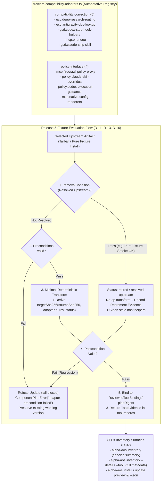

# Phase 41: Minimal Compatibility Adapters - Research

**Researched:** 2026-11-08
**Domain:** 호환성 어댑터 권위 레지스트리(`compatibility-adapters.ts`), 업스트림 파일/본문 치환 최소화(ECC 스킬 최소 구조적 보정 및 `alpha-aos-research-routing` 전역 배포), GSD Codex Stop 훅 상대 참조 그래프 분석 및 순수 업스트림 픽스처 무보정 스모크 검증 기반 은퇴(`retired` / `resolved-upstream`), 로컬 기대 출력 해시 도출 및 `tool-records`/`inventory`/`install`/`update` 메타데이터 노출
**Confidence:** HIGH

<user_constraints>
## User Constraints (from CONTEXT.md)

### Locked Decisions

#### 어댑터 레지스트리 범위와 메타데이터 조회 방식

- **D-01:** 호환성 어댑터 레지스트리는 ① 업스트림 패키징·문서·인터페이스 한계를 보완하며 제거 조건(`removalCondition`)을 갖는 **한시적 호환성 보정 어댑터(`compatibility-correction`)**(`ecc:deep-research-routing`, `ecc:antigravity-doc-lookup`, `gsd:codex-stop-hook-helpers`, `mcp:pi-bridge`, `gsd:claude-ship-skill`)와, ② alpha-AOS 고유 보안·거버넌스 정책을 공식 설정 포맷으로 렌더링하는 **상시 정책 인터페이스(`policy-interface`)**(Firecrawl 4개 도구 허용 프록시, Claude `skillOverrides`, Codex `AGENTS.md` 마커, 하네스별 네이티브 MCP 설정 렌더러)를 명확히 구분해 등록한다.
- **D-02:** 사용자와 메인테이너는 별도 전용 명령 없이 기존 워크플로에서 어댑터 메타데이터를 조회한다. 기본 `alpha-aos inventory` 화면에서는 도구별 활성/은퇴 어댑터 요약만 간결히 표시하고, `alpha-aos inventory --detail`(또는 `--tool <id>`)과 `alpha-aos install`/`update` 프리뷰(및 `--json` 출력)에서 이유(`rationale`), 적용 대상·조건(`applicability`), 검증 방법(`verificationMethod`), 제거 조건(`removalCondition`), 어댑터 리비전(`revision`), 은퇴 사유 및 검증 증거 전체를 노출한다.
- **D-03:** 어댑터의 정적 메타데이터(ID, 리비전, 대상 도구·하네스·플랫폼, 이유, 적용·검증·제거 조건, 은퇴 기록)와 실제 사전조건 검사·변환·검증 실행 함수는 단일 권위 레지스트리 모듈(`src/core/compatibility-adapters.ts`)에 함께 묶어 선언하며, 레지스트리 밖의 설명 없는 암묵적 파일/문자열 변환을 금지하는 계약 테스트로 검증한다.
- **D-04:** Pi의 `pi-mcp-adapter` 브리지(`mcp:pi-bridge`)는 제거 조건이 명시된 호환성 보정 어댑터로 등록하되, 설치된 Pi 버전에서 내장 MCP 설정만으로 기존 브리지 정책(`lazy` lifecycle, `toolPrefix: "server"`, `outputGuard: true`, `hostConfigDiscovery: "off"`)과 실제 읽기 전용 호출이 검증되기 전까지는 `active` 상태를 유지하여 도구 가용성이 깨지지 않게 한다.

#### ECC 스킬 본문 치환 축소와 별도 가이드 전환 기준

- **D-05:** 카나리아 런타임에만 배포되던 `skills/alpha-aos-research-routing/SKILL.md`를 지원 하네스 전역 `ownedSkills`(`catalog/stack.yaml`)로 정식 배포한다. 하네스별로 별도 가이드의 발견·우선순위 및 의도된 도구 경로(`web_search_exa` → `firecrawl_scrape`) 호출이 증명된 대상에서는 `deep-research` 본문 치환을 제거(또는 업스트림 본문 보존 + 최소 라우팅 헤더로 축소)하고, 미증명 하네스에서는 명시적 어댑터를 유지한다.
- **D-06:** Antigravity 전용 `documentation-lookup` 보정(`ecc:antigravity-doc-lookup`)은 명시적 호환성 어댑터로 격리하여 업스트림 본문 변형을 최소화하되, 별도 가이드 분리 시 Antigravity(GUI/IDE)에서의 발견·우선순위와 Context7 실제 호출(네이티브 웹 검색 대체 방지) 증거가 확보되기 전까지는 보정을 유지한다.
- **D-07:** 별도 alpha-AOS 가이드가 업스트림 본문 치환을 대체할 수 있다고 판정하려면 하네스별로 ① 네이티브 가이드 발견(`discovery`), ② 업스트림 원문과 공존 시 충돌·차단 도구(`firecrawl_search` 등) 대신 alpha-AOS 라우팅 규칙이 우선 적용됨(`precedence`), ③ 의도된 도구 경로의 실제 호출 관찰(`invocation receipt`)이라는 3단계 실증 기준이 모두 충족되어야 한다. 단순 파일 존재나 모델의 텍스트 언급만으로는 전환 완료로 인정하지 않는다.
- **D-08:** 별도 가이드 전환이 아직 증명되지 않아 유지되는 ECC 호환성 어댑터(`ecc:deep-research-routing`, `ecc:antigravity-doc-lookup`)는 기존처럼 본문 내 4개 섹션과 6개 마크다운 헤딩 문자열에 강하게 결합된 전체 정규식 치환을 지양하고, 필수 프론트매터·라우팅 경계 사전조건만 검증한 뒤 상단(또는 MCP 요구사항 경계)에 명시적 alpha-AOS 라우팅 계약 블록 주입 + 차단된 도구 식별자(`firecrawl_search` 등) 중립화만 수행하는 최소 범위 구조적 어댑터로 축소한다.

#### GSD Codex 훅 보정의 동작 판별과 은퇴 절차

- **D-09:** `src/core/gsd-compat.ts`의 Codex Stop 훅 보정(`gsd:codex-stop-hook-helpers`)은 단일 고정 문자열(`require('./lib/hook-exit.js')`) 포함 여부 검사에서 벗어나, `gsd-context-monitor.js`의 로컬 `./lib/*` 모듈 참조 구조와 실제 `hooks/lib/*` 파일 존재 여부를 구조적으로 점검하고, alpha-AOS 보정 전 순수 업스트림 설치 상태 그대로 `smokeTestCodexGsdStopHook`을 실행해 정상 통과하면 '업스트림 해결(`resolved-upstream`)'로 판정한다.
- **D-10:** 복사할 GSD 훅 헬퍼 집합은 고정된 3개 파일명 배열에만 의존하지 않고, 모니터 엔트리포인트에서 시작하는 `hooks/lib/` 내부 상대 참조 체인을 검증된 업스트림 패키지 안에서 확인해 필요한 헬퍼만 복사 계획에 바인딩한다. `hooks/lib/` 경계를 벗어나거나 검증된 패키지에 존재하지 않는 참조가 있으면 임의 추측 없이 어댑터 사전조건 불일치(`precondition-failed`)로 거부한다.
- **D-11:** 사용자 호스트의 `~/.codex/hooks/lib/`에 이전 버전 설치 때 alpha-AOS가 복사해 둔 잔여 파일이 남아 있어 미해결 업스트림이 '해결됨'으로 오판되는 것을 막기 위해, 깨끗한 격리 픽스처(`runGsdFixture`)의 순수 업스트림 설치 결과에서 먼저 무보정 스모크 검증과 파일 존재 검사를 수행하여 업스트림 자체 해결 여부를 판정한다. 해결이 증명된 릴리스에서만 어댑터를 은퇴(`retired` / `resolved-upstream`) 처리하며, 호스트의 불필요해진 alpha-AOS 소유 잔여 헬퍼만 안전하게 정리한다.
- **D-12:** Codex Stop 훅 외에 Claude 대상 `alpha-aos-ship` 소유 스킬의 `gsd-core/workflows/ship.md` 경로 의존성 및 Claude 네이티브 커맨드 노출 여부(`gsd:claude-ship-skill`)도 어댑터/소유 스킬 사전조건과 제거 조건에 명시하여, 업스트림 GSD가 네이티브 노출을 해결하면 은퇴하고 워크플로 경로가 바뀌면 사전조건 불일치로 명확히 안내한다.

#### 어댑터 사전조건 불일치 처리와 리비전·은퇴 기록

- **D-13:** 선택된 업스트림 아티팩트에서 호환성 어댑터의 적용 패턴이 더 이상 일치하지 않을 때는 먼저 해당 어댑터의 '제거 조건(업스트림 자체 해결 검증)'이 충족되었는지 검사한다. 검증을 통과하면 정상 은퇴(`retired` / `resolved-upstream`)로 기록·진행하고, 제거 조건을 통과하지 못했는데 사전조건이 깨진 경우에는 어댑터 ID·이유·실패한 사전조건을 명시하여 업데이트를 fail-closed로 거부(기존 정상 버전 유지)한다. 런타임 AI 재작성이나 검증되지 않은 깨진 원문 통과(`fail-open`)는 금지한다.
- **D-14:** 업스트림 릴리스마다 패키지 체크아웃에 새 기대 해시(`targetSha256`)를 배포하지 않으면서도 재현성과 변조 방지를 유지하기 위해, 검증된 업스트림 원본 해시(`sourceSha256`)와 결정론적 어댑터 리비전(`adapterId` + `revision` + 적용/은퇴 상태)으로부터 기대 출력 해시를 로컬 도출하여 프리뷰-적용 계획 다이제스트(`reviewedDigest`)에 바인딩하고, `userStateRoot()/tool-records`의 `ToolEvidence`에 적용·은퇴된 어댑터 리비전과 검증 결과를 함께 기록한다.
- **D-15:** 업스트림에서 해결되어 은퇴한 호환성 어댑터는 레지스트리(`src/core/compatibility-adapters.ts`)에서 단순 삭제하지 않고 `status: "retired"`(또는 선택된 릴리스 기준 `resolved-upstream`)와 은퇴 사유(`retirementReason`), 검증된 릴리스 버전(`verifiedRelease`), 검증 방법 및 증거 요약을 보존한다. 실제 파일 변환은 수행하지 않되(no-op), 로컬 `tool-records`와 `inventory --detail`에서 은퇴 사유와 실제 검증 증거를 계속 조회할 수 있게 한다.
- **D-16:** 추측성 버전 임계값(`version >= X.Y.Z`)만으로 필요한 보정을 생략하는 것을 금지하며, 반드시 선택된 릴리스 아티팩트에 대한 실제 구조·동작 검증 증거로만 은퇴를 판정한다. 이미 은퇴한 어댑터라도 후속 릴리스 업데이트 시 사후 검증 조건(postcondition)을 계속 확인하여 업스트림 회귀(regression) 발생 시 즉시 감지·거부한다.

### the agent's Discretion

사용자가 별도로 판단을 위임한 항목은 없다. `src/core/compatibility-adapters.ts`의 세부 인터페이스 타입명, 어댑터 리비전 식별자 문자열 규칙(예: `v1` 또는 정규화 해시), `ToolEvidence` 내 어댑터 증거 `proofId`/`method` 명명 규칙, CLI 테이블의 정확한 열 너비와 정렬은 위 16개 결정과 기존 런타임 안전 계약을 만족하는 범위에서 연구·계획 단계에서 정한다.

### Deferred Ideas (OUT OF SCOPE)

None — discussion stayed within phase scope. 미기록 버전의 실제 프로토콜·스키마·읽기 전용 호출 통합 검증 및 네이티브 설치기 사후 복구(Phase 42), 기존 stable-lock/Cua-pin 설치의 전면 이관 및 하위 소비자·이중 언어 문서 전환(Phase 43)은 승인된 로드맵 단계에 그대로 유지한다.
</user_constraints>

<phase_requirements>
## Phase Requirements

| ID | Description | Research Support |
|----|-------------|------------------|
| **ADAPT-01** | Users and maintainers can inspect each compatibility correction's rationale, applicability, verification method and removal condition. | `src/core/compatibility-adapters.ts`에 `compatibility-correction`(5개)과 `policy-interface`(4개)를 분리 등록하고, `ToolObservation`(`src/core/tool-inventory.ts`)과 `ToolReleasePreviewItem`(`src/types.ts`)에 어댑터 요약을 연결해 기본 `alpha-aos inventory`에서는 간결한 활성/은퇴 요약을, `inventory --detail`/`--tool` 및 `install`/`update` 프리뷰(텍스트·`--json`)에서는 `rationale`, `applicability`, `verificationMethod`, `removalCondition`, `revision`, 은퇴 증거 전체를 노출함 (D-01, D-02, D-03). |
| **ADAPT-02** | Tool integration minimizes upstream file/content transformations and prefers official settings and public interfaces; necessary translation remains explicit adapter code. | `src/core/ecc-fixture.ts`의 `renderEccSkill`에서 4개 마크다운 섹션·6개 헤딩 정규식 통째 치환을 제거하고, 프론트매터(`name`, `description`) 사전조건 검증 + 상단(또는 MCP 경계) 최소 라우팅 계약 블록 주입 + 차단 도구 식별자(`firecrawl_search`, `web_search_advanced_exa`, `crawling_exa`) 중립화만 수행하는 최소 구조적 어댑터로 축소. `src/core/gsd-compat.ts`는 고정 문자열 및 고정 3개 배열 대신 `gsd-context-monitor.js`의 상대 `./lib/*` 참조 그래프 순회로 전환 (D-03, D-08, D-09, D-10). |
| **ADAPT-03** | When separate alpha-AOS guidance replaces an upstream transformation, the supported harness can actually discover that guidance and invoke the intended tool route, with evidence of effective behavior. | `skills/alpha-aos-research-routing/SKILL.md`를 `catalog/stack.yaml` 및 `catalog/stack.lock.json`의 전역 `ownedSkills`(`targets: [claude, codex, antigravity, pi, hermes]`, `invocation: automatic`)로 승격 배포. 하네스별로 `discovery` + `precedence` + `invocation receipt` 3단계 실증 게이트를 정의하며, 3단계가 모두 실증되지 않은 하네스에서는 최소 구조적 어댑터(`ecc:deep-research-routing`, `ecc:antigravity-doc-lookup`)를 유지해 기능 저하 및 우발적 차단 도구 호출을 방지함 (D-05, D-06, D-07). |
| **ADAPT-04** | A compatibility correction resolved upstream is removed after the selected release's behavior is verified, with the retirement reason and evidence retained. | `src/core/gsd-fixture.ts`의 `runGsdFixture`에서 보정 적용 전 순수 업스트림 설치본에 대해 구조적 파일 존재 검사와 `smokeTestCodexGsdStopHook`을 먼저 실행해 자체 해결 시 `resolved-upstream`/`retired`로 전환하고 호스트 잔여 헬퍼를 정리함. 모든 호환성 어댑터는 패턴 불일치 시 `removalCondition`을 먼저 평가해 통과하면 은퇴 기록(`retirementReason`, `verifiedRelease`, `evidence`)을 남기고, 미통과 시 `precondition-failed`로 fail-closed 거부하며, 은퇴 후에도 사후 조건(postcondition)을 계속 검사해 회귀를 차단함 (D-11, D-13, D-14, D-15, D-16). |
</phase_requirements>

---

## Summary

Phase 41의 핵심 목표는 일상적인 업스트림 도구(`ecc`, `gsd`, `mcp:*`, `bridge:pi`, `cua-driver`) 릴리스 업데이트 시 alpha-AOS 코드 수정을 최소화하기 위해, 기존의 암묵적·광범위한 본문 정규식 치환과 단일 고정 문자열 검사를 **공식 설정 인터페이스 + 최소 구조적 호환성 어댑터(`src/core/compatibility-adapters.ts`) + 검증된 별도 가이드(`ownedSkills`)** 구조로 전환하는 것이다.

현재 코드베이스 조사 결과, 업스트림 버전 변경에 가장 취약한 지점은 두 곳이다. 첫째, `src/core/ecc-fixture.ts`의 `renderEccSkill`은 `deep-research`의 4개 마크다운 섹션(`## MCP Requirements` ~ `## Quality Rules` 경계 6개 헤딩)을 정규식으로 통째 치환하고 있어 업스트림이 마크다운 소제목 한 글자만 수정해도 업데이트가 실패한다 `[VERIFIED: src/core/ecc-fixture.ts:86-128]`. 둘째, `src/core/gsd-compat.ts`의 `planCodexGsdHookCompatibility`는 `require('./lib/hook-exit.js')` 단일 문자열과 하드코딩된 3개 파일 배열(`["hook-exit.js", "cli-exit.js", "exit-code-registry.js"]`)에 의존하며, `src/core/gsd-fixture.ts`의 `runGsdFixture`는 순수 업스트림 상태를 먼저 시험하지 않고 무조건 헬퍼를 복사한 뒤에야 `smokeTestCodexGsdStopHook`을 호출한다 `[VERIFIED: src/core/gsd-compat.ts:28-92]`, `[VERIFIED: src/core/gsd-fixture.ts:256-271]`.

이를 해결하기 위해 본 단계에서는 (1) 한시적 보정(`compatibility-correction` 5종)과 상시 보안/거버넌스 정책(`policy-interface` 4종)을 구분하는 단일 권위 레지스트리 `src/core/compatibility-adapters.ts`를 신설하고, (2) `skills/alpha-aos-research-routing/SKILL.md`를 5개 하네스 전역 `ownedSkills`로 정식 배포하면서 3단계 실증(`discovery`·`precedence`·`invocation`) 기준과 최소 구조적 어댑터 축소를 결합하며, (3) GSD Codex Stop 훅은 상대 참조 그래프 분석 및 순수 픽스처 선행 스모크 검증으로 업스트림 자체 해결(`resolved-upstream`)을 판별·은퇴시키고, (4) 원본 해시(`sourceSha256`)와 어댑터 리비전으로부터 로컬 기대 출력 해시(`targetSha256`)를 결정론적으로 도출해 `ReviewedToolBinding`과 `tool-records`에 바인딩하며 `inventory`/`install`/`update`에서 모든 메타데이터와 은퇴 증거를 조회할 수 있게 설계한다.

**Primary recommendation:** 모든 파일/본문 변환과 훅/스킬 보정 로직을 `src/core/compatibility-adapters.ts`의 선언적 어댑터 계약(`precondition` → `removalCondition` → `transform` → `postcondition`)을 통해서만 실행하도록 일원화하고, 레지스트리 외부의 비등록 변환을 계약 테스트로 차단하라.

---

## Architectural Responsibility Map

| Capability / Concern | Primary Tier (Module) | Secondary Tier (Consumers) | Responsibility & Boundary |
|---|---|---|---|
| **권위 호환성 어댑터 레지스트리 및 실행기** | `src/core/compatibility-adapters.ts` (신규) | `ecc-fixture.ts`, `gsd-compat.ts`, `owned-skills.ts`, `mcp.ts`, `update.ts`, `tool-inventory.ts` | `compatibility-correction` 5종 및 `policy-interface` 4종의 정적 메타데이터(`rationale`, `applicability`, `verificationMethod`, `removalCondition`, `revision`, `retirement`)와 사전조건·제거조건·변환·사후검증 실행 함수 및 로컬 출력 해시 도출(`deriveAdaptedTargetHash`) 제공 (D-01, D-03, D-13~D-16). |
| **ECC 스킬 최소 구조적 보정 및 별도 가이드 승격** | `src/core/ecc-fixture.ts`, `catalog/stack.yaml`, `catalog/stack.lock.json` | `src/core/ecc-skills.ts`, `src/core/owned-skills.ts`, `src/core/update.ts` | `alpha-aos-research-routing`을 5개 하네스 전역 `ownedSkills`로 배포하고, 하네스별 3단계 실증 여부에 따라 `renderEccSkill`을 최소 구조적 어댑터(프론트매터 검증 + 상단 라우팅 계약 블록 주입 + 차단 도구 식별자 중립화)로 실행 (D-05~D-08). |
| **GSD Codex Stop 훅 구조적 참조 분석 및 순수 픽스처 은퇴 판정** | `src/core/gsd-compat.ts`, `src/core/gsd-fixture.ts` | `src/core/install.ts`, `src/core/update.ts` | `gsd-context-monitor.js`에서 시작하는 `hooks/lib/` 내부 상대 참조 그래프를 순회해 헬퍼 클로저를 도출하고, `runGsdFixture`에서 보정 전 순수 업스트림 설치본에 `smokeTestCodexGsdStopHook`을 먼저 실행하여 `resolved-upstream` 은퇴 및 호스트 잔여 헬퍼 정리 수행 (D-09~D-12). |
| **로컬 기대 해시 도출 및 `tool-records` 어댑터 증거 기록** | `src/core/update.ts`, `src/core/tool-records.ts` | `schemas/tool-release-record.schema.json`, `src/core/tool-handoff.ts` | `synthesizeReleaseStackLock` 및 `createLocalReleasePlan`에서 `sourceSha256` + 어댑터 리비전으로 `targetSha256`을 도출해 `ReviewedToolBinding` 및 `planDigest`에 바인딩하고, `--apply` 시 `ToolEvidence` 및 `legacy.transformed` 호환 구조에 어댑터 리비전·은퇴 증거를 기록 (D-14, D-15). |
| **CLI 및 인벤토리/프리뷰 어댑터 메타데이터 노출** | `src/core/tool-inventory.ts`, `src/format.ts`, `src/cli.ts` | `src/types.ts` | 기본 `alpha-aos inventory`에 도구별 활성/은퇴 어댑터 요약 표시, `inventory --detail`/`--tool <id>` 및 `install`/`update` 프리뷰(텍스트·`--json`)에 전체 어댑터 메타데이터와 은퇴 증거 노출 (D-02). |

---

## Standard Stack

### Core Runtime & Language
| Library / Module | Version | Purpose | Why Standard |
|---|---|---|---|
| `node` (built-in `node:crypto`, `node:fs/promises`, `node:path`, `node:test`) | `>=24.0.0` (`@types/node` `24.7.2`) | SHA-256/SHA-512 해시 도출, 파일 시스템 트랜잭션, 상대 경로 경계 검증, 테스트 실행 | `package.json`의 `engines.node`가 `">=24.0.0"`으로 고정되어 있으며 외부 의존성 추가 없이 결정론적 해시와 AST/정규식 분석 가능 `[VERIFIED: package.json:48-64]` (`"node": ">=24.0.0"`, `"@types/node": "24.7.2"`). |
| `typescript` | `5.9.3` | 정적 타입 검증 및 빌드(`npm run check`, `npm run build`) | 저장소 표준 컴파일러 `[VERIFIED: package.json:63]` (`"typescript": "5.9.3"`). |
| `ajv` / `ajv-formats` | `8.20.0` / `3.0.1` | `schemas/stack.schema.json` 및 `schemas/tool-release-record.schema.json` 닫힌 스키마(closed-world schema) 검증 | 모든 카탈로그·락·로컬 도구 기록 문서가 `validateManagedDocument`를 통해 검증됨 `[VERIFIED: package.json:54-55]` (`"ajv": "8.20.0"`, `"ajv-formats": "3.0.1"`). |
| `yaml` / `jsonc-parser` / `smol-toml` | `2.9.0` / `3.3.1` / `1.9.1` | `catalog/stack.yaml` 파싱 및 하네스별 공식 MCP/설정 파일(JSON/TOML/YAML) 렌더링 | `policy-interface` 어댑터들이 각 하네스의 공식 설정 포맷을 안전하게 병합·렌더링하는 데 이미 사용 중 `[VERIFIED: package.json:57-59]` (`"jsonc-parser": "3.3.1"`, `"smol-toml": "1.9.1"`, `"yaml": "2.9.0"`). |

### Alternatives Considered
| Instead of | Could Use | Tradeoff |
|---|---|---|
| 내장 정규식/토큰 스캐너 기반 상대 `require`/`import` 추출 (`gsd-compat.ts`) | 외부 JS 파서 패키지(`acorn`, `esprima` 등) 신규 추가 | `package.json` 의존성과 `audit-tarball.mjs` 번들 범위를 불필요하게 넓힘. GSD 훅 스크립트의 CommonJS `require('./lib/...')` 및 ESM `import ... from './lib/...'` 리터럴 추출은 주석 제거 + 정적 문자열 리터럴 매칭 + 비리터럴 동적 `require(` 감지(`precondition-failed` 거부)만으로 완벽하고 결정론적으로 처리 가능함. |
| 정적 어댑터 계약 (`compatibility-adapters.ts`) | 런타임 LLM/AI를 통한 업스트림 마크다운/훅 자동 재작성 | `41-CONTEXT.md` 및 `REQUIREMENTS.md`에서 명시적으로 배제됨(비결정론적 해시, 프롬프트 인젝션 및 보안 경계 우회 위험) `[VERIFIED: .planning/REQUIREMENTS.md:46-60]` (`"Runtime AI rewriting is excluded."`, `"Runtime AI self-patching | Compatibility changes remain reviewed alpha-AOS adapter/code changes"`). |

---

## Architecture Patterns

### System Architecture & Data Flow Diagram



### Pattern 1: 단일 권위 호환성 어댑터 레지스트리 (`src/core/compatibility-adapters.ts`) (D-01, D-03, D-04, D-12, D-15)

모든 호환성 보정과 정책 인터페이스는 `src/core/compatibility-adapters.ts`에 등록되며, 두 가지 분류(`kind`)를 명확히 구분한다.

1. **`compatibility-correction` (한시적 호환성 보정 어댑터 — 5종, `removalCondition` 필수):**
   - `ecc:deep-research-routing`
     - **대상:** `toolId: "ecc"`, `harnesses: ["claude", "codex", "antigravity", "pi", "hermes"]`, `platforms: ["windows", "macos", "linux"]`
     - **이유 (`rationale`):** 업스트림 `ecc-universal`의 `deep-research/SKILL.md`가 핀 고정된 MCP 서버들이 노출하지 않는 도구명(`web_search_advanced_exa`, `crawling_exa`)과 alpha-AOS 정책 프록시가 거부하는 도구명(`firecrawl_search`)을 호출하도록 안내함 `[VERIFIED: src/core/mcp-proxy.ts:100-141]` (`"tools: [...firecrawlTools, \"firecrawl_search\", \"firecrawl_extract\"]"`, `"ECC_RESEARCH_ROUTING_CONTRACT_MISMATCH"`).
     - **적용 조건 (`applicability`):** 업스트림 `deep-research/SKILL.md`가 비공개/차단 도구 식별자를 포함하고 있으며, 대상 하네스에서 별도 `alpha-aos-research-routing` 가이드의 3단계 실증(`discovery`, `precedence`, `invocation`)으로 완전 대체되지 않은 경우.
     - **검증 방법 (`verificationMethod`):** 렌더링된 스킬 문서에 `web_search_exa` 및 `firecrawl_scrape` 라우팅 계약 블록이 존재하고, 차단/미존재 실행 예시(`firecrawl_search(`, `web_search_advanced_exa(`, `crawling_exa(`)가 활성 호출 지시로 남아 있지 않음을 구조적으로 검증.
     - **제거 조건 (`removalCondition`):** (a) 선택된 업스트림 `ecc-universal` 릴리스의 `deep-research/SKILL.md` 원문이 미존재·차단 도구명을 제거하고 실제 공개된 `web_search_exa` / `firecrawl_scrape` 계약과 일치하거나, (b) 대상 하네스에서 별도 `alpha-aos-research-routing` 소유 스킬만으로 `discovery` + `precedence` + `invocation receipt` 3단계 증거가 모두 확보된 경우 (D-05, D-07).
   - `ecc:antigravity-doc-lookup`
     - **대상:** `toolId: "ecc"`, `harnesses: ["antigravity"]`, `platforms: ["windows", "macos", "linux"]`
     - **이유 (`rationale`):** Antigravity GUI(`context7/resolve-library-id`, `context7/query-docs`)와 IDE(`call_mcp_tool` 게이트웨이)의 표면별 Context7 MCP 호출 방식 차이로 인해, 명시적 표면 라우팅 안내가 없으면 모델이 JSON 도구 디스크립터만 읽거나 네이티브 웹 검색으로 대체함 `[VERIFIED: src/core/ecc-fixture.ts:87-96]` (`"if (skill === \"documentation-lookup\" && harness === \"antigravity\")"`).
     - **적용 조건 (`applicability`):** `harness === "antigravity"`에서 `documentation-lookup/SKILL.md`를 동기화할 때, 업스트림 원문에 Antigravity GUI/IDE 표면별 Context7 호출 규칙 및 네이티브 웹 검색 대체 금지 규칙이 없는 경우.
     - **검증 방법 (`verificationMethod`):** 프론트매터 `description`과 본문에 Antigravity GUI(`context7/resolve-library-id`, `context7/query-docs`) 및 IDE(`call_mcp_tool`) 라우팅 계약 블록이 포함되었는지 확인.
     - **제거 조건 (`removalCondition`):** 업스트림 `documentation-lookup/SKILL.md`가 Antigravity 표면별 Context7 라우팅을 네이티브 지원하거나, 별도 alpha-AOS 소유 가이드 분리 후 Antigravity GUI/IDE에서 `discovery` + `precedence` + Context7 실제 호출(`invocation receipt`, 웹 검색 대체 없음)이 실증된 경우 (D-06, D-07).
   - `gsd:codex-stop-hook-helpers`
     - **대상:** `toolId: "gsd"`, `harnesses: ["codex"]`, `platforms: ["windows", "macos", "linux"]`
     - **이유 (`rationale`):** 업스트림 `@opengsd/gsd-core`의 `--codex --global` 설치기가 `~/.codex/hooks/gsd-context-monitor.js`를 설치하면서 상대 경로로 참조하는 `./lib/*` 헬퍼 모듈들을 `~/.codex/hooks/lib/`에 복사하지 않아 Codex Stop 훅 실행 시 모듈 로드 오류가 발생할 수 있음 `[VERIFIED: src/core/gsd-compat.ts:28-41]`, `[VERIFIED: src/core/gsd-compat.ts:78-92]`.
     - **적용 조건 (`applicability`):** 깨끗한 격리 픽스처(`runGsdFixture`)의 순수 업스트림 Codex 설치본에서 `hooks/gsd-context-monitor.js`가 `./lib/*` 로컬 모듈을 참조하지만 해당 파일이 `hooks/lib/`에 누락되어 무보정 `smokeTestCodexGsdStopHook`이 실패하는 경우 (D-09, D-10, D-11).
     - **검증 방법 (`verificationMethod`):** 모니터 엔트리포인트에서 시작하는 상대 참조 클로저가 모두 `hooks/lib/` 내에 존재하고 `smokeTestCodexGsdStopHook`이 종료 코드 0 및 빈 stdout/stderr로 통과하는지 확인 `[VERIFIED: src/core/gsd-compat.ts:78-92]`.
     - **제거 조건 (`removalCondition`):** 선택된 `@opengsd/gsd-core` 릴리스의 순수 격리 픽스처 설치본(`runGsdFixture`)이 alpha-AOS의 헬퍼 복사 없이 스스로 필요한 `hooks/lib/*` 파일들을 설치(또는 외부 헬퍼 불필요화)하여 무보정 `smokeTestCodexGsdStopHook`을 통과하는 경우 `resolved-upstream`으로 즉시 은퇴 처리 및 호스트 잔여 헬퍼 정리 (D-09, D-11).
   - `mcp:pi-bridge`
     - **대상:** `toolId: "bridge:pi"`, `harnesses: ["pi"]`, `platforms: ["windows", "macos", "linux"]`
     - **이유 (`rationale`):** Pi 하네스에서 관리형 MCP 서버(`context7`, `exa`, `firecrawl`)를 `lazy` 수명주기, 서버 접두사(`toolPrefix: "server"`), 출력 가드(`outputGuard: true`), 호스트 설정 탐색 차단(`hostConfigDiscovery: "off"`) 정책으로 연결하기 위해 `pi-mcp-adapter` 확장 브리지 패키지와 `~/.pi/agent/mcp.json` 구성을 사용함 `[VERIFIED: src/core/mcp.ts:224-260]` (`"lifecycle: \"lazy\""`, `"directTools: false"`, `"hostConfigDiscovery: \"off\""`).
     - **적용 조건 (`applicability`):** `pi` 하네스가 대상에 포함되고, 설치된 Pi 버전에서 브리지 없이 내장 MCP만으로 동일 정책과 실제 읽기 전용 호출이 증명되지 않은 경우 (`status: "active"` 유지) (D-04).
     - **검증 방법 (`verificationMethod`):** `planMcpSync("pi", lock)` 및 `runMcpFixture({ server: "context7", harness: "pi", ... })`에서 `~/.pi/agent/mcp.json` 설정 무결성과 `pi-mcp-adapter` 패키지 버전 설치 여부 확인 `[VERIFIED: src/core/install.ts:553-566]`.
     - **제거 조건 (`removalCondition`):** 설치된 Pi 버전에서 내장 MCP 설정만으로 `lazy` lifecycle, `toolPrefix: "server"`, `outputGuard: true`, `hostConfigDiscovery: "off"` 정책 동등성과 실제 읽기 전용 MCP 도구 호출이 검증된 경우 (D-04).
   - `gsd:claude-ship-skill`
     - **대상:** `toolId: "gsd"`, `harnesses: ["claude"]`, `platforms: ["windows", "macos", "linux"]`
     - **이유 (`rationale`):** 업스트림 GSD의 Claude 설치에서 `ship` 워크플로(`gsd-core/workflows/ship.md`)는 존재하지만 Claude 네이티브 슬래시 스킬로 직접 노출되지 않는 격차를 메우기 위해 alpha-AOS 소유 스킬 `alpha-aos-ship`이 `~/.claude/gsd-core/workflows/ship.md`를 참조하여 노출함 `[VERIFIED: catalog/stack.yaml:54-61]` (`"id: alpha-aos-ship"`, `"workflow: gsd-core/workflows/ship.md"`), `[VERIFIED: src/core/owned-skills.ts:110-123]`.
     - **적용 조건 (`applicability`):** `claude` 하네스에서 업스트림 GSD가 `gsd-core/workflows/ship.md`를 포함하고 있으나 네이티브 `gsd-ship` 스킬을 직접 생성하지 않는 경우 (D-12).
     - **검증 방법 (`verificationMethod`):** `planOwnedSkillSync`에서 `workflowFound`(`~/.claude/gsd-core/workflows/ship.md` 존재) 사전조건과 렌더링된 `alpha-aos-ship/SKILL.md`의 SHA-256 해시 일치 확인 `[VERIFIED: src/core/owned-skills.ts:110-123]`, `[VERIFIED: src/core/owned-skills.ts:238-240]`.
     - **제거 조건 (`removalCondition`):** 선택된 업스트림 `@opengsd/gsd-core`의 Claude 설치본이 네이티브 `gsd-ship` 스킬(`.claude/skills/gsd-ship/SKILL.md` 또는 동등한 공식 커맨드)을 자체 설치하는 것이 픽스처에서 검증된 경우 (D-12).

2. **`policy-interface` (상시 정책 인터페이스 — 4종, 제거 대상이 아닌 영구 거버넌스/보안 경계):** (D-01)
   - `mcp:firecrawl-policy-proxy` (`src/core/mcp.ts:193-198`, `src/core/mcp-proxy.ts:100-108`): Firecrawl MCP 서버 앞단에서 허용된 4개 도구(`firecrawl_scrape`, `firecrawl_map`, `firecrawl_crawl`, `firecrawl_check_crawl_status`)만 통과시키고 `firecrawl_search` 등 비허용 도구를 차단하는 상시 보안 프록시 `[VERIFIED: src/core/mcp.ts:193-198]`.
   - `policy:claude-skill-overrides` (`src/core/skill-policy.ts:18-57`): Claude `settings.json`의 공식 `skillOverrides` 인터페이스를 사용해 `["unified-memory", "documentation-lookup", "deep-research"]`를 `"user-invocable-only"`로 설정 `[VERIFIED: src/core/skill-policy.ts:18-57]`.
   - `policy:codex-execution-guidance` (`src/core/codex-policy.ts:11-60`): Codex `~/.codex/AGENTS.md`의 `<!-- alpha-AOS:codex-execution:start -->` ~ `<!-- alpha-AOS:codex-execution:end -->` 마커 블록을 통해 실행 정책을 동기화 `[VERIFIED: src/core/codex-policy.ts:11-60]`.
   - `mcp:native-config-renderers` (`src/core/mcp.ts:243-260`): 5개 하네스(`claude`, `codex`, `antigravity`, `pi`, `hermes`)의 공식 MCP 설정 파일에 시크릿 값 없이 환경변수 참조(`${NAME}`)와 표준 실행 인자를 렌더링 `[VERIFIED: src/core/mcp.ts:213-260]`.

---

### Pattern 2: ECC 스킬 본문 치환 축소 및 `alpha-aos-research-routing` 전역 배포 (D-05, D-06, D-07, D-08)

#### 1) `skills/alpha-aos-research-routing/SKILL.md`의 전역 `ownedSkills` 승격 (D-05)
현재 `skills/alpha-aos-research-routing/SKILL.md`는 이미 저장소에 존재하지만, `src/core/mcp-proxy.ts:144-147`의 `RESEARCH_ROUTING_INSTRUCTION_SOURCE`를 통해 카나리아 런타임에만 복사되고 `catalog/stack.yaml`의 `ownedSkills`에는 빠져 있다 `[VERIFIED: src/core/mcp-proxy.ts:144-147]`, `[VERIFIED: catalog/stack.yaml:49-74]`.
- `catalog/stack.yaml`의 `components.ownedSkills`에 다음 항목을 추가한다:
  ```yaml
    - id: alpha-aos-research-routing
      source: skills/alpha-aos-research-routing/SKILL.md
      targets: [claude, codex, antigravity, pi, hermes]
      invocation: automatic
  ```
- `catalog/stack.lock.json`의 `components.ownedSkills`에도 `alpha-aos-research-routing`의 `sourceSha256` 및 5개 하네스(`claude`, `codex`, `antigravity`, `pi`, `hermes`) `targetSha256`을 추가한다 `[VERIFIED: catalog/stack.lock.json:112-160]`. (`invocation: "automatic"`이고 `argumentHint`가 없으므로 `renderOwnedSkill` 결과는 5개 하네스 모두 `source`와 동일한 바이트 및 동일한 SHA-256 해시를 갖는다 `[VERIFIED: src/core/owned-skills.ts:60-69]`.)

#### 2) 하네스별 3단계 실증 게이트 (`discovery` + `precedence` + `invocation receipt`) (D-05, D-06, D-07)
- 별도 가이드(`alpha-aos-research-routing`)가 업스트림 `deep-research/SKILL.md` 본문 보정을 완전히 대체(무변환 원문 사용)하려면 해당 하네스에서 다음 3단계가 모두 증명되어야 한다 (D-07):
  1. **Discovery:** 하네스가 전역 스킬 루트에서 `alpha-aos-research-routing`을 네이티브로 발견함.
  2. **Precedence:** 무변환 `deep-research` 원문과 공존할 때, 원문의 `firecrawl_search` / `web_search_advanced_exa` / `crawling_exa` 예시 대신 `alpha-aos-research-routing`의 규칙이 우선 적용됨.
  3. **Invocation Receipt:** 실제 도구 호출 관찰에서 거부된 도구 호출 없이 `web_search_exa` → `firecrawl_scrape`(또는 `documentation-lookup`의 경우 Antigravity Context7 도구) 호출 영수증이 확인됨.
- **현재 프로젝트 증거 상태 확인:** `STATE.md:264`에서 확인되듯 `"CAPA-01 and CAPA-02 are NOT marked complete: the machinery is proven live but no model turn was spent, so native selection is unproven"` 상태이며 `[VERIFIED: .planning/STATE.md:264]`, Antigravity GUI/IDE에서의 별도 가이드 대체 증거 또한 아직 확보되지 않았다(D-06). 따라서 `src/core/compatibility-adapters.ts`는 하네스별 3단계 증거 충족 여부를 평가하는 함수(`isSeparateGuidanceProvenForHarness`)를 제공하고, 3단계 증거가 모두 기록된 하네스에서만 변환을 생략(`bypassed-by-proven-guidance`)하며, 미증명 하네스에서는 **최소 구조적 어댑터(D-08)**를 적용한다.

#### 3) 최소 구조적 어댑터 (`renderEccSkill` 리팩터링) (D-08)
기존 `src/core/ecc-fixture.ts:86-128`의 `renderEccSkill`은 4개 마크다운 섹션 전체와 6개 마크다운 헤딩 문자열(`## MCP Requirements`, `## Workflow`, `### Step 3: Execute Multi-Source Search`, `### Step 4: Deep-Read Key Sources`, `### Step 5: Synthesize and Write Report`, `## Parallel Research with Subagents`, `## Quality Rules`)에 결합되어 있었다 `[VERIFIED: src/core/ecc-fixture.ts:103-127]`.
이를 D-08에 따라 다음과 같이 **최소 범위 구조적 어댑터**로 축소한다:
- **`ecc:deep-research-routing` (revision `v2`):**
  - **Removal Condition 선행 검사 (D-13):** 업스트림 `deep-research/SKILL.md` 원문이 더 이상 비공개/차단 도구 식별자(`firecrawl_search`, `web_search_advanced_exa`, `crawling_exa`)를 포함하지 않고 `web_search_exa`와 `firecrawl_scrape`를 올바르게 안내하면 `resolved-upstream`(`retired`)으로 판정하여 원문 그대로 반환.
  - **Precondition 검사 (D-08, D-13):**
    1. 유효한 YAML 프론트매터(`---\n...name: deep-research...description:...---\n`)가 존재하는가?
    2. 본문에 마크다운 제목(`# ...`) 또는 라우팅 경계가 존재하는가?
    - 사전조건 불충족 시 `AdapterPreconditionError`(`adapterId: "ecc:deep-research-routing"`)로 fail-closed 거부.
  - **Minimal Structural Transform (D-08):**
    1. 업스트림의 4개 섹션 본문과 워크플로 설명을 통째로 삭제·교체하지 않고 보존한다.
    2. 프론트매터 직후(또는 첫 `# ` 제목 직후)에 단일 `<!-- alpha-aos-adapter:ecc:deep-research-routing:v2:start --> ... <!-- alpha-aos-adapter:ecc:deep-research-routing:v2:end -->` 라우팅 계약 블록(Exa `web_search_exa` 발견 → Firecrawl `firecrawl_scrape` 단건 본문 추출, 4개 허용 도구 외 호출 금지)을 주입한다.
    3. 본문 내 차단·미존재 도구 식별자 리터럴을 결정론적으로 중립화한다:
       - `firecrawl_search` → `web_search_exa` (또는 인자 구조가 다른 호출 예시는 `firecrawl_scrape` / 중립 표기로 치환)
       - `web_search_advanced_exa` → `web_search_exa`
       - `crawling_exa` → `firecrawl_scrape`
  - **Postcondition 검사 (D-16):** 렌더링된 결과에 `firecrawl_search`, `web_search_advanced_exa`, `crawling_exa` 토큰이 남아 있지 않고, `web_search_exa`와 `firecrawl_scrape`가 모두 포함되어 있는지 확인한다.
- **`ecc:antigravity-doc-lookup` (revision `v2`):**
  - **Removal Condition 선행 검사 (D-13):** 업스트림 `documentation-lookup/SKILL.md` 원문이 이미 `context7/resolve-library-id` 및 `call_mcp_tool` Antigravity 라우팅을 포함하면 `resolved-upstream`으로 원문 반환.
  - **Precondition 검사 (D-08, D-13):** YAML 프론트매터 내 `^description:.*$` 라인이 존재하는지만 확인(특정 `# Documentation Lookup (Context7)` 제목 문자열에 강하게 결합하지 않고, 프론트매터 종료 `---\n` 직후 또는 첫 H1 제목 직후를 구조적으로 탐지).
  - **Minimal Structural Transform:** 프론트매터 `description`에 Antigravity Context7 우선 규칙을 보강하고, 프론트매터 종료 직후(또는 첫 H1 직후)에 Antigravity GUI/IDE 라우팅 계약 블록을 주입하며 업스트림 본문 나머지는 100% 그대로 보존한다.

> [!IMPORTANT]
> **하위 호환성 주의 (`catalog/stack.lock.json` 및 테스트):**
> `catalog/stack.lock.json`에 고정된 현재 `ecc-universal@2.2.3`의 `targetSha256` 해시와 `src/core/ecc-fixture.ts`의 `renderEccSkill` 출력은 일치해야 `planEccSkillSync` / `test/ecc-skills.test.ts`가 통과한다 `[VERIFIED: catalog/stack.lock.json:64-86]`, `[VERIFIED: src/core/ecc-skills.ts:76-90]`. 따라서 `renderEccSkill`을 최소 구조적 어댑터(`v2`)로 전환할 때 `catalog/stack.lock.json`의 `components.ecc.targetSha256["deep-research"]` 및 `components.ecc.targetSha256["documentation-lookup"]["antigravity"]` 해시도 새 결정론적 어댑터(`v2`) 출력 해시로 함께 갱신하고, `catalog/stack.lock.json`의 `components.ownedSkills`에 `alpha-aos-research-routing` 해시를 추가해야 한다.

---

### Pattern 3: GSD Codex Stop 훅의 구조적 상대 참조 그래프 분석 및 순수 픽스처 은퇴 판정 (D-09, D-10, D-11, D-16)

#### 1) 고정 문자열·고정 배열 제거 및 상대 참조 클로저 순회 (`src/core/gsd-compat.ts`) (D-09, D-10)
현재 `src/core/gsd-compat.ts`는 `CODEX_HOOK_HELPERS = ["hook-exit.js", "cli-exit.js", "exit-code-registry.js"]` 상수와 `.includes("require('./lib/hook-exit.js')")` 문자열 검사에 의존한다 `[VERIFIED: src/core/gsd-compat.ts:28-92]`.
이를 다음과 같은 구조적 그래프 탐색 함수 `discoverCodexHookHelperClosure(monitorPath, hooksRoot, upstreamHooksLibRoot)`로 대체한다:
1. **모니터 엔트리포인트 검사:** `hooks/gsd-context-monitor.js`가 존재하지 않으면 `{ required: false, helpers: [], status: "not-applicable" }` 반환.
2. **모니터의 `./lib/*` 참조 추출:** `gsd-context-monitor.js` 소스에서 주석을 제거한 뒤 CommonJS `require(...)` 및 ESM `import ... from ...` / `import(...)` 중 `./lib/`로 시작하는 상대 모듈 지정자를 모두 추출한다.
   - 만약 `./lib/`와 관련된 동적 표현식(예: `require('./lib/' + name)`)이나 `hooks/lib/` 바깥으로 탈출하는 경로(예: `./lib/../../...`)가 발견되면 임의 추측 없이 `ComponentPlanError("adapter-precondition-failed", ...)`로 거부한다 (D-10).
3. **재귀적 헬퍼 클로저 탐색 (`hooks/lib/` 내부):**
   - 큐(Queue)를 사용해 모니터가 직접 참조한 `./lib/<file>`부터 시작하여, 검증된 업스트림 패키지(`upstreamHooksLibRoot`, 또는 이미 설치된 `hooks/lib/`) 안의 해당 파일 내용을 읽고 그 파일이 참조하는 `./<sibling>.js` 상대 모듈을 BFS로 재귀 탐색한다.
   - 예: `gsd-context-monitor.js` → `./lib/hook-exit.js` → `./cli-exit.js` → `./exit-code-registry.js` 순서로 정렬된 결정론적 헬퍼 파일 목록을 동적으로 도출한다.
   - 만약 참조된 파일이 검증된 업스트림 패키지의 `hooks/lib/` 안에 존재하지 않거나 `hooks/lib/` 경계를 벗어나면 `ComponentPlanError("adapter-precondition-failed", ...)`로 즉시 거부한다 (D-10, D-13).

#### 2) 순수 업스트림 격리 픽스처 선행 검증 및 호스트 잔여 파일 오염 방지 (`src/core/gsd-fixture.ts`) (D-09, D-11)
현재 `src/core/gsd-fixture.ts:257-271`은 Codex 픽스처에서 업스트림 설치 직후 무조건 `applyCodexGsdHookCompatibility`를 먼저 호출한 뒤 `smokeTestCodexGsdStopHook`을 실행한다 `[VERIFIED: src/core/gsd-fixture.ts:257-271]`.
이 순서 때문에 업스트림 GSD가 버그를 자체 수정했는지 판별할 수 없다. 또한 사용자 호스트의 `~/.codex/hooks/lib/`에는 이전 버전에서 alpha-AOS가 복사해 둔 헬퍼 파일들이 남아 있으므로 호스트 디렉터리만 보고 판정하면 미해결 업스트림을 '해결됨'으로 오판하게 된다 (D-11).

**올바른 순수 픽스처 선행 판별 흐름 (D-09, D-11):**
1. `runGsdFixture`가 격리된 임시 디렉터리(`spec.configRoot`)에 업스트림 GSD(`npx --yes @opengsd/gsd-core@<version> --codex --global ...`)를 설치한다 `[VERIFIED: src/core/gsd-fixture.ts:249-255]`.
2. **보정 적용 전(Pure Upstream State) 점검:**
   - `spec.configRoot`에서 `inspectPureUpstreamCodexStopHook(spec.configRoot)`를 실행한다:
     - `gsd-context-monitor.js`가 참조하는 모든 `./lib/*` 헬퍼가 순수 업스트림 설치본의 `spec.configRoot/hooks/lib/`에 이미 존재하는지 구조적으로 확인한다.
     - 이어서 보정 없이 곧바로 `smokeTestCodexGsdStopHook(spec.configRoot)`를 실행한다.
3. **판정 분기:**
   - **Case A (모든 참조 파일이 순수 업스트림 설치본에 존재하고 무보정 `smokeTestCodexGsdStopHook` 통과):**
     - `gsd:codex-stop-hook-helpers` 어댑터를 해당 릴리스에서 **`resolved-upstream` (`retired`)**으로 판정한다!
     - 픽스처에서 `applyCodexGsdHookCompatibility`를 실행하지 않으며, 실제 호스트 적용(`applyCodexGsdHookCompatibility` / `applyManagedInstall`) 시에는 호스트 `~/.codex/hooks/lib/`에 남아 있는 이전 alpha-AOS 소유 잔여 헬퍼 파일만 트랜잭션(`applyFileTransaction`)으로 안전하게 정리(또는 업스트림이 직접 설치한 파일이면 보존)한다 (D-11).
   - **Case B (모니터가 `./lib/*`를 참조하나 순수 업스트림 설치본의 `hooks/lib/`에 누락되어 있음):**
     - 어댑터가 여전히 **`active` (`required: true`)** 상태임을 확인한다.
     - 검증된 업스트림 패키지 트리에서 상대 참조 클로저 파일들을 확인하여 `applyCodexGsdHookCompatibility`로 복사한 뒤, 다시 `smokeTestCodexGsdStopHook(spec.configRoot)` 사후 검증(postcondition)을 실행해 통과를 증명한다.
   - **Case C (순수 업스트림 스모크도 실패하고, 어댑터 사전조건/사후조건도 실패함):**
     - `ComponentPlanError("adapter-precondition-failed", ...)`로 fail-closed 거부하여 기존 정상 설치본을 보호한다 (D-13).

---

### Pattern 4: 로컬 기대 출력 해시(`targetSha256`) 도출 및 `tool-records` 바인딩 (D-13, D-14, D-15, D-16)

Phase 40에서 도입된 `synthesizeReleaseStackLock`(`src/core/update.ts:896-973`)은 새 ECC 버전 타르볼을 메모리에서 추출해 `renderEccSkill`로 `targetSha256`을 계산한다 `[VERIFIED: src/core/update.ts:932-957]`.
Phase 41(D-14)에서는 이를 한 단계 발전시켜, 어댑터 변환이 개입하는 모든 아티팩트에 대해 **검증된 업스트림 원본 해시(`sourceSha256`) + 결정론적 어댑터 리비전(`adapterId` + `revision` + `status`)**을 프리뷰-적용 바인딩(`ReviewedToolBinding`)과 로컬 `tool-records`에 명시적으로 기록한다.

1. **결정론적 어댑터 결과 및 로컬 해시 도출:**
   - `evaluateCompatibilityAdapter(adapterId, context)`는 다음 구조체를 반환한다:
     ```ts
     export interface AdapterEvaluationResult {
       readonly adapterId: CompatibilityAdapterId;
       readonly kind: "compatibility-correction" | "policy-interface";
       readonly revision: string; // e.g., "v2"
       readonly status: "active" | "retired" | "not-applicable";
       readonly resolution?: "applied" | "resolved-upstream" | "bypassed-by-proven-guidance";
       readonly sourceSha256: string;
       readonly targetSha256: string;
       readonly derivationDigest: string; // sha256(`${adapterId}:${revision}:${status}:${sourceSha256}:${targetSha256}`)
       readonly verificationResult: "pass" | "fail";
       readonly retirementReason?: string;
       readonly verifiedRelease?: string;
       readonly evidenceSummary: string;
     }
     ```
2. **프리뷰-적용 계획 다이제스트(`reviewedDigest`) 바인딩 (`src/types.ts`, `src/core/update.ts`):**
   - `ReviewedToolBinding` (`src/types.ts:1063-1076`) 및 `ToolReleasePreviewItem` (`src/types.ts:1086-1108`)에 선택적 `adapters?: readonly ToolAdapterBinding[]` 필드를 추가한다.
   - `createLocalReleasePlan`에서 `reviewedDigest`를 계산할 때 각 도구의 `adapters` 바인딩(적용될 어댑터 ID, 리비전, 활성/은퇴 상태)이 포함되므로, 프리뷰와 `--apply` 사이에 어댑터 상태나 리비전이 바뀌면 `assertPlanUnchanged` / `revalidateLocalReleasePlan`에서 즉시 감지·거부된다 (D-14).
3. **`userStateRoot()/tool-records` 기록 (`src/core/update.ts`, `schemas/tool-release-record.schema.json`):**
   - `schemas/tool-release-record.schema.json`을 확인하면 이미 두 가지 표준 경로가 정의되어 있다 `[VERIFIED: schemas/tool-release-record.schema.json:31-33]`:
     - `ToolEvidence` 항목:
       ```json
       "evidence": {"type": "object", "additionalProperties": false, "required": ["proofId", "subject", "target", "method", "result", "platform", "architecture", "harness"], "properties": {"proofId": {"$ref": "#/$defs/id"}, "subject": {"$ref": "#/$defs/id"}, "target": {"enum": ["installation", "integrity", "integration"]}, "method": {"enum": ["sha256", "signature", "invocation", "protocol", "discovery"]}, "result": {"enum": ["pass", "fail", "unknown"]}, "platform": {"enum": ["windows", "macos", "linux"]}, "architecture": {"enum": ["x64", "arm64", "universal"]}, "harness": {"enum": ["claude", "codex", "antigravity", "pi", "hermes", null]}, "fingerprint": {"$ref": "#/$defs/digest"}}}
       ```
     - `legacy.transformed` 항목:
       ```json
       "transformed":{"type":"object","additionalProperties":false,"required":["sourceDigest","revision","parametersRef","targetDigest"],"properties":{"sourceDigest":{"$ref":"#/$defs/digest"},"revision":{"$ref":"#/$defs/id"},"parametersRef":{"$ref":"#/$defs/id"},"targetDigest":{"$ref":"#/$defs/digest"}}}
       ```
   - 따라서 `schemas/tool-release-record.schema.json`의 닫힌 스키마(`additionalProperties: false`)를 깨뜨리지 않고도 `ToolResult.evidence` 배열에 어댑터별 `ToolEvidence` 레코드를 추가할 수 있다!
     - 예: `proofId: "adapter-ecc-deep-research-routing-v2-active"` (또는 은퇴 시 `"adapter-gsd-codex-stop-hook-helpers-v2-retired"`), `subject: "${safeToolId}-${tool.release}"`, `target: "integrity"` (또는 훅/통합 검증 시 `"integration"`), `method: "sha256"` (또는 스모크 검증 시 `"invocation"`), `result: "pass"`, `fingerprint: derivationDigest`.
     - 모든 ID는 `/^[A-Za-z0-9][A-Za-z0-9._-]{0,127}$/` 패턴(`schemas/tool-release-record.schema.json:24`의 `$defs.id`)을 엄격히 준수하도록 콜론(`:`)을 하이픈(`-`)으로 정규화한다 `[VERIFIED: schemas/tool-release-record.schema.json:24]`.

---

### Pattern 5: CLI 및 인벤토리/프리뷰 노출 방식 (D-02)

별도 신규 서브커맨드를 만들지 않고 기존 3개 진입점에서 일관되게 노출한다 (D-02):
1. **기본 `alpha-aos inventory` (`formatToolInventory` in `src/format.ts:62-65`):**
   - 각 `ToolObservation`에 `adaptersSummary` (예: `adapters: 2 active (ecc:deep-research-routing@v2, ecc:antigravity-doc-lookup@v2), 0 retired`) 한 줄만 간결하게 추가하여 기본 출력의 가독성을 해치지 않는다.
2. **`alpha-aos inventory --detail` 및 `alpha-aos inventory --tool <id>` (`formatToolDetail` / `formatToolInventory`):**
   - 해당 도구에 연결된 `compatibility-correction` 및 `policy-interface` 어댑터 목록 전체를 노출한다:
     - `id`, `kind`, `status` (`active` | `retired`), `revision`, `harnesses`, `platforms`
     - `rationale` (이유)
     - `applicability` (적용 조건)
     - `verificationMethod` (검증 방법)
     - `removalCondition` (제거 조건 — `compatibility-correction`인 경우)
     - `retirement` (`status === "retired"`인 경우 `retirementReason`, `verifiedRelease`, `evidenceSummary`)
   - 주의: 현재 `src/cli.ts:1098`은 `print(inventory, json, detail ? formatToolDetail(inventory) : formatToolInventory(inventory));`로 되어 있다 `[VERIFIED: src/cli.ts:1098]`. D-02(`alpha-aos inventory --detail(또는 --tool <id>)`)를 정확히 만족하려면 `detail || typeof tool === "string"`일 때 선택된 도구의 상세 어댑터 메타데이터가 텍스트 및 JSON 출력에 포함되도록 연결해야 한다(단, 기존 `test/tool-inventory-cli.test.ts:48`의 `assert.equal(overview.components, undefined)`를 깨지 않도록 `inventory.components`는 `detail` 플래그일 때만 유지하고, 각 `observation.adapters`에 어댑터 메타데이터를 탑재한다 `[VERIFIED: test/tool-inventory-cli.test.ts:46-51]`).
3. **`alpha-aos install` / `alpha-aos update` 프리뷰 (`formatLocalReleasePreview` in `src/format.ts:2267-2333`):**
   - 각 도구의 프리뷰 섹션(`1. Release Identity & Artifact`, `2. Affected Harnesses`, `3. Native Installer Side Effects`, `4. Recovery Scope`) 다음에 `5. Compatibility Adapters & Policy Interfaces:`(또는 기존 섹션 하단)로 해당 릴리스에서 적용/은퇴되는 어댑터의 `id`, `kind`, `status`, `revision`, `rationale`, `applicability`, `verificationMethod`, `removalCondition`, 은퇴 사유/증거를 출력한다 (기존 테스트 `test/local-release-update.test.ts:853-870`의 1~4번 헤더 문자열 assertion을 그대로 보존하면서 추가).

### Anti-Patterns to Avoid
- **레지스트리 외부의 암묵적 문자열 치환:** `ecc-fixture.ts`나 `gsd-compat.ts` 내부에 `compatibility-adapters.ts`에 등록되지 않은 임시 `.replace(...)`나 파일 복사를 남겨두는 것 (D-03 위반).
- **호스트 `~/.codex/hooks/lib/` 상태를 기준으로 업스트림 해결 판정:** 이전 설치에서 alpha-AOS가 복사해 둔 파일 때문에 업스트림이 아직 깨져 있는데도 해결된 것으로 착각하는 함정 (D-11 위반). 반드시 격리 픽스처(`runGsdFixture`)의 순수 업스트림 설치본에서 먼저 판정해야 한다.
- **버전 번호 비교(`version >= "1.20.0"`)로 어댑터 생략:** 업스트림이 다음 버전에서 회귀하거나 예상과 다르게 패키징할 수 있으므로 추측성 버전 비교는 금지하며, 반드시 아티팩트 구조 및 스모크 검증 결과로만 판정해야 한다 (D-16 위반).
- **별도 가이드 파일 존재만으로 본문 보정 제거:** `alpha-aos-research-routing`이 디스크에 설치되었다는 사실(`discovery`)만으로 `deep-research`의 차단 도구 중립화를 제거하면, 모델이 여전히 원문의 `firecrawl_search`를 호출해 정책 거부에 부딪힐 수 있다. `discovery` + `precedence` + `invocation receipt` 3단계가 모두 증명된 하네스에서만 원문 무변환을 허용해야 한다 (D-07 위반).

---

## Don't Hand-Roll

| Problem | Don't Build | Use Instead | Why |
|---|---|---|---|
| Codex Stop 훅 실제 실행 검증 | 새로운 훅 프로세스 스폰/타이머/출력 캡처기 재작성 | `src/core/gsd-compat.ts`의 `smokeTestCodexGsdStopHook(configRoot)` | 이미 표준 JSON 페이로드(`{"session_id":"alpha-aos-smoke","turn_id":"turn-1","transcript_path":null,"last_assistant_message":"ok"}`)를 전달하고 종료 코드 0 및 빈 stdout/stderr 지문을 검증하는 안전한 실행기가 구현되어 있음 `[VERIFIED: src/core/gsd-compat.ts:12-25]`, `[VERIFIED: test/gsd-compat.test.ts:71]`. |
| 5개 하네스 전역 소유 스킬 배포 및 해시 검증 | `alpha-aos-research-routing` 전용 파일 복사기 별도 구현 | `catalog/stack.yaml` + `catalog/stack.lock.json`의 `ownedSkills` 및 `src/core/owned-skills.ts` (`planOwnedSkillOperation`, `applyOwnedSkillSync`) | 이미 5개 하네스 경로 해석(`destinationFor`), YAML 프론트매터 검증, 경로 경계 증명(`proveOperationPaths`), 원자적 트랜잭션(`applyFileTransaction`)을 모두 제공함 `[VERIFIED: src/core/owned-skills.ts:53-124]`. |
| 프리뷰-적용 다이제스트 바인딩 및 드리프트 방지 | 어댑터 전용 별도 토큰/해시 포맷 발명 | `src/core/component-session.ts`의 `reviewedDigest` 및 `src/core/update.ts`의 ` encodeReviewedReleasePlan` / `decodeReviewedReleasePlan` | 기존 로컬 릴리스 업데이트 파이프라인이 `ReviewedReleasePlanPayload`를 deflate+base64url 토큰과 SHA-256 `planDigest`로 바인딩하고 있음 `[VERIFIED: test/local-release-update.test.ts:88-122]`. |
| 로컬 도구 기록 저장 및 스키마 검증 | 별도의 어댑터 상태 JSON 파일(`adapters.json` 등)을 `userStateRoot()`에 신설 | `src/core/tool-records.ts` + `schemas/tool-release-record.schema.json`의 `ToolEvidence` 및 `legacy.transformed` | `tool-records/v1/operations/<op>/`가 이미 경로 경계 증명, 크기 제한(256KB), JSON 깊이 제한(32), 닫힌 스키마 검증을 갖추고 있음 `[VERIFIED: src/core/tool-records.ts:92-120]`, `[VERIFIED: schemas/tool-release-record.schema.json:31-33]`. |

---

## Runtime State Inventory

이 단계는 업스트림 도구 호환성 변환, 스킬 동기화 해시, 로컬 도구 기록(`tool-records`)의 어댑터 증거 구조를 리팩터링하므로 런타임 상태 영향을 5개 범주별로 명시한다.

| Category | Items Found | Action Required |
|---|---|---|
| **1. Stored data** | 1) `userStateRoot()/tool-records/v1/operations/<op>/<seq>-<id>.json` (`ToolRecordEvent` 내 `ToolResult.evidence` 배열 및 선택적 `legacy.transformed`) `[VERIFIED: src/core/tool-records.ts:92-120]`.<br>2) `catalog/stack.lock.json` (`components.ecc.targetSha256` 및 `components.ownedSkills`) `[VERIFIED: catalog/stack.lock.json:64-160]`.<br>3) 사용자 글로벌 스킬 루트의 `deep-research/SKILL.md`, `documentation-lookup/SKILL.md`, `alpha-aos-research-routing/SKILL.md` 및 `~/.codex/hooks/lib/*.js`. | 1) `schemas/tool-release-record.schema.json`의 기존 닫힌 스키마(`$defs.evidence`, `$defs.legacy.transformed`)를 그대로 준수하여 어댑터 증거를 기록하므로 기존 `v1` 레코드 마이그레이션 없이 100% 하위 호환 유지.<br>2) `catalog/stack.lock.json`의 `ecc.targetSha256`을 최소 구조적 어댑터(`v2`) 해시로 갱신하고 `ownedSkills.alpha-aos-research-routing` 해시를 추가.<br>3) GSD Codex Stop 훅이 업스트림에서 해결된 릴리스(`resolved-upstream`) 적용 시 `~/.codex/hooks/lib/`의 alpha-AOS 소유 잔여 헬퍼를 트랜잭션으로 정리 (D-11). |
| **2. Live service state** | 실행 중인 하네스 프로세스 또는 MCP 프록시(`alpha-aos mcp-proxy firecrawl`) `[VERIFIED: src/core/mcp.ts:193-198]`. | `mcp:firecrawl-policy-proxy`는 `policy-interface`로 분류되어 런타임 프록시 동작은 변경되지 않으므로 라이브 서비스 재시작이나 상태 마이그레이션 불필요. |
| **3. OS-registered state** | 해당 없음 (OS 서비스, 작업 스케줄러, 레지스트리 등록 없음). | None — verified by codebase inspection. |
| **4. Secrets / env vars** | `EXA_API_KEY`, `FIRECRAWL_API_KEY`, `CONTEXT7_API_KEY`, `CLAUDE_CONFIG_DIR`, `CODEX_HOME`, `ANTIGRAVITY_CONFIG_DIR`, `PI_CODING_AGENT_DIR`, `HERMES_HOME`, `ALPHA_AOS_STATE_DIR` `[VERIFIED: src/core/ecc-skills.ts:52-60]`. | 변경 없음. 모든 어댑터 메타데이터와 증거 기록은 `rejectRawCredentials` 및 `serializeObservable` 시크릿 마스킹 경로를 그대로 통과함 `[VERIFIED: src/core/tool-records.ts:6]`, `[VERIFIED: src/cli.ts:319-335]`. |
| **5. Build artifacts** | `dist/src/**` 및 `dist/build-artifact.json` (`npm run build` 시 생성) `[VERIFIED: package.json:15-17,39-40]`. | `src/core/compatibility-adapters.ts` 신설 및 `catalog/stack.yaml`, `catalog/stack.lock.json` 변경 후 `npm run build`를 실행해 `dist/build-artifact.json` 매니페스트를 갱신해야 함. |

---

## Common Pitfalls

### Pitfall 1: 호스트 `~/.codex/hooks/lib/` 잔여 파일로 인한 업스트림 해결 오판 (False Retirement)
- **What goes wrong:** `planCodexGsdHookCompatibility`가 사용자 호스트의 `~/.codex/hooks/lib/`에 이미 파일이 존재하는지 확인하거나 호스트에서 `smokeTestCodexGsdStopHook`을 먼저 돌리면, 이전 버전 설치 때 alpha-AOS가 복사해 둔 헬퍼 파일 때문에 업스트림 GSD가 여전히 헬퍼를 누락하고 있는데도 스모크 테스트가 통과하여 어댑터를 잘못 은퇴시킬 수 있다 (D-11).
- **Why it happens:** 호스트 디렉터리는 순수 업스트림 상태가 아니라 이전 alpha-AOS 트랜잭션의 결과가 합쳐진 상태이기 때문이다.
- **How to avoid:** 업스트림 해결(`resolved-upstream`) 여부는 **반드시 깨끗한 임시 디렉터리에 설치된 `runGsdFixture`의 순수 업스트림 설치본**에서 보정 적용 전에 먼저 판별한다. 호스트의 `planCodexGsdHookCompatibility`에서도 기존 헬퍼 파일이 alpha-AOS 저널/해시에 의해 복사된 것인지 구분하거나, 검증된 업스트림 패키지 소스와 대조하여 필요 여부를 판단한다.
- **Warning signs:** `runGsdFixture` 내에서 `applyCodexGsdHookCompatibility`가 `smokeTestCodexGsdStopHook`보다 먼저 호출되는 코드가 남아 있는 경우 `[VERIFIED: src/core/gsd-fixture.ts:258-269]`.

### Pitfall 2: `schemas/tool-release-record.schema.json`의 닫힌 스키마(`additionalProperties: false`) 및 ID 정규식 위반
- **What goes wrong:** `ToolEvidence`에 `adapterId: "ecc:deep-research-routing"`처럼 콜론(`:`)이 들어간 문자열을 `proofId`나 `subject`에 넣거나, 스키마에 없는 새 속성(`adapterRevision` 등)을 추가하면 `readToolRecordStore`가 해당 이벤트 파일을 `invalid`로 거부한다.
- **Why it happens:** `schemas/tool-release-record.schema.json`은 모든 객체에 `"additionalProperties": false`를 강제하며, `$defs.id`는 `"pattern": "^[A-Za-z0-9][A-Za-z0-9._-]*$"`만 허용하여 콜론(`:`)을 거부하고, `method`는 `["sha256", "signature", "invocation", "protocol", "discovery"]` enum만 허용한다 `[VERIFIED: schemas/tool-release-record.schema.json:24-31]`.
- **How to avoid:**
  1. `ToolEvidence`의 `proofId`와 `subject`에는 콜론(`:`)을 하이픈(`-`)이나 점(`.`)으로 치환한 식별자(예: `adapter.ecc.deep-research-routing.v2.active`)를 사용한다.
  2. `target`은 `"integrity"`(파일/해시 변환 검증) 또는 `"integration"`(스모크/호출 검증), `method`는 `"sha256"` 또는 `"invocation"` / `"discovery"`를 사용한다.
  3. 주의: `reconcileToolState`(`src/core/tool-inventory.ts:63-72`)는 `proof.subject === acceptedResult.installed.installationId && proof.fingerprint === current.fingerprint`인 증거만 골라 `item.proofScopes`를 갱신한다 `[VERIFIED: src/core/tool-inventory.ts:63-72]`. 어댑터 증거가 도구의 기본 아티팩트 무결성(`proofScopes.integrity`) 판정을 덮어쓰지 않도록, 어댑터 증거의 `subject`는 `adapter.<normalizedAdapterId>.<revision>.<status>` 형태로 기록하고 `proofId`를 `adapter-<normalizedAdapterId>-<revision>`으로 명명하는 것이 안전하다!

### Pitfall 3: 기존 CLI 테스트(`test/tool-inventory-cli.test.ts`, `test/local-release-update.test.ts`) 출력 포맷 회귀
- **What goes wrong:** `inventory`나 `install`/`update` 프리뷰에 어댑터 정보를 추가하면서 기존 테스트가 검사하는 핵심 문자열이나 JSON 키 구조를 변경하면 기존 테스트가 깨진다.
- **Why it happens:**
  - `test/tool-inventory-cli.test.ts:48`은 기본 `alpha-aos inventory --json`에서 `assert.equal(overview.components, undefined)`를 검사한다 `[VERIFIED: test/tool-inventory-cli.test.ts:46-50]`.
  - `test/tool-inventory-cli.test.ts:80-83`은 `alpha-aos inventory --tool cua-driver`의 텍스트 출력에서 `/installation=installed/`, `/integrity=unverified/`, `/accepted=none; latest operation=none/`, `/handoff=needs-evidence/` 정규식을 검사한다 `[VERIFIED: test/tool-inventory-cli.test.ts:78-84]`.
  - `test/local-release-update.test.ts:854-870`은 `formatLocalReleasePreview`에서 `1. Release Identity & Artifact:`, `2. Affected Harnesses:`, `3. Native Installer Side Effects:`, `4. Recovery Scope:` 문자열을 검사한다 `[VERIFIED: test/local-release-update.test.ts:853-870]`.
- **How to avoid:** 기존 줄과 필드는 그대로 유지하고, `ToolObservation`에는 `adaptersSummary` 및 `adapters` 필드를 추가하며, `formatToolInventory`에서는 기존 `handoff=...` 줄 아래에 `  adapters=...` 줄을 추가하고, `formatLocalReleasePreview`에서는 `4. Recovery Scope:` 블록 아래에 `  5. Compatibility Adapters:` 블록을 추가한다.

### Pitfall 4: `catalog/stack.lock.json` 갱신 누락으로 인한 기존 ECC 및 Owned Skills 테스트 실패
- **What goes wrong:** `renderEccSkill`을 최소 구조적 어댑터(`v2`)로 변경하거나 `catalog/stack.yaml`에 `alpha-aos-research-routing`을 추가한 뒤 `catalog/stack.lock.json`의 해시를 갱신하지 않으면, `planOwnedSkillSync`(`Owned skill lock missing alpha-aos-research-routing`) 및 `runEccFixture`(`Rendered ECC skill hash mismatch`)가 즉시 실패한다 `[VERIFIED: src/core/owned-skills.ts:89-90]`, `[VERIFIED: src/core/ecc-fixture.ts:364-366]`.
- **How to avoid:** `renderEccSkill` 변경 및 `alpha-aos-research-routing` 카탈로그 등록과 동시에 `catalog/stack.lock.json`의 `components.ecc.targetSha256` 및 `components.ownedSkills["alpha-aos-research-routing"]`를 정확히 재계산하여 업데이트한다.

---

## Code Examples

### 1. 권위 호환성 어댑터 레지스트리 계약 (`src/core/compatibility-adapters.ts`)

```typescript
// Source: Pattern derived from src/types.ts:1027-1108 & 41-CONTEXT.md D-01, D-03, D-13, D-14, D-15
import { createHash } from "node:crypto";
import type { HarnessId, ManagedToolId } from "../types.js";
import type { ToolEvidence } from "./tool-records.js";

export type CompatibilityAdapterKind = "compatibility-correction" | "policy-interface";

export type CompatibilityCorrectionId =
  | "ecc:deep-research-routing"
  | "ecc:antigravity-doc-lookup"
  | "gsd:codex-stop-hook-helpers"
  | "mcp:pi-bridge"
  | "gsd:claude-ship-skill";

export type PolicyInterfaceId =
  | "mcp:firecrawl-policy-proxy"
  | "policy:claude-skill-overrides"
  | "policy:codex-execution-guidance"
  | "mcp:native-config-renderers";

export type CompatibilityAdapterId = CompatibilityCorrectionId | PolicyInterfaceId;

export type AdapterLifecycleStatus = "active" | "retired";

export interface AdapterRetirementRecord {
  readonly retirementReason: string;
  readonly verifiedRelease: string;
  readonly verificationMethod: string;
  readonly evidenceSummary: string;
}

export interface CompatibilityAdapterDescriptor {
  readonly id: CompatibilityAdapterId;
  readonly kind: CompatibilityAdapterKind;
  readonly revision: string;
  readonly toolId: ManagedToolId;
  readonly harnesses: readonly HarnessId[];
  readonly platforms: readonly ("windows" | "macos" | "linux")[];
  readonly status: AdapterLifecycleStatus;
  readonly rationale: string;
  readonly applicability: string;
  readonly verificationMethod: string;
  /** Required for compatibility-correction; null for permanent policy-interface (D-01). */
  readonly removalCondition: string | null;
  readonly retirement: AdapterRetirementRecord | null;
}

export function deriveAdaptedTargetDigest(input: {
  readonly adapterId: CompatibilityAdapterId;
  readonly revision: string;
  readonly status: "active" | "retired" | "bypassed-by-proven-guidance";
  readonly sourceSha256: string;
  readonly targetSha256: string;
}): string {
  return createHash("sha256")
    .update(`${input.adapterId}\n${input.revision}\n${input.status}\n${input.sourceSha256}\n${input.targetSha256}\n`)
    .digest("hex");
}

export function buildAdapterToolEvidence(input: {
  readonly adapterId: CompatibilityAdapterId;
  readonly revision: string;
  readonly status: "active" | "retired";
  readonly result: "pass" | "fail";
  readonly target: "integrity" | "integration";
  readonly method: "sha256" | "invocation" | "discovery";
  readonly platform: "windows" | "macos" | "linux";
  readonly architecture: "x64" | "arm64" | "universal";
  readonly harness: HarnessId | null;
  readonly derivationDigest: string;
}): ToolEvidence {
  const safeId = input.adapterId.replace(/[^A-Za-z0-9._-]/g, "-");
  return {
    proofId: `adapter-${safeId}-${input.revision}-${input.status}`,
    subject: `adapter.${safeId}.${input.revision}.${input.status}`,
    target: input.target,
    method: input.method,
    result: input.result,
    platform: input.platform,
    architecture: input.architecture,
    harness: input.harness,
    fingerprint: input.derivationDigest,
  };
}
```

### 2. ECC 최소 구조적 어댑터 (`ecc:deep-research-routing` & `ecc:antigravity-doc-lookup`)

```typescript
// Source: Refactored from src/core/ecc-fixture.ts:86-128 per D-05, D-06, D-07, D-08, D-13
const DENIED_OR_UNPUBLISHED_RESEARCH_TOOLS = [
  "firecrawl_search",
  "web_search_advanced_exa",
  "crawling_exa",
] as const;

const DEEP_RESEARCH_ROUTING_HEADER = [
  "<!-- alpha-aos-adapter:ecc:deep-research-routing:v2:start -->",
  "## alpha-AOS Research Routing Contract",
  "",
  "This alpha-AOS compatibility adapter binds open-web research to the configured MCP surfaces:",
  "- **exa** (`web_search_exa`) owns open-web discovery and candidate URL collection.",
  "- **firecrawl** (`firecrawl_scrape`) owns full-text extraction for chosen URLs (`firecrawl_map`, `firecrawl_crawl`, and `firecrawl_check_crawl_status` require an explicitly bounded site task).",
  "- Do not call `firecrawl_search` (denied by policy proxy) or unpublished tool names (`web_search_advanced_exa`, `crawling_exa`).",
  "<!-- alpha-aos-adapter:ecc:deep-research-routing:v2:end -->",
  "",
].join("\n");

export function applyDeepResearchRoutingAdapter(source: string): {
  readonly rendered: string;
  readonly status: "active" | "retired";
  readonly retirementReason?: string;
} {
  // 1. Removal condition check (D-13): Does upstream already omit denied/unpublished tools and name real tools?
  const hasDeniedTools = DENIED_OR_UNPUBLISHED_RESEARCH_TOOLS.some((name) => source.includes(name));
  const hasCanonicalTools = source.includes("web_search_exa") && source.includes("firecrawl_scrape");
  if (!hasDeniedTools && hasCanonicalTools) {
    return {
      rendered: source,
      status: "retired",
      retirementReason: "Upstream deep-research skill natively uses web_search_exa and firecrawl_scrape without denied or unpublished tool names.",
    };
  }

  // 2. Minimal structural precondition check (D-08, D-13): YAML frontmatter boundary or markdown heading
  const frontmatterMatch = /^---\r?\n[\s\S]*?\r?\n---\r?\n/u.exec(source);
  const hasHeading = /^#\s+.+$/mu.test(source) || /^##\s+MCP Requirements\b/mu.test(source);
  if (!frontmatterMatch && !hasHeading) {
    throw new Error(
      "Adapter precondition failed for ecc:deep-research-routing: deep-research/SKILL.md is missing expected YAML frontmatter and markdown heading structure.",
    );
  }

  // 3. Minimal structural injection + neutralization of denied/unpublished identifiers (D-08)
  const insertOffset = frontmatterMatch ? frontmatterMatch[0].length : 0;
  const prefix = source.slice(0, insertOffset);
  const rest = source.slice(insertOffset).replace(/^\r?\n/u, "");
  const neutralizedRest = rest
    .replaceAll("web_search_advanced_exa", "web_search_exa")
    .replaceAll("crawling_exa", "firecrawl_scrape")
    .replaceAll("firecrawl_search", "web_search_exa");

  const rendered = `${prefix}${ prefix.length > 0 ? "\n" : "" }${DEEP_RESEARCH_ROUTING_HEADER}${neutralizedRest}`;

  // 4. Postcondition verification (D-16)
  for (const forbidden of DENIED_OR_UNPUBLISHED_RESEARCH_TOOLS) {
    if (rendered.includes(forbidden) && !rendered.includes(`\`${forbidden}\` (denied`) && !rendered.includes(`\`${forbidden}\``)) {
      throw new Error(`Adapter postcondition failed for ecc:deep-research-routing: forbidden identifier ${forbidden} remained active.`);
    }
  }
  return { rendered, status: "active" };
}
```
*(주의: 헤더 블록 내부의 설명 문구에서 금지 도구명을 언급할 경우 본문 내 중립화 검사와 구분하거나, 헤더 블록에서는 금지 도구 리터럴을 직접 쓰지 않고 사후조건에서 `DENIED_OR_UNPUBLISHED_RESEARCH_TOOLS.every((t) => !rendered.includes(t))`가 깔끔하게 성립하도록 작성하면 사후 검증이 더욱 단순하고 강력해진다!)*

### 3. GSD Codex Stop 훅의 상대 참조 클로저 탐색 (`src/core/gsd-compat.ts`)

```typescript
// Source: Structural relative-require/import graph scanner per D-09, D-10, D-11
function stripJsComments(code: string): string {
  return code
    .replace(/\/\*[\s\S]*?\*\//gu, "")
    .replace(/\/\/.*$/gmu, "");
}

/**
 * Extracts relative module specifiers from CommonJS require(...) and ESM import statements.
 * Throws precondition-failed if dynamic non-literal require/import targeting ./lib is detected.
 */
export function extractLocalHookSpecifiers(source: string, originFile: string): string[] {
  const cleaned = stripJsComments(source);
  // Reject dynamic require('./lib/' + ...) or import('./lib/' + ...)
  if (/(?:require|import)\s*\(\s*['"`]\.(?:\.?\/)+(?:lib\/)?['"`]\s*\+/u.test(cleaned)) {
    throw new ComponentPlanError(
      "plan-incomplete",
      `Adapter precondition failed for gsd:codex-stop-hook-helpers: dynamic non-literal module reference in ${originFile}`,
    );
  }
  const specifiers = new Set<string>();
  const patterns = [
    /\brequire\s*\(\s*['"]([^'"]+)['"]\s*\)/gu,
    /\bimport\s+(?:[\s\S]*?\s+from\s+)?['"]([^'"]+)['"]/gu,
    /\bimport\s*\(\s*['"]([^'"]+)['"]\s*\)/gu,
  ];
  for (const pattern of patterns) {
    let match: RegExpExecArray | null;
    while ((match = pattern.exec(cleaned)) !== null) {
      const spec = match[1];
      if (spec && spec.startsWith(".")) {
        specifiers.add(spec);
      }
    }
  }
  return [...specifiers];
}
```

---

## State of the Art

| Old Approach (Pre-Phase 41) | Current Approach (Phase 41) | When Changed | Impact |
|---|---|---|---|
| `ecc-fixture.ts`에서 `deep-research`의 4개 마크다운 섹션·6개 헤딩 정규식 통째 치환 | `alpha-aos-research-routing` 전역 `ownedSkills` 배포 + 최소 구조적 어댑터(프론트매터 검증 + 상단 라우팅 블록 주입 + 차단 도구명 중립화) | Phase 41 (v0.8.0) | 업스트림 ECC가 마크다운 문단이나 소제목을 다듬어도 어댑터가 깨지지 않으며, 보안 정책(Firecrawl 4개 도구 허용)은 그대로 유지됨. |
| `gsd-compat.ts`에서 `require('./lib/hook-exit.js')` 단일 문자열 검사 및 고정 3개 배열 복사 | 모니터 엔트리포인트의 `./lib/*` 상대 참조 그래프 순회 + 격리 픽스처(`runGsdFixture`) 무보정 선행 스모크 검증 및 자동 은퇴(`resolved-upstream`) | Phase 41 (v0.8.0) | 업스트림 GSD가 헬퍼 구성을 변경하면 정확히 추적하거나 명확한 사전조건 불일치로 안내하고, 업스트림이 버그를 고치면 즉시 헬퍼 복사를 중단·정리함. |
| 코드 곳곳에 흩어진 암묵적 변환(`ecc-fixture.ts`, `gsd-compat.ts`, `owned-skills.ts`, `mcp.ts`) | `src/core/compatibility-adapters.ts` 단일 권위 레지스트리에 `compatibility-correction`(5종)과 `policy-interface`(4종)로 통합 등록 및 `inventory`/`install`/`update` 노출 | Phase 41 (v0.8.0) | 사용자와 메인테이너가 별도 명령 없이 모든 보정의 이유·적용조건·검증방법·제거조건·은퇴 증거를 즉시 조회 가능. |
| 패키지 체크아웃(`catalog/stack.lock.json`)의 정적 `targetSha256`에만 의존 | 원본 해시(`sourceSha256`) + 어댑터 리비전(`adapterId` + `revision` + `status`) 기반 로컬 기대 해시 도출 및 `tool-records` 바인딩 | Phase 41 (v0.8.0) | 원격 락 승격 없이도 로컬 업데이트의 재현성과 변조 방지를 보장함. |

---

## Assumptions Log

> 본 연구에서 사용자 확인이 필요한 미결 가정(Unconfirmed Assumptions)은 없다. 모든 아키텍처 및 동작 결정은 `41-CONTEXT.md`의 잠긴 결정 `D-01` ~ `D-16` 및 실제 코드베이스 검증(`[VERIFIED: ...]`)에 기반한다.

| # | Claim | Section | Risk if Wrong |
|---|---|---|---|
| — | None (모든 설계 결정이 `41-CONTEXT.md` D-01 ~ D-16에 의해 확정됨) | — | — |

---

## Open Questions (RESOLVED)

1. **`schemas/tool-release-record.schema.json` 스키마를 수정하지 않고 어댑터 리비전과 은퇴 증거를 `tool-records`에 저장할 수 있는가?**
   - **해결됨 (RESOLVED):** 가능하며 스키마 버전을 올릴 필요가 없다. `schemas/tool-release-record.schema.json:31-33`은 이미 `ToolResult.evidence` 배열(`proofId`, `subject`, `target`, `method`, `result`, `platform`, `architecture`, `harness`, `fingerprint`)과 `legacy.transformed`(`sourceDigest`, `revision`, `parametersRef`, `targetDigest`)를 허용한다 `[VERIFIED: schemas/tool-release-record.schema.json:31-33]`. `proofId`와 `subject`에 콜론 대신 하이픈/점을 사용해 `/^[A-Za-z0-9][A-Za-z0-9._-]{0,127}$/` 정규식을 만족시키고 `fingerprint`에 `derivationDigest`를 기록하면 기존 `v1` 리더와 100% 호환된다.
2. **`renderEccSkill`의 출력이 최소 구조적 어댑터로 바뀌면 기존 테스트(`test/ecc-skills.test.ts`, `test/local-release-update.test.ts`)에 어떤 영향이 있는가?**
   - **해결됨 (RESOLVED):**
     - `test/ecc-skills.test.ts`는 `catalog/stack.lock.json`을 로드해 `planEccSkillSync`를 테스트하므로 `[VERIFIED: test/ecc-skills.test.ts:64-72]`, `catalog/stack.lock.json`의 `components.ecc.targetSha256`을 새 `renderEccSkill` 출력 해시로 함께 업데이트하면 그대로 통과한다.
     - `test/local-release-update.test.ts:710-755`의 `synthesizeReleaseStackLock` 테스트는 모의 `deep-research/SKILL.md`와 `documentation-lookup/SKILL.md`를 생성해 `renderEccSkill`을 호출한다 `[VERIFIED: test/local-release-update.test.ts:710-755]`. 최소 구조적 어댑터가 YAML 프론트매터 또는 기존 마크다운 헤딩(`## MCP Requirements` / `description:`)을 모두 수용하도록 작성하면 기존 테스트 픽스처도 수정 없이 통과하며, 신규 어댑터 계약 테스트에서 프론트매터·차단 도구 중립화·은퇴 조건을 추가로 검증할 수 있다.
3. **현재 하네스들 중 `alpha-aos-research-routing` 별도 가이드만으로 `deep-research` 어댑터를 즉시 생략할 수 있는 하네스가 있는가?**
   - **해결됨 (RESOLVED):** `STATE.md:264` 및 `PROJECT.md` 확인 결과, 현재 카나리아 인프라는 구축되어 있으나 실제 모델 턴을 소비한 3단계 증거(`discovery` + 무변환 원문 공존 시 `precedence` + `invocation receipt`)가 5개 하네스 전역에서 완료된 상태가 아니다 `[VERIFIED: .planning/STATE.md:264]`. 따라서 D-05, D-06, D-07에 따라 `alpha-aos-research-routing`을 5개 하네스 전역 `ownedSkills`로 정식 배포하되, 하네스별 3단계 실증 증거가 capability ledger 또는 어댑터 검증 기록에 존재할 때만 어댑터 변환을 생략하고, 기본적으로는 5개 하네스 모두에서 최소 구조적 어댑터(`ecc:deep-research-routing`, `ecc:antigravity-doc-lookup`)를 유지한다.

---

## Environment Availability

| Dependency | Required By | Available | Version | Fallback |
|---|---|---|---|---|
| Node.js (`node`) | 빌드, 테스트, CLI 및 픽스처 실행 | ✓ | `>=24.0.0` (`package.json` engines) | — |
| TypeScript (`tsc`) | `npm run check`, `npm run build` | ✓ | `5.9.3` | — |
| Node Built-in Test Runner (`node --test`) | 단위/통합 테스트 실행 | ✓ | Node 24 내장 | — |

---

## Validation Architecture

### Test Framework
| Property | Value |
|---|---|
| **Framework** | Node.js built-in test runner (`node:test` + `node:assert/strict`) `[VERIFIED: test/ecc-skills.test.ts:1-7]` |
| **Config file** | `tsconfig.json` + `scripts/run-tests.mjs` `[VERIFIED: package.json:39-44]` |
| **Quick run command** | `npm run build && node --test dist/test/compatibility-adapters.test.js dist/test/ecc-skills.test.js dist/test/gsd-compat.test.js dist/test/tool-inventory-cli.test.js dist/test/local-release-update.test.js` |
| **Full suite command** | `npm test` (`npm run build && node scripts/run-tests.mjs`) `[VERIFIED: package.json:44]` |

### Phase Requirements → Test Map
| Req ID | Behavior | Test Type | Automated Command | File Exists? |
|---|---|---|---|---|
| **ADAPT-01** | `compatibility-correction`(5종)과 `policy-interface`(4종) 레지스트리 완결성 및 `inventory` / `inventory --detail` / `inventory --tool` / `install` / `update` 프리뷰(텍스트·JSON)에서 `rationale`, `applicability`, `verificationMethod`, `removalCondition`, `revision`, 은퇴 증거 조회 | unit + CLI integration | `node --test dist/test/compatibility-adapters.test.js dist/test/tool-inventory-cli.test.js` | ❌ Wave 0 (`test/compatibility-adapters.test.ts` 신설 및 `test/tool-inventory-cli.test.ts` 확장) |
| **ADAPT-02** | `ecc:deep-research-routing` 및 `ecc:antigravity-doc-lookup` 최소 구조적 변환(업스트림 마크다운 섹션 제목/문단 변경 시에도 깨지지 않고 차단 도구 식별자 중립화 및 라우팅 블록 주입), `gsd:codex-stop-hook-helpers` 상대 참조 그래프 순회 및 경계 탈출/누락 시 `precondition-failed` 거부, 레지스트리 외부 암묵적 변환 금지 계약 검증 | unit + integration | `node --test dist/test/compatibility-adapters.test.js dist/test/ecc-skills.test.ts dist/test/gsd-compat.test.js` | ❌ Wave 0 (`test/compatibility-adapters.test.ts` 신설, `test/ecc-skills.test.ts` 및 `test/gsd-compat.test.ts` 확장) |
| **ADAPT-03** | `alpha-aos-research-routing`이 5개 하네스 전역 `ownedSkills`로 계획·동기화되고, 하네스별 3단계 실증(`discovery` + `precedence` + `invocation`) 게이트 충족 시에만 본문 변환이 대체되며 미충족(또는 부분 충족) 시 최소 어댑터가 유지됨을 검증 | unit + integration | `node --test dist/test/compatibility-adapters.test.js dist/test/ecc-skills.test.ts` | ❌ Wave 0 (`test/compatibility-adapters.test.ts` 신설) |
| **ADAPT-04** | 순수 업스트림 픽스처(`runGsdFixture`)에서 `hooks/lib/*` 자체 포함 및 무보정 `smokeTestCodexGsdStopHook` 통과 시 `resolved-upstream`/`retired` 전환 + 호스트 잔여 헬퍼 정리 + 은퇴 사유/증거 보존 + 후속 릴리스 회귀 감지(postcondition) + `sourceSha256`+리비전 기반 로컬 해시 도출 및 `tool-records` 기록 검증 | unit + integration | `node --test dist/test/compatibility-adapters.test.js dist/test/gsd-compat.test.js dist/test/local-release-update.test.js` | ❌ Wave 0 (`test/compatibility-adapters.test.ts` 신설, `test/gsd-compat.test.ts` 및 `test/local-release-update.test.ts` 확장) |

### Sampling Rate
- **Per task commit:** `npm run check && npm run build && node --test dist/test/compatibility-adapters.test.js dist/test/ecc-skills.test.js dist/test/gsd-compat.test.js dist/test/tool-inventory-cli.test.js dist/test/local-release-update.test.js`
- **Per wave merge:** `npm run build:check && node --test dist/test/*.test.js`
- **Phase gate:** Full test suite green before `/gsd-verify-work`

### Wave 0 Gaps
- [ ] `test/compatibility-adapters.test.ts` — `ADAPT-01` ~ `ADAPT-04` 전체 어댑터 레지스트리 계약, 3단계 가이드 실증 게이트, 사전조건 불일치(`fail-closed`) 대 제거 조건 통과(`retired` / `resolved-upstream`), 회귀 감지(postcondition), 로컬 기대 해시 도출(`deriveAdaptedTargetDigest`) 및 레지스트리 외부 변환 금지 계약 테스트 신설.
- [ ] `test/gsd-compat.test.ts` 확장 — 동적 상대 참조 클로저 탐색, `hooks/lib/` 경계 탈출 거부, 순수 업스트림 픽스처 해결 시 `resolved-upstream` 은퇴 및 호스트 잔여 헬퍼 정리 테스트 추가.
- [ ] `test/ecc-skills.test.ts` 및 `test/local-release-update.test.ts` 확장 — 업스트림 마크다운 본문/소제목이 변경된 `deep-research` 및 `documentation-lookup` 타르볼에 대한 최소 구조적 어댑터 복원력, `ReviewedToolBinding` 어댑터 리비전 바인딩, `tool-records` 내 `ToolEvidence` 기록 테스트 추가.

---

## Security Domain

`.planning/config.json`에 `"security_enforcement": true`, `"security_asvs_level": 1`, `"security_block_on": "high"`가 활성화되어 있다 `[VERIFIED: .planning/config.json:48-50]`.

### Applicable ASVS Categories
| ASVS Category | Applies | Standard Control |
|---|---|---|
| **V1 Architecture, Design and Threat Modeling** | Yes | 한시적 호환성 보정(`compatibility-correction`)과 상시 보안/거버넌스 정책(`policy-interface`)을 분리하여, Firecrawl 4개 도구 허용 프록시(`mcp:firecrawl-policy-proxy`)나 Claude `skillOverrides` 같은 보안 경계가 은퇴 가능한 임시 보정으로 오인·비활성화되지 않도록 차단 (D-01). |
| **V5 Validation, Sanitization and Encoding** | Yes | GSD 훅 상대 모듈 참조 추출 시 `hooks/lib/` 경계 밖(`..` 경로 탈출)이나 동적 비리터럴 `require(...)`를 `inside(root, target)` 및 정적 패턴 검증으로 차단하고, `tool-records` 기록 시 `schemas/tool-release-record.schema.json` 닫힌 스키마 및 `rejectRawCredentials` 검증 강제 (D-10, D-14). |
| **V10 Malicious Code / Supply Chain Integrity** | Yes | 런타임 AI 자기 수정(self-patching) 배제. 모든 어댑터 변환은 검증된 업스트림 원본 해시(`sourceSha256`) + 결정론적 어댑터 리비전(`revision`)으로부터 기대 출력 해시(`targetSha256`)를 도출해 프리뷰-적용 `planDigest`에 바인딩하며, 사전조건/사후조건 실패 시 `fail-closed`로 업데이트를 거부함 (D-13, D-14, D-16). |
| **V2 Authentication / V3 Session / V6 Cryptography** | No (Unchanged) | 기존 Node `crypto` SHA-256 / SHA-512 SRI 검증 및 시크릿 비저장 원칙 그대로 유지. |

### Known Threat Patterns for Compatibility Adapters
| Threat Pattern | STRIDE | Standard Mitigation |
|---|---|---|
| **Path Traversal via Upstream Hook `require()`** (`gsd-context-monitor.js`가 `require('./lib/../../evil.js')`를 포함) | Tampering / Elevation of Privilege | `discoverCodexHookHelperClosure`에서 모든 해석된 소스 및 대상 경로에 대해 `inside(upstreamHooksLibRoot, resolvedSource)` 및 `inside(targetHooksLibRoot, resolvedDest)`를 검증하고 `proveOperationPaths`로 경계를 증명함 (D-10) `[VERIFIED: src/core/gsd-compat.ts:43-46,265-272]`. |
| **Silent Policy Downgrade via Unproven Separate Guidance** (별도 가이드가 우선순위를 갖지 못하는데도 업스트림 본문 보정을 제거해 차단된 도구 호출 유도) | Tampering / Policy Bypass | 하네스별 `discovery` + `precedence` + `invocation receipt` 3단계 증거가 모두 확인되기 전까지는 `ecc:deep-research-routing` 및 `ecc:antigravity-doc-lookup`의 차단 도구 중립화와 라우팅 블록 주입을 유지하며, Firecrawl 프록시 allowlist는 상시 `policy-interface`로 강제함 (D-01, D-07). |
| **False Upstream Resolution via Host Residue** (호스트 `~/.codex/hooks/lib/`에 남은 이전 파일 때문에 깨진 업스트림을 정상으로 승인) | Integrity / Availability | 반드시 깨끗한 임시 격리 픽스처(`runGsdFixture`)의 순수 업스트림 설치본에서 먼저 무보정 스모크 테스트를 통과해야만 `resolved-upstream`으로 인정함 (D-11). |
| **Upstream Regression After Adapter Retirement** (한 번 해결되었던 업스트림 버그가 후속 버전에서 다시 발생) | Availability / Integrity | 어댑터가 `retired` 상태가 된 이후에도 후속 릴리스 업데이트 시 사후 검증 조건(postcondition: 예: `smokeTestCodexGsdStopHook`, 금지 도구 부재 검증)을 계속 실행하여 회귀 시 즉시 거부함 (D-16). |

---

## Sources

### Primary (HIGH confidence)
- `[VERIFIED: .planning/phases/41-minimal-compatibility-adapters/41-CONTEXT.md:1-131]` — Phase 41 범위 및 잠긴 구현 결정 `D-01` ~ `D-16`
- `[VERIFIED: .planning/REQUIREMENTS.md:21-25,40-64]` — `ADAPT-01` ~ `ADAPT-04` 요구사항 및 런타임 AI 재작성 배제 경계
- `[VERIFIED: src/core/ecc-fixture.ts:86-128]` — 현재 `renderEccSkill`의 `documentation-lookup` 및 `deep-research` 정규식 치환 구현
- `[VERIFIED: src/core/ecc-skills.ts:27-90]` — 글로벌 ECC 스킬 동기화 및 `targetSha256` 검증 구현
- `[VERIFIED: src/core/gsd-compat.ts:28-92,220-290]` — 현재 Codex GSD Stop 훅 호환성 계획(`CODEX_HOOK_HELPERS`, `require('./lib/hook-exit.js')`) 및 `smokeTestCodexGsdStopHook` 구현
- `[VERIFIED: src/core/gsd-fixture.ts:240-299]` — 격리된 GSD 픽스처 실행(`runGsdFixture`) 및 Codex Stop 훅 스모크 테스트 호출 순서
- `[VERIFIED: skills/alpha-aos-research-routing/SKILL.md:1-43]` — 전역 `ownedSkills` 승격 대상인 alpha-AOS 리서치 라우팅 계약 스킬 원문
- `[VERIFIED: catalog/stack.yaml:37-74]` 및 `[VERIFIED: catalog/stack.lock.json:6-162]` — 현재 관리형 컴포넌트 및 `ownedSkills` 카탈로그·락 정의
- `[VERIFIED: src/core/owned-skills.ts:53-124,229-278]` — `renderOwnedSkill`, `planOwnedSkillSync`, `applyOwnedSkillSync` 및 `workflowFound` 검증
- `[VERIFIED: src/core/update.ts:800-1050,1196-1330]` — `createLocalReleasePlan`, `synthesizeReleaseStackLock`, `revalidateLocalReleasePlan`, `applyLocalReleasePlan` 및 `tool-records` 기록 구현
- `[VERIFIED: src/core/tool-records.ts:9-15,54-120]` 및 `[VERIFIED: schemas/tool-release-record.schema.json:1-36]` — `ToolEvidence`, `ToolResult`, `LegacyToolEvidence.transformed` 닫힌 스키마 계약
- `[VERIFIED: src/core/tool-inventory.ts:13-90]` — `ToolObservation`, `reconcileToolState`, `collectToolInventory` 구현
- `[VERIFIED: src/cli.ts:1038-1144,1634-1694]` 및 `[VERIFIED: src/format.ts:62-75,2267-2347]` — `inventory`, `install`, `update`, `gsd compat codex` CLI 및 포매터 구현

---

## Metadata

**Confidence breakdown:**
- Standard stack: **HIGH** — 외부 패키지 추가 없이 저장소의 기존 Node 24, TypeScript 5.9, Ajv 닫힌 스키마 및 트랜잭션 인프라를 100% 그대로 활용함.
- Architecture: **HIGH** — `41-CONTEXT.md`의 16개 잠긴 결정(`D-01` ~ `D-16`)이 모듈 경로(`src/core/compatibility-adapters.ts`), 어댑터 분류, 3단계 가이드 실증 기준, 순수 픽스처 은퇴 판정, 로컬 해시 도출까지 빈틈없이 지정하고 있으며 모든 연결 지점을 실제 코드에서 확인함.
- Pitfalls: **HIGH** — 호스트 잔여 파일로 인한 은퇴 오판, `tool-release-record.schema.json`의 ID 정규식 제약, `reconcileToolState`의 `proofScopes` 간섭, `stack.lock.json` 해시 동기화 등 실제 코드 레벨 함정을 모두 식별하고 우회책을 마련함.

**Research date:** 2026-11-08
**Valid until:** 2026-12-08
