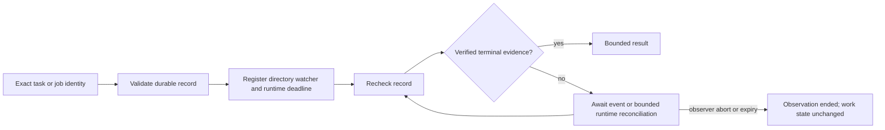

# Quick 261021-mcn — Efficient Waiting Research

**Researched:** 2026-10-21. **Domain:** durable local process/task observation. **Confidence:** MEDIUM for external API findings (GSD confidence seam); HIGH for opened repository evidence.

<user_constraints>
## User Constraints (from CONTEXT.md)

### Locked Decisions

- Use durable exact task/run identity; never follow a changing latest-run alias while waiting.
- Use event-driven completion with race-safe register/recheck and bounded runtime reconciliation. Do not use periodic model sleep/status loops.
- Bound output and observer timeout/abort. Ending observation never fabricates task cancellation or changes GSD state; orphaned ownership fails closed.
- Support autopilot task observation and ordinary/quick build, test, and delegated-work waiting. Prefer native completion handles; provide a durable local job route where a native persistent handle is unavailable.
- Keep GSD the sole project lifecycle/state authority. Waiting grants no delegation, mutation, GUI, or additional process authority.
- Document Claude Code, Codex, Antigravity, Pi Agent, and Hermes Agent behavior honestly. Do not promise control over host wakeups or infer token savings from tool-call counts.
- Preserve v0.4.0 computer-use behavior and prepare v0.4.1 efficient-wait documentation. macOS/Linux real GUI verification and three-OS CI remain unrun unless actually executed.
- Source, tests, and product documentation implementation uses `agy --model gemini-3.8-flash-high --effort high`; GPT-6.1 Sol high owns research, architecture, planning, checking, independent review, and verification.
- Add `scripts/verify-efficient-wait.mjs`: JSON stdin selects `completion`, `safety`, or `integration`; stdout contains only `{ok:true,check}` after the selected checks actually succeed. Reject invalid input and false evidence.
- Require adversarial, race, and integration regressions, then one final full suite and release dry-run after implementation. Local commits are authorized; push, tag, and publish are outside this task.

### the agent's Discretion

- Select the smallest dependency-free runtime design, bounded observation defaults, API details, and meaningful fixtures that meet the decisions above.
- Correct existing guidance when its background-supervision claims exceed implemented behavior; do not invent a daemon solely to preserve a documentation claim.

### Deferred Ideas (OUT OF SCOPE)

- GUI permission changes; a general service/daemon platform; unmeasured token-cost guarantees; suppressing host-generated model wakeups; remote publication.
</user_constraints>

## Summary

Use a shared runtime observation primitive plus thin task and local-job adapters. Keep the model out of the observation loop: one invocation remains pending until verified completion, bounded observer expiry, abort, or an explicit unresolved/error outcome. This is a design recommendation implementing the locked decisions, not a claim that host tools cannot yield intermediate wakeups.

The existing process runner already finishes from child events; replacing all runtime timers would solve the wrong layer. Its `child.once("close", (exitCode, signal) => {` drives process settlement. [VERIFIED: src/core/process.ts:554-563] The CLI currently executes `const { run } = await startTask({` before it constructs operator commands, whereas the skill says `The background execution runs under supervisor control in an independent process.` [VERIFIED: src/cli.ts:2188-2215; skills/alpha-aos-task/SKILL.md:89-90] Correct that mismatch explicitly. A local job wrapper can host an authorized command; do not silently change existing task-start semantics into a detached daemon.

## Architectural Responsibility Map

| Capability | Primary owner | Secondary | Planning decision |
|---|---|---|---|
| Completion observation | Node CLI runtime | Durable record storage | Watch hints plus validated rereads; no model timer loop |
| Task verdict | Existing task verification/review | GSD controller | Observer never promotes execution to acceptance |
| Generic build/test job | Bounded process runner | Local job record | Explicit argv, durable ID, bounded retained output |
| Delegated work | Native harness completion handle | Owned artifacts | Authorized independent work or one pending wait |

All rows are recommended responsibilities derived from the locked decisions.

## Project Constraints (from AGENTS.md)

GSD governs intake, workflow, required reads, checkpoints, verification and commits; do not edit outside that authority. Keep operations portable, deterministic, previewable, root-bounded and rollback-aware; keep credentials out of arguments, manifests, plans, journals and diagnostics. Native discovery requires meaningful invocation. Match existing TypeScript style, strict compiler flags, relative `.js` imports, boundary validation, return-oriented core modules and explicit CLI formatting. Invoke research capabilities; preserve durable continuity via the controller. Do not duplicate another agent's owned edits/tests or retry quota failures blindly. These actionable directives come from the supplied AGENTS execution guidance and opened project instructions. [VERIFIED: AGENTS.md:13-25,99-125,232-250,265-290]

## Standard Stack

Keep the installed Node runtime and built-in filesystem/events/process/test APIs; no package additions or legitimacy audit are needed. The package declares `"node": ">=24.0.0"`, `"npm": ">=10.0.0"`, and `"typescript": "5.9.3"`; its test script is `"test": "npm run build && node scripts/run-tests.mjs"`. [VERIFIED: package.json:40-73] Session probes returned Node `v24.13.1`, npm `11.8.0`, and an installed `agy.exe`. [VERIFIED: research environment probe, 2026-10-21] These are existing versions, not a latest-package recommendation.

## Architecture Patterns and Integration Points

Recommended integration boundaries:

- **Task adapter:** resolve one execution through the existing selection service, then pin identity and revision/digest for every read. Selection currently branches on `if (runId !== undefined && runId !== "")` and returns `selectionRule: "exact-run-id"`; omitted IDs instead select newest records. Do not repeatedly select latest. [VERIFIED: src/core/task-read.ts:69-101] Validate the run record against the schema and current durable identity; do not trust display strings or the weak checkpoint reader alone.
- **Schema distinction:** run status is verbatim `"enum": ["executing", "accepted", "rejected", "unknown", "blocked", "stopped"]`. [VERIFIED: schemas/task-receipt.schema.json:191-199] Checkpoint state is verbatim `"pending" | "running" | "accepted" | "rejected" | "blocked" | "stopped" | "needs-input"`. [VERIFIED: src/core/task-journal.ts:41-48] A supervisor may retry after an attempt ends; observe the requested attempt or whole supervisor explicitly, never infer one from the other.
- **Persistence:** watch the parent directory and reread the canonical record after every hint and after registration. Checkpoint persistence uses `await rename(temporary, target);`, so watching only the replaced inode is unsafe. [VERIFIED: src/core/task-journal.ts:193-210] Node documents inode replacement, unavailable/unreliable watchers and nullable filenames; a runtime-owned bounded reconciliation fallback is necessary. [CITED: https://nodejs.org/docs/latest-v24.x/api/fs.html#caveats]
- **Ownership:** use durable ID plus digest/revision and owner fencing, not PID existence alone. Current controller record includes `readonly token: string;`, `readonly pid: number;`, `readonly host: string;`, `readonly startedAt: string;`, `readonly contractDigest: string;`. [VERIFIED: src/core/controller-lease.ts:8-16] Missing/mismatched ownership with a nonterminal record must yield unresolved/orphaned observation; never accept or cancel automatically.
- **Local jobs:** add a small explicit command wrapper and wait/status route, rather than requiring autopilot approval records for ordinary GSD tests. Use the existing bounded runner, isolated environment policy and safe argv; persist launch identity before returning a handle and atomically persist actual process result afterward. If independent lifetime is advertised, test actual wrapper detach/reconnect and crash behavior. Proposed module/CLI names belong to the planner; no existing generic-job path is asserted here.
- **Guidance:** update generated controller instructions in addition to the task skill; the current prompt contains `"# Delegation"` and existing model-inheritance safeguards. [VERIFIED: src/core/task-gsd.ts:223-227] Distinguish independent authorized delegation from redundant waiting agents; retain one GSD writer, ownership, model/effort and a concise result. Ordinary/quick work must not manufacture an autopilot contract. Document native handles for each of the five harnesses only where available, otherwise use the shared local runtime route and report unsupported delivery honestly.

## Don't Hand-Roll

Reuse bounded process execution, validated task records, existing root/environment policies and native completion handles. Do not implement a second GSD state machine, shell command concatenation, an unbounded log relay or a model-driven scheduler. The current runner already uses `shell: false,` and `windowsHide: true,`. [VERIFIED: src/core/process.ts:465-470]

## Common Pitfalls

1. **Completion before registration / during reread:** register then recheck; serialize reconciliation; settle once and always dispose listeners/timers.
2. **Watch noise or loss:** ignore filename as authority, reread bounded validated records; handle watcher errors and missing directories without a busy loop. [CITED: https://nodejs.org/docs/latest-v24.x/api/fs.html#caveats]
3. **Observer cancellation kills work:** use a separate observer AbortSignal. Passing it to child-process execution can terminate the child. [CITED: https://nodejs.org/docs/latest-v24.x/api/child_process.html#child_processexeccommand-options-callback]
4. **Process/turn completion becomes accepted:** Codex events are adapter evidence; its final turn is not GSD acceptance. The parser uses `case "turn.completed":` and `usage = numericFields(event.usage);`, and rejects retained-stream truncation with `terminal: "not-retained"`. [VERIFIED: src/adapters/task-codex.ts:306-331] Preserve independent task checks.
5. **False cost claims:** official JSONL includes measured input/cached/output usage; counts of sleep calls do not establish those totals. [CITED: https://learn.chatgpt.com/docs/non-interactive-mode#make-output-machine-readable] The external report's arithmetic remains uncorroborated; publish no savings percentage.

## Code Examples

Recommended algorithm (pseudocode; not an existing API): `validate exact identity → register directory watcher → reread → await hint/reconciliation/deadline → reread → settle once → dispose`. Separate observer expiry from process cancellation. Process completion must await closed stdio when capturing output; Node distinguishes close from exit. [CITED: https://nodejs.org/docs/latest-v24.x/api/child_process.html#event-close]

## State of the Art

Use documented Codex JSONL events and usage where available, retaining existing adapter parsing; do not parse prose or require an SDK migration. [CITED: https://learn.chatgpt.com/docs/non-interactive-mode] Update the existing background-supervision claim to actual behavior, and publish v0.4.1 release notes that retain the authorized v0.4.0 GUI scope. [User Constraints]

## Validation Architecture

Use existing Node test fixtures and the environment-cleaning test runner; task CLI fixtures already import `runProcess` and use isolated state. [VERIFIED: test/task-cli.test.ts:7-35; scripts/run-tests.mjs:1-25] Proposed Wave 0 tests must exercise observable behavior, not source-string presence:

| Check | Required adversarial evidence |
|---|---|
| completion | Already terminal; completion before registration; during registration; atomic replacement; two simultaneous observers; irrelevant events; missing events with bounded reconciliation |
| safety | Wrong ID/digest/revision; latest run changes; malformed/oversized/symlink records; missing owner or crash; observer timeout/preabort/midabort leaves job alive; listeners cleaned; bounded output; spawn failure/nonzero exit |
| integration | Real CLI child job start/wait/reconnect; task run and supervisor retry distinction; generated prompt and skill guidance; verifier rejects invalid input and fails when selected regressions fail |

Run targeted compiled suites through the existing test runner per task; run the full suite once at the final gate after code stabilizes. The required verifier must execute relevant checks and emit only the locked success object after real success; stdin assertions such as a claimed pass flag are insufficient. One final release dry-run is required by User Constraints. Commands and new test paths are planner proposals until implementation exists.

## Security Domain

Scope mapping uses ASVS **4.0.3** category names explicitly, rather than claiming current certification: V4 access control (root/exact identity), V5 validation (closed bounded schemas), V6 cryptography (existing digest/random owner IDs), V7 logging and V12 resources (redacted bounded output/cleanup) apply; V2 authentication and V3 sessions add no new credential/session mechanism in this design. Category names are documented by OWASP. [CITED: https://devguide.owasp.org/en/06-verification/01-guides/03-asvs/] Spoofed completion, path substitution and resource exhaustion are the main design threats; filesystem notifications themselves are not a trust boundary. [CITED: https://nodejs.org/docs/latest-v24.x/api/fs.html#caveats]

## Environment Availability / Open Questions

Node, npm and `agy` are present (probe above); actual Antigravity model execution belongs to the controller's authorized implementation stage. Context7 and Firecrawl successfully retrieved primary docs. Exa discovery returned HTTP 401 missing API key; official-domain web fallback plus Firecrawl supplied primary sources. Graph context is disabled. Research-plan and confidence seams ran; cache writes failed with EPERM outside writable roots, so this artifact retains the findings. [VERIFIED: session tool outputs, 2026-10-21] No dependency install is proposed. Actual GUI behavior on macOS/Linux, three-OS CI, host wakeup behavior and production token savings remain unverified. [User Constraints]

## Assumptions Log

No training-only claims are promoted into locked decisions. Proposed architecture is identified as a recommendation; platform-specific native completion delivery beyond inspected interfaces requires implementation evidence. No token or compatibility guarantee is inferred from missing metadata.

## Sources and Metadata

- Opened repository evidence is cited with line ranges and verbatim discrete values above (HIGH).
- Official OpenAI non-interactive docs were retrieved by Firecrawl; official Node v24 fs/process docs were cross-checked through Context7 and Firecrawl (MEDIUM returned by `classify-confidence` for both providers, including `--verified`).
- Official OWASP Developer Guide supplies explicitly versioned ASVS category names (cited, MEDIUM).
- External BUG-06 report: symptoms and requested scope only; cost arithmetic has no corroborating telemetry.

**Valid until:** implementation changes the cited integration points, or 2026-11-20 for external API recheck. No commits were made by this research writer; the sole controller owns GSD state and commit gates.
