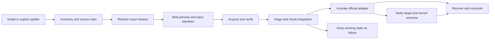

# Architecture Research

**Milestone:** v0.8.0 Unified Tool Updates & Compatibility
**Researched:** 2026-11-06
**Confidence:** HIGH for current seams; MEDIUM for proposed integration/recovery design.

## Recommended Architecture

Use one local lifecycle over source-specific resolvers, official installers and explicit compatibility adapters. Reuse existing component sessions, process/path boundaries and transactions. The local exact record becomes the shared install/render/verify input. Mutable channels are discovery inputs only. Proposed contracts below are not implemented APIs.

## Component Responsibilities

| Component | Responsibility | Existing integration |
|---|---|---|
| Tool/source catalog | Ownership, official channel rules, platform support | stack.yaml and separate Cua manifest |
| Release resolver | Bounded public metadata -> exact artifact/provenance | update.ts; add driver-family resolver |
| Local record | Requested/resolved/installed/verified identities and adapter revision | New schema under userStateRoot, outside checkout |
| Planner | Bind pre-state, target proofs, effects, dependencies and recovery | component-session.ts, install.ts |
| Official installer adapter | Exact install and declared native effects | Existing GSD/ECC/Pi/Cua steps |
| Compatibility adapter | Minimal translation with preconditions/postconditions and retirement | ECC renderers, GSD compatibility, MCP frontends |
| Verifier | Formats, negotiated protocol/schema, actual permitted read-only invocation | Existing fixtures/canaries/native probes |
| Recovery | Retain previous identity, switch/restore supported state, report remaining effects | Transactions plus source-specific native recovery |

Sources: [update](../../src/core/update.ts), [install](../../src/core/install.ts), [Cua](../../src/core/computer-use-install.ts), [ECC](../../src/core/ecc-fixture.ts), [GSD](../../src/core/gsd-compat.ts), [MCP](../../src/core/mcp.ts).

## Data Flow and Compatibility Contract

1. Resolve once and capture exact version/artifact/integrity, official source and selection rule. A tag moving later must not change the reviewed artifact.
2. Revalidate bound inputs before mutation and verify acquired bytes. Unresolved metadata, unsupported platform and provenance failure are explicit conditions; do not silently select an older release.
3. Compute output hashes locally from verified source bytes and deterministic adapter revisions. Shipping new expected hashes inside alpha-AOS for every upstream release would preserve the maintenance bottleneck.
4. Describe applicability by tool, actual protocol/capabilities, OS, harness and adapter revision. Unknown version alone is not a compatibility failure.
5. Prefer native public config and separate policy/guidance. Prove discovery, precedence and invocation; another Markdown file does not automatically replace an upstream rewrite.
6. Stage where officially supported. An installer that cannot isolate staging must declare native effects and a concrete recovery capability before mutation. Synthetic fixture success does not prove target-host permissions or credentialed calls.
7. Verify the active target after activation. Missing authority, credentials, GUI permission, service availability or host reload produces explicit unverified/needs-action evidence, not false readiness.

[Cua Windows](https://raw.githubusercontent.com/trycua/cua/main/libs/cua-driver/scripts/install.ps1) documents versioned directories/junction switching. [Unix helper](https://raw.githubusercontent.com/trycua/cua/main/libs/cua-driver/scripts/_install-rust.sh) has different platform layouts. [GSD update docs](https://github.com/open-gsd/gsd-core/blob/next/docs/how-to/update-gsd.md) describe runtime-specific restoration differences; mutable next-branch claims must be checked against the selected npm artifact.

## Migration and Ownership

Use shipped stable locks/Cua pins as migration inputs, retaining prior verified identity and ownership. Every config renderer, diagnostic, pack hash lookup, isolation runtime, native verifier and rollback reader must use the same selected record. Changing only discovery leaves hidden old pins in effect.

Keep alpha-AOS package dependencies/bootstrap self-update separate and preserve GSD's product single-writer contract. Shared config/runtime effects create dependency groups: report partial results precisely and stop dependent changes where consistency cannot be established.

## Suggested Build Order

1. Inventory/source rules and exact local record.
2. Local discovery and unified planning, including Cua.
3. Transformation reduction and adapter lifecycle metadata.
4. Integration, activation and recovery.
5. Existing-install migration and consistent CLI/docs.

Start at Phase 39. This is research guidance, not an approved roadmap.
