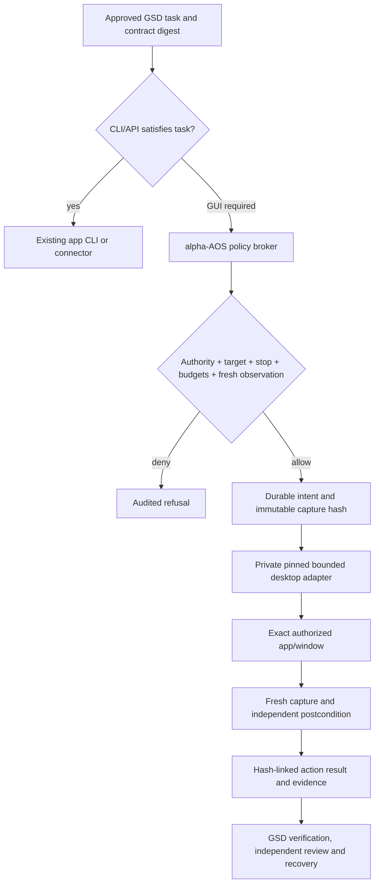

# Computer-use capability research

Research cut: 2026-10-20 UTC / 2026-10-21 Asia/Seoul. Task 261021-677, approved contract revision 3. This is a current-source comparison followed by a recommendation; no backend was locked before comparison.

## Recommendation and evidence limits

Use **Cua Driver 0.37.0 as the preferred optional desktop actuator**, behind an alpha-AOS broker that owns task authorization, bounded action budgets, stop handling, evidence and support reporting. Keep the adapter replaceable. Prefer an already suitable application CLI/API first. Do not add another agent planner or continuous history recorder to solve the actuator requirement. This is an engineering recommendation, not a claim that Cua has passed alpha-AOS production or live cross-platform gates.

The current Driver provides a local MCP/CLI boundary, native accessibility and pixel actions, bounded manifests and explicit unsupported outcomes. The alternative strengths are real: nut.js fits TypeScript directly; PyAutoGUI is simple and locally executable; UI-TARS and Agent S supply visual planning; Screenpipe supplies searchable history. Their tradeoffs appear below. [Cua Driver](https://github.com/trycua/cua/blob/main/libs/cua-driver/README.md), [permission contract](https://cua.ai/docs/cua-driver/guides/permissions).

**Evidence labels:** **documented** means a primary source declares it; **upstream fixture** means upstream describes a named automated GUI test; **alpha-AOS fixture** means our host-free production-module test; **live** requires an actual matching host/backend action and observed postcondition; **unavailable** means the attempted probe could not establish it. None of the first three is live proof.

At the initial research stage, this session imported the installed Codex bundled native Windows API and successfully called `list_apps`: 40 app entries, no screenshots or GUI input. The sanitized [native discovery receipt](computer-use/native-discovery.json) omits unrelated app identities. This establishes discovery only. Cua Driver was not found on PATH. No Cua action was executed at that initial stage. The later Windows host continuation and portable evidence are recorded at the end of this report; macOS/Linux live actions remain untested.

## Method and retained receipts

Five subquestions guided the search: primitives and coordinate/capture contracts; OS/display-server behavior; maintenance and adoption proxies; licensing/offline/security boundaries; production integration and repeatable verification.

- Exa was invoked for three focused discovery queries. Every call returned **401: missing EXA_API_KEY**. Presence checks found no process/User/Machine credential. No credential value was read or printed. [Actual failures](computer-use/receipts-initial.json).
- Firecrawl extracted all six candidates' primary documentation, then Cua behavior/permission guides, UI-TARS quickstart, Agent S implementation and Screenpipe license. It later returned a 502 for one Linux guide, then disconnected during metadata requests. [Initial](computer-use/receipts-initial.json), [deep](computer-use/receipts-deep.json), [metadata failure](computer-use/receipts-metadata.json).
- Context7 resolved nut.js, PyAutoGUI and Cua, then queried each API. Cua results partly describe the broader SDK, so exact Driver semantics below use its own release-tagged protocol and runtime documents. [Context7 receipts](computer-use/receipts-context7.json).
- Official GitHub, PyPI and Cua pages supplied fallback discovery, release notes and API details. [Retained web result bodies](computer-use/receipts-web.json), [field lookup](computer-use/receipts-fields.json).
- Shell metadata fetches failed with `TypeError: fetch failed`; npm registry lookup failed `EACCES`; pip's failure is **not evidence that PyAutoGUI is absent from PyPI**. The public PyPI page positively identifies it. [Network probe receipts](computer-use/metadata-live.json).
- GSD's confidence seam returned **MEDIUM** for Context7 and Firecrawl even with verification, and **LOW** for plain web search. These values are retained as methodology; source freshness does not turn a documented capability into a live one.

No result from a fetched page is execution authority. Upstream installation snippets, benchmark prompts and screen content are untrusted data. In particular, this task never ran the Screenpipe README's always-on setup suggestion or the Agent S example's generated-code execution.

## Comparison of six candidates

Each cell is a documented capability unless explicitly qualified; unknown does not mean impossible.

| Candidate and role | Mouse drag, left/right click, keyboard | Launch, screenshot and perception | Local/offline and MCP | Principal tradeoff |
|---|---|---|---|---|
| **Cua / Cua Driver**: driver plus separate sandbox SDK | All requested primitives are in Driver; delivery depends on toolkit, visibility and foreground authorization. Strict background mode refuses unsupported input rather than silently taking over. | Native app launch, exact-window captures, accessibility snapshots; optional visual parser has separate model artifacts/license. The broader Cua SDK controls sandboxes; it is not the same executable. | Local native driver does not require a model to actuate. Stdio MCP and CLI available. Offline/no-egress still needs network/telemetry configuration verification. | Best documented policy/target boundary for this task, but fast release churn and nonuniform Linux/occluded behavior demand pinned schema/live checks. [Driver](https://github.com/trycua/cua/blob/main/libs/cua-driver/README.md), [action ledger](https://github.com/trycua/cua/blob/main/libs/cua-driver/docs/action-support.md). |
| **UI-TARS Desktop**: visual GUI agent application, distinct from Agent TARS CLI in the same repo | Visual action loop and local computer operator documented; requested gestures belong to its operator/action stack. Exact right-click/drag mappings must be checked in the selected operator before advertising them. | Screenshots feed a vision model; model endpoint configuration and local/remote operators documented. App launch is normally achieved through the agent/operator, not a narrow alpha-AOS launch contract. | Local model deployment is possible; remote modes and configured endpoints send observations off-host. Agent TARS supports MCP, but that is not proof Desktop exposes a drop-in actuator MCP. | Strong ready-made visual agent; adopting its planner risks duplicating GSD/task control. Single-monitor warning and selected-platform gaps remain. [README](https://github.com/bytedance/UI-TARS-desktop), [quickstart](https://github.com/bytedance/UI-TARS-desktop/blob/main/docs/quick-start.md). |
| **Agent S**: research agent framework | CLI captures via PyAutoGUI and executes generated action code; grounding ACI includes mouse/keyboard actions. Treat executable model output as a broader code-execution authority, not a safe gesture schema. | Screenshot, grounding model and OCR; app switching/launch is generated platform-specific code. Main reasoning and grounding models are separately configured. | Open-weight provider/local endpoint options exist, but an offline configuration and local resources were not exercised. Hosted Sai MCP is a separate service, not proof local Agent S provides a bounded local MCP driver. | Strong research reasoning and benchmark reproducibility; extra Python/model stack and competing planner. [README](https://github.com/simular-ai/Agent-S), [CLI implementation](https://github.com/simular-ai/Agent-S/blob/main/gui_agents/s3/cli_app.py), [grounding](https://github.com/simular-ai/Agent-S/blob/main/gui_agents/s3/agents/grounding.py). |
| **nut.js**: TypeScript/JavaScript actuator library | Drag, click/rightClick and keyboard APIs documented; native providers deliver input. | Screen capture and image matching/provider plugins; app/window APIs exist, but app launch/process scope must be supplied by the integration. | Local native operations; no model required. An MCP wrapper would be additional integration, not established by the library API. | Excellent language fit; explicit X11-only Linux support and source-build/subscription distribution costs. [README](https://github.com/nut-tree/nut.js), [API receipts](computer-use/receipts-context7.json). |
| **PyAutoGUI**: Python desktop actuator | `click`, right-button click, `dragTo`, `write`, key/chord APIs; inputs use current foreground focus. | Screenshot plus image matching; docs explicitly say OCR is not currently included and primary-monitor-only. Launch needs external process/platform integration. | Local actions work without inference; no core MCP integration established here. | Small, understandable fallback; foreground race, primary-display restrictions and X11 implementation make a universal claim unsafe. [Docs](https://pyautogui.readthedocs.io/en/latest/), [PyPI](https://pypi.org/project/PyAutoGUI/). |
| **Screenpipe**: continuous screen/audio history and context | Captures input/app changes; current README does not establish a complete bounded gesture actuator. Workflow agents can act, but that does not prove the recorder itself delivers each gesture. | Event-driven screenshots, accessibility/OCR and audio transcription, local history/search. | Local capture/search works offline after setup; cloud AI/sync/integrations have independent egress. MCP searches history. | Valuable separate opt-in memory capability; excessive capture scope and a current commercial license make it unsuitable as the default actuator. [README](https://github.com/screenpipe/screenpipe), [current license](https://github.com/screenpipe/screenpipe/blob/main/LICENSE.md). |

## Platform and display-server truth

| Candidate | Windows | macOS | Linux X11 | Native Wayland |
|---|---|---|---|---|
| Cua Driver | Native UIA/pixel routes; per-toolkit background refusals; foreground input explicitly separate | Native AX/window captures; Accessibility/Screen Recording grants bound to responsible app identity | Upstream Openbox/X11 fixture catalog includes deliveries and deliberate refusals | Distinct Sway, GNOME, KDE, nested compositor and Hyprland routes; no blanket parity |
| UI-TARS Desktop | Quickstart documented | Quickstart documented with OS permissions | Linux local Desktop lane not established by the quickstart; assess selected operator/source | Not established; remote Linux browser/container success would not prove local Wayland desktop |
| Agent S | Declared | Declared | PyAutoGUI/Xlib and wmctrl-oriented source path provides concrete X11 evidence | Native Wayland not established; general Linux badge cannot answer compositor behavior |
| nut.js | Declared | Declared, permission prerequisites | Explicitly supported, libXtst/native dependencies | **Explicitly unsupported** in README |
| PyAutoGUI | Declared, foreground input | Declared | Source imports Xlib/XTest | Native Wayland not established by this X11 source; do not infer compatibility from XWayland |
| Screenpipe | Desktop app available | Desktop app available | Linux desktop app available | Distribution/desktop/permissions dependent; no actuator parity established |

Sources: [Cua empirical action ledger](https://github.com/trycua/cua/blob/main/libs/cua-driver/docs/action-support.md), [UI-TARS quickstart](https://github.com/bytedance/UI-TARS-desktop/blob/main/docs/quick-start.md), [Agent S grounding](https://github.com/simular-ai/Agent-S/blob/main/gui_agents/s3/agents/grounding.py), [nut.js README](https://github.com/nut-tree/nut.js), [PyAutoGUI X11 source](https://github.com/asweigart/pyautogui/blob/master/pyautogui/_pyautogui_x11.py), [Screenpipe README](https://github.com/screenpipe/screenpipe).

Cua's ledger counts **expected refusals as passing fixture outcomes**. Windows 122/122 means 99 deliveries and 23 exact refusals; Linux X11 116/116 means 75 deliveries and 41 refusals. Sway's full catalog does not establish another compositor's equivalence. GNOME requires a helper/portal setup. KDE intentionally refuses raw target-addressed keyboard/pointer delivery until mutation can be bound to the target; a verified window identity alone is insufficient. Nested compositor experiments have remaining failures. These are upstream reports, not runs performed here.

On Windows specifically, current Driver background behavior varies across Win32, WPF, WinUI3, Electron and Tauri. Several Electron keyboard/scroll and occluded drag paths deliberately refuse; authorization for one application is not authorization to foreground it. Screenshot acquisition must never fall back from an exact window to the full desktop.

## Maintenance, adoption proxies and licenses

Approximate displayed GitHub star/fork counts are a timestamped **interest proxy only**. They are not users, installations, success rate, safety, or latency. Exact API metadata requests failed, so do not report exact stars, commit dates, contributor counts or download rates inferred from those failures.

| Project | Displayed interest proxy, observed Oct 20 UTC | Positive maintenance/currency signal | License/distribution caveat |
|---|---|---|---|
| Cua | ~30.4k stars / ~2.2k forks in initial Firecrawl repository page | Driver 0.37.0 release on Oct 20; active action ledger and versioned signed assets | Driver MIT; Spaces/FSL and perception/AGPL are separate artifacts |
| UI-TARS repo | ~39.3k / ~4.0k | Agent TARS v0.3.1 Oct 8 release contains server security fixes; not necessarily a new Desktop binary version | Apache-2.0 repo; chosen model and hosted service have separate terms |
| Agent S | ~12.7k / ~1.7k | README records Oct 1 API launch and 2026 research updates; local framework version not resolved here | Apache-2.0 repo; models and hosted Sai separate |
| nut.js | ~2.9k / 186 | Release page shows v4.2.0; root and core manifests agree 4.2.0 | Core manifest Apache-2.0; prebuilt packages require subscription; native dependencies must be audited |
| PyAutoGUI | ~12.7k / ~1.4k | PyPI positively shows 0.9.54, uploaded May 24, 2023; old release date alone does not prove abandonment | BSD-3-Clause; screenshot/image dependencies separately pinned if used |
| Screenpipe | ~22.0k stars; fork count not retained | Current source/README and license retrieved; latest release version not established | Current Screenpipe Commercial License; older MIT versions retain their own license |

Primary repository/release sources: [Cua](https://github.com/trycua/cua), [Driver release](https://github.com/trycua/cua/releases/tag/cua-driver-rs-v0.37.0), [UI-TARS](https://github.com/bytedance/UI-TARS-desktop), [v0.3.1](https://github.com/bytedance/UI-TARS-desktop/releases/tag/v0.3.1), [Agent S](https://github.com/simular-ai/Agent-S), [nut.js](https://github.com/nut-tree/nut.js), [core manifest](https://github.com/nut-tree/nut.js/blob/develop/core/nut.js/package.json), [PyAutoGUI](https://pypi.org/project/PyAutoGUI/), [Screenpipe license](https://github.com/screenpipe/screenpipe/blob/main/LICENSE.md). Changing license/distribution status is a reason to pin exact artifacts rather than use historical summaries.

Cua Driver's optional visual perception extension includes an AGPL-only detector and separate OCR/runtime notices. Keep it **disabled by default**. The MIT driver can operate via native accessibility and screenshot observations supplied to an already authorized model. A local screenshot does not imply model inference stays local.

## Security, offline behavior and performance

UI-TARS's current Agent TARS server release explicitly fixes loopback binding, remote token requirements, Host/Origin checks, CSRF and request-body option injection. That is a concrete reason not to deploy older remote defaults. Agent S's generated Python/Bash executor is a materially wider authority than a bounded action adapter. PyAutoGUI's corner fail-safe and default 0.1-second pause are useful, but neither provides application authorization. nut.js similarly needs an outer authority boundary. Screenpipe capture/search and cloud/sync settings require independent data-flow review. [UI-TARS security release](https://github.com/bytedance/UI-TARS-desktop/releases/tag/v0.3.1), [Agent S CLI](https://github.com/simular-ai/Agent-S/blob/main/gui_agents/s3/cli_app.py), [PyAutoGUI fail-safe docs](https://pyautogui.readthedocs.io/en/latest/), [Screenpipe](https://github.com/screenpipe/screenpipe).

No apples-to-apples actuator benchmark was run. Do not rank these projects by model task-success benchmarks or promotional speed videos. Agent S's reported OSWorld result depends on model, environment, step budget and rollout selection; it does not measure a click API's latency. PyAutoGUI documents roughly 100 ms screenshot time for one historical 1920×1080 example; that is not a current host benchmark. Screenpipe's CPU/RAM estimates describe continuous capture, not per-action latency.

Measure separate timers in the synthetic smoke: capture, accessibility parsing, policy/audit overhead, backend input, postcondition read and optional inference. Report cold/warm sample counts, display scale/resolution, toolkit, median/p95 and failures only when sufficient samples exist. Numeric performance targets are task defaults requiring evidence, not facts from this survey.

## Exact optional runtime and supply-chain plan

Recommended experiment pin: **Cua Driver 0.37.0**, release tag `cua-driver-rs-v0.37.0`, source commit `2d2f99228d4d2508dc6fcc84c176b296e146714a`. Release page is dated Oct 20 03:41. GitHub marks it prerelease for monorepo Latest routing; release notes explicitly call plain Driver SemVer stable. This does not make it alpha-AOS's stable dependency.

The following **published checksums**, not locally downloaded/verified bytes, were read from the official release list. Source URL for every row: `https://github.com/trycua/cua/releases/download/cua-driver-rs-v0.37.0/<asset>`.

| OS/architecture | Asset | Published SHA-256 | This-session proof |
|---|---|---|---|
| Windows x64 | cua-driver-rs-0.37.0-windows-x86_64-binary.zip | 40481b55073f1225b0010235b30217bd640ef1f323e982aec0a5f6131d3e4a99 | documented only |
| Windows arm64 | cua-driver-rs-0.37.0-windows-arm64-binary.zip | 0fce682b251775e25fd76bf29ff856f7f5ab5aae5759d6b76a40f8312a194a5a | documented only |
| macOS universal binary | cua-driver-rs-0.37.0-darwin-universal-binary.tar.gz | 7d491f67f54be5f3b380ffd85c64b242eaefd05dad6df78012cde227c95aee2a | documented only; responsible signed app identity still required |
| Linux x64 | cua-driver-rs-0.37.0-linux-x86_64-binary.tar.gz | c7ac376b10da7c207e510b2d90b88a9588bec9852a237962c273fe81b9cd5623 | documented only; preview/support depends on session |
| Linux arm64 | cua-driver-rs-0.37.0-linux-arm64-binary.tar.gz | 879e8040a4ce24caeee34b2e4ac6119be01661082202919db1bcc1ab0b97e4c8 | documented only |

[Official release list with SHA256SUMS and Sigstore assets](https://github.com/trycua/cua/releases). Every asset has an adjacent `.sigstore.json`; signatures were **not verified** here. Verify expected workflow/source identity and digest with the reviewed verification tool before enabling production; checksum equality alone is not publisher authentication. Download/unpack to a reviewed task-scoped directory, reject archive traversal/symlinks, inspect binary identity/version and preserve the executable hash. Do not execute the moving install script or register autostart.

Actionable Windows download/hash check, for the executor's approved writable root (not executed by research):

```powershell
$cuAsset = Join-Path $PWD ".alpha-aos/computer-use-runtime/cua-driver-0.37.0.zip"
# Create and verify the parent directory inside this workspace before download.
Invoke-WebRequest -Uri "https://github.com/trycua/cua/releases/download/cua-driver-rs-v0.37.0/cua-driver-rs-0.37.0-windows-x86_64-binary.zip" -OutFile $cuAsset
if ((Get-FileHash -LiteralPath $cuAsset -Algorithm SHA256).Hash.ToLowerInvariant() -ne "40481b55073f1225b0010235b30217bd640ef1f323e982aec0a5f6131d3e4a99") { throw "Driver digest mismatch" }
# Verify release signature/identity; inspect archive members; extract only inside the reviewed runtime root.
```

No new npm package is recommended. Official Driver documentation does identify `@trycua/cua-driver`, but the GSD npm legitimacy gate returned **SUS** with all registry observations unknown; `npm view` failed EACCES. This does not establish a malicious or nonexistent package. Do not install that package from this research; if the planner chooses it instead of the binary path, include its prescribed human verification checkpoint and complete registry/postinstall verification. No stable-lock or manifest promotion is authorized.

## Protocol and action contract for the implementation

Use the repository's existing MCP SDK and one persistent **stdio connection** to the pinned Driver. Perform initialize, tools/list and a meaningful read-only tool call; inspect the returned tool schemas rather than inventing a JSON protocol. The release-tagged Driver documents legacy MCP `2025-06-18` compatibility as well as modern `2026-07-28` stdio. Stay on the existing SDK's negotiated supported revision. HTTP is authenticated loopback, legacy only; it is unnecessary for this slice. [Pinned protocol](https://github.com/trycua/cua/blob/cua-driver-rs-v0.37.0/libs/cua-driver/docs/mcp-protocol-and-skills.md).

Use a private task-owned bounded process with a reviewed capability manifest. Current documentation provides `CUA_DRIVER_PERMISSION_MODE=bounded`, `CUA_DRIVER_CAPABILITY_MANIFEST_FILE=<absolute file>` and `CUA_DRIVER_CAPABILITY_MANIFEST_APPROVED=1`; never expose these controls as agent-selected input. Use a short expiry and idle timeout, an exact executable app allowlist and `desktop.display: false`. Never attach the broker to a broad ambient daemon merely because its CLI version matches. [Permission contract](https://cua.ai/docs/cua-driver/guides/permissions).

Capture `get_window_state` for the discovered PID/window. Semantic actions use `element_token`; pixel clicks use screenshot-pixel x/y plus the observed target and a one-use `capture_id`. Stale/mismatched capture fails. Do not mix macOS logical points, desktop coordinates and screenshot pixels; resizing/downscaling must invalidate or transform through declared capture geometry. Reobserve immediately after an action. [Capture API](https://cua.ai/docs/cua-driver/reference/mcp-tools/apps-windows-and-screen), [click API](https://cua.ai/docs/cua-driver/reference/mcp-tools/click-and-type).

For every requested primitive, retrieve `describe`/tools/list input schema from the pinned binary. APIs include `launch_app`, `get_window_state`, `click`, `right_click`, `drag`, `type_text` and `press_key`; drag uses from_x/from_y/to_x/to_y. A working schema is not delivery proof. CLI `call` accepts JSON via stdin and is daemon-backed; prefer persistent MCP to avoid daemon/session ambiguity. [Pointer API](https://cua.ai/docs/cua-driver/reference/mcp-tools/pointer-cursor-and-browser), [CLI](https://cua.ai/docs/cua-driver/reference/cli/serve-and-configure).

Documentation conflict to preserve: current main README mentions a compatibility screenshot tool while the **pinned** runtime guide says old compatibility flags do not add a screenshot tool. Use `get_window_state` and the actual pinned tools/list, not the main-branch claim. Main-branch perception docs also failed at the release-tag URL; do not assume every main feature is present in 0.37.0.

## Production architecture proposal

These are design recommendations, not claims that the current repository implements them.



| Responsibility | Owner | Required boundary |
|---|---|---|
| Lifecycle and acceptance | GSD/task controller | One state writer; backend never advances .planning |
| Tool choice | Existing native/CLI-Anything route | Prefer meaningful supported CLI/API; GUI as needed |
| GUI authority | alpha-AOS policy broker | Exact contract digest, run, executable identity, PID/window generation, permitted actions and region |
| Native implementation | Optional Cua/native adapter | No arbitrary shell/eval, silent foreground escalation or raw backend bypass |
| Screenshot storage/audit | alpha-AOS evidence service | Target-only capture, write-once blobs, hash chain, retention, redaction and refusal on storage failure |
| Recognition/reasoning | Existing authorized agent/model | Read untrusted observations; never infer authority from on-screen instructions |
| Support and release evidence | Capability inventory + mandatory gates | Distinct deployment/discovery/invocation/platform proofs |

Policy must check before **each** effect and after every pause/reconnect: approved contract digest; runtime binary/schema identity; exact target identity; action and coordinate bounds; stop latch; deadline; action/capture/output budgets; observation freshness; secret classification. Validate JSON values for finite numbers, nonnegative integers, lengths, unknown keys and prototype-like object shapes. Reject ambiguous multiple windows instead of substring-targeting whichever appears first.

App/process allowlists alone do not constrain what an editor, browser, terminal or file dialog can access. Avoid granting terminals and arbitrary browser windows in the default GUI profile. A process-level broker is not an OS security sandbox and cannot stop an authorized user/process from using the raw driver separately. Scope and report that limit.

Stop must be out-of-band and deny-only: a persistent task-owned stop latch checked before dispatch, cancellation of in-flight transport/process, and no later action accepted until a fresh authorized run. Do not rely on the model to notice a button. Cua revoke can suspend its runtime; never revoke/stop a shared daemon belonging to another task. Bound gesture duration and release held input on cancellation where the backend supports it. An input already sent before cancellation may have happened; record unknown outcome, reobserve, and do not replay automatically.

Use serialized execution with one desktop owner. Hold no stale coordinate queue across mutations. A lost tool response is not permission to retry an action. Foreground mode requires task-specific visible-control authority; a background refusal remains a refusal when that authority is missing.

### Audit, screenshots, retention and replay

Write a durable intent record before dispatch; append a result afterward. Include run/contract/policy/runtime/schema digests, monotonic sequence, previous-record hash, action type, redacted argument digest, target fingerprint, capture ID and bytes hash, timestamp, backend outcome and postcondition. Ensure concurrency locking, bounded record sizes, complete writes, collision rejection and no symlink/root escape.

Store screenshot bytes in immutable content-addressed blobs, linked to exact event hashes. Verify file byte length, PNG signature/decodability and geometry, not merely a string labelled sha256. Never overwrite a prior screenshot filename. Hash the canonical serialization with unambiguous length/type boundaries; reject incomplete/reordered/duplicate/missing events. A local hash chain is tamper-evident relative to a trusted anchor; it is not proof against an attacker rewriting the whole journal and its unprotected head.

Default to no raw typed text, clipboard, credentials, accessibility text or private window titles in public logs. Secret entry is denied unless explicit data+destination authority exists and a suitable secret channel avoids command arguments/logging. Cropping alone cannot guarantee no secrets inside the authorized window. If a safe target-only capture cannot be obtained, fail closed rather than capture the desktop.

Retention is a reviewed local policy, not an invented legal requirement. Recommend a finite byte/capture cap and task-scoped expiry, plus explicit cleanup that journals tombstones and prevents replay validation from treating expired blobs as intact evidence. Preserve pending/failed run evidence until reviewed cleanup. Do not quietly delete old screenshots during app operation.

Replay defaults to **verification only**: inspect journal order/hashes/blobs and render an action timeline without sending input. Re-execution is a new task requiring new authority and fresh observations; old captures and clicks cannot authorize a replayed mutation.

## Existing alpha-AOS integration anchors

These are narrow source observations, not instructions to rewrite unrelated modules.

- `src/cli.ts` routes existing task lifecycle and gate commands. Add a coherent plan/doctor/action/evidence/replay surface with dry-run defaults; do not accept an executor path and arbitrary argv directly from an agent.
- `skills/cli-anything/SKILL.md` already separates task-scoped external tools from the stable lock and requires real backend verification. Extend the routing guidance to describe when a computer-use capability is appropriate without replacing CLI discovery.
- `src/core/task-capability-inventory.ts` builds owned-skill and control-command inventory and distinguishes host proof from deployment. Add computer-use applicability/probe evidence rather than marking support from configuration presence.
- `src/core/task-capability-obligations.ts` requires independent review/verify invocations; GUI evidence collected during execution cannot stand in for a fresh verifier.
- `src/core/pack-catalog.ts` explicitly enumerates pack files. If adding a new pack file, register it and its schema/fact vocabulary; alternatively add a narrowly justified skill to an existing approved pack. Broad global GUI enablement is inappropriate.
- `src/core/owned-skills.ts` validates source hashes and supported target lists. Distribute repository-owned entry guidance through that existing mechanism; update only its owned skill hashes, never promote the optional runtime into the external stable component lock.
- `src/core/gate.ts` maps risk surfaces to mandatory obligations. Ensure GUI authority/audit/adapter changes deterministically trigger security review, and platform support claims require matching invocation evidence.
- `src/core/process.ts` supplies bounded, redacted, explicit-environment process execution and cancellation. Use that facility or a similarly bounded persistent MCP transport; do not inherit all ambient credentials.

## Verification contract for the executor

1. **Host-free compiled production tests:** reject unauthorized app/action, stale/duplicate capture, wrong contract, malformed coordinates, expired budgets, stopped run, unsafe screenshot path and unsupported platform; ensure refusal sends no input. Cover cancellation/focus drift and audit failure before dispatch.
2. **Audit/replay adversarial tests:** modified PNG bytes, changed metadata, forged action hash, missing previous event, truncation, duplicate sequence, path traversal, symlink, journal replacement and concurrent append. Replay must never actuate.
3. **Snapshot verifier:** `scripts/verify-computer-use.mjs` must import and execute the compiled production policy/audit modules from the snapshot. It must validate the six-candidate evidence/source relations, integration anchors and platform-proof labels. A regex search or copied miniature policy implementation cannot establish runtime behavior.
4. **Controlled Windows live lane:** launch a dedicated owned fixture with plain nonsecret text, a left-click counter, a right-click counter and a draggable region. Select exactly its returned window identity. Capture only that window, then execute one action and reobserve per step. Prove keyboard entry, both click buttons, drag and postconditions; preserve screenshot/action hashes and backend identity. Parent/executor owns this lane; research discovery alone is insufficient.
5. **Negative live safety checks:** out-of-window coordinate refusal, stale screenshot refusal, stop prevents next input and no access to a second/unrelated app. Test failures are results, not permission-escalation requests.
6. **Three-OS CI:** run portable compiled policy/audit/integration tests; report macOS/Linux GUI as unavailable without actual host runs. Distinguish X11, each Wayland compositor, toolkit, architecture and driver version in support evidence.
7. **Final gates:** appropriate focused tests and source-snapshot verifier, TypeScript check, meaningful full suite, independent review and mandatory security gate. Update public support text only to the level actually proven.

## Open evidence and deliberate exclusions

- Exact Cua runtime bytes/signatures and pinned tool schemas were not downloaded/run due shell network restrictions; official release metadata is available, but production enablement must validate artifacts locally.
- Exa remains unavailable (missing key); Firecrawl succeeded for substantive sources before disconnecting. This task has not fabricated success receipts.
- UI-TARS local Linux/Wayland operator parity, Agent S native Wayland, Screenpipe per-action actuator APIs and current nut.js native artifact compatibility are unverified.
- No benchmark-based actuator ranking, download/user estimates or compliance retention period is asserted.
- No global app/agent configuration, automatic recording, cloud upload, stable lock promotion, or unrelated account/application interaction was performed by research.

The evidence graph is in [evidence.json](computer-use/evidence.json). Receipt bodies are retained so source claims can be rechecked without trusting this prose.


## Host continuation: verified Windows evidence

The earlier sandbox limitations above describe that executor only. The host continuation downloaded the exact official Windows x64 asset, matched the published SHA-256, and successfully verified its Sigstore bundle with cosign 3.1.4 against the pinned `cd-rust-cua-driver.yml` tag identity and source commit. [Host provenance receipt](computer-use/host-runtime-verification.json), [verification output](computer-use/signature-verification.txt). No external stable-lock component was promoted.

The production alpha-AOS CLI/MCP broker then exercised a clean owned WinForms app: left and right click, field focus, public text entry, Backspace and drag. Five domain effects were independently confirmed by the app state; the preparatory focus click was confirmed by subsequent typing. All six action records established their explicit observation predicate. Twenty chained events and immutable PNGs passed replay integrity checks. [Live receipt](computer-use/windows-host-smoke.json), [visual report](computer-use/windows-live/report.html). Observed complete cycles were roughly 5–7 seconds including executable/process checks and before/after observation; this is not a comparable pure-actuator benchmark. Earlier refused/partial attempts remain in GSD recovery records.

Pinned 0.37.0 schema/live corrections: native manifest durations use whole seconds; default input is background even when foreground is permitted; `right_click`/`drag` do not accept `capture_id` and use the private runtime latest screenshot context; native window bounds can include invisible borders and are not a reliable screenshot-size equality check. Windows foreground refusal stayed a refusal and was not silently escalated. The accessibility state excludes snapshot tokens so fresh reads alone cannot prove a change. [Native schema fixture](../../test/fixtures/cua-0.37.0-windows-tools.json).

Current official CLI docs explicitly support private `mcp --direct` on macOS with that process owning TCC attribution. The adapter now supports this path with an approved target bundle ID; existing OS grants are required. macOS/Linux/X11/Wayland live actions were not performed on this Windows host. [Official CLI reference](https://cua.ai/docs/cua-driver/reference/cli/serve-and-configure), [retained extraction](computer-use/receipts-host-cli.json).
